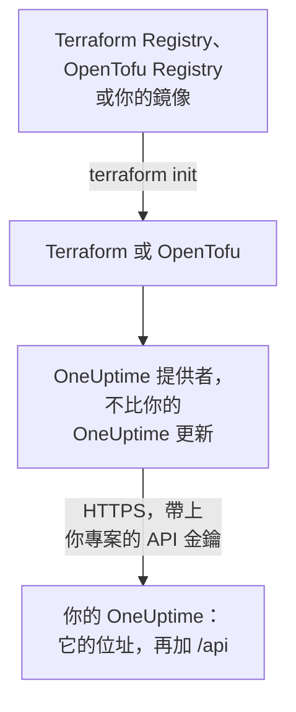

# 自架設定

提供者在你自己的 OneUptime 上的運作方式與在 OneUptime Cloud 上相同：同樣的資源、同樣的屬性和同樣的專案 API 金鑰。需要你自己設定的是：你的 OneUptime 的位址、與之相符的提供者版本，以及在需要時，為無法連上網際網路的機器準備的鏡像和對私人憑證授權單位的信任。

:::cards
- [讓提供者指向你的 OneUptime](#讓提供者指向你的-oneuptime): 它的位址，以及你專案的 API 金鑰。
- [選擇提供者版本](#選擇提供者版本): 不比你的 OneUptime 更新的最新提供者。
- [無法連上網際網路時](#無法連上網際網路時): 把提供者鏡像到你的網路中。
- [TLS 和憑證](#tls-和憑證): 私人憑證授權單位、Proxy 和一般 HTTP。
:::



## 讓提供者指向你的 OneUptime

把 `oneuptime_url` 設為你開啟儀表板時使用的位址：通訊協定和主機，不含路徑。位址沒有通訊協定時，提供者會加上 `https://`，並在結尾加上 `/api`，所以 `https://oneuptime.example.com` 會把每個請求傳送到 `https://oneuptime.example.com/api`。

```hcl title="main.tf"
terraform {
  required_providers {
    oneuptime = {
      source  = "oneuptime/oneuptime"
      version = "{{TERRAFORM_PROVIDER_MATCHING}}"
    }
  }
}

provider "oneuptime" {
  oneuptime_url = "https://oneuptime.example.com"
  # The API key comes from the ONEUPTIME_API_KEY environment variable.
}
```

位址也可以改為來自環境變數 `ONEUPTIME_URL`，這樣同一份設定可以指向多個安裝：

```bash
export ONEUPTIME_URL="https://oneuptime.example.com"
export ONEUPTIME_API_KEY="<your-api-key>"
```

位址就是你的安裝對外提供服務的主機：使用 Docker Compose 時是 `HOST` 和 `HTTP_PROTOCOL`（位於 `config.env` 中），使用 Helm 時是 `host` 和 `httpProtocol`（位於 chart 的 values 中）。

金鑰是你所管理專案的 API 金鑰，與 OneUptime Cloud 上一樣，在你的 OneUptime 儀表板中的 **專案設定 → 進階 → API 金鑰** 下建立。自架 OneUptime 的主 API 金鑰不屬於任何專案，所以用它進行的建立會失敗並顯示 `ProjectId required`。

> [!TIP]
> 你的 OneUptime 會替你寫出這個區塊。在儀表板中開啟任一資源或清單，然後在它的側邊選單中依序開啟 **開發者** 和 **Terraform**：它顯示的提供者區塊包含你的 OneUptime 的位址，以及與之相符的版本範圍。

## 選擇提供者版本

使用不比你的 OneUptime 更新的最新已發佈提供者。提供者的版本跟隨 OneUptime 的版本：變更了提供者的 OneUptime 發行版本，會以該發行版本自己的版本號發佈提供者，而比你的 OneUptime 更新的提供者，可能會傳送你的 OneUptime 尚未具備的設定。

所以，請像儀表板那樣寫一個以你的 OneUptime 版本為終點的範圍。上面的區塊使用 `{{TERRAFORM_PROVIDER_MATCHING}}`，也就是與提供本文件的 OneUptime 相符的範圍：當你在自己的 OneUptime 上閱讀本文件時，這個範圍就是你的範圍。否則，請寫入你自己的版本：

:::steps
### 查看你的 OneUptime 版本

向你的 OneUptime 查詢：

```bash
curl https://oneuptime.example.com/version
```

回應是 JSON，例如 `{"version":"{{TERRAFORM_PROVIDER_MAJOR}}.0.40","commit":"..."}`。身為主管理員，你也可以開啟管理員儀表板頁首中的版本標籤：請參閱[查看目前的版本](/docs/installation/upgrading#查看目前的版本)。

### 把它寫進範圍

範圍從主要版本開始，到你的版本結束。以 OneUptime {{TERRAFORM_PROVIDER_MAJOR}}.0.40 為例：

```hcl title="main.tf"
terraform {
  required_providers {
    oneuptime = {
      source  = "oneuptime/oneuptime"
      version = ">= {{TERRAFORM_PROVIDER_MAJOR}}.0, <= {{TERRAFORM_PROVIDER_MAJOR}}.0.40"
    }
  }
}
```

Terraform 會選用範圍內最新的提供者。沒有變更提供者的 OneUptime 發行版本不會發佈提供者，範圍會略過不存在的版本。

### 下載提供者

執行 `terraform init`。它會顯示安裝的版本，並將其記錄在 `.terraform.lock.hcl` 中。
:::

升級時，請先升級 OneUptime。然後把範圍的終點提高到它的新版本，並執行 `terraform init -upgrade`。

## 無法連上網際網路時

當執行 Terraform 的機器無法連到登錄檔時，請把提供者複製到你的網路中一次，再讓 Terraform 指向這份副本。

:::steps
### 鏡像提供者

在一台可以連上網際網路的機器上，在包含你設定的資料夾中，為你的機器所執行的每個平台下載提供者。不加 `-platform` 時，這個命令只會下載它自身平台的提供者：

:::tabs
@tab Terraform
```bash
terraform providers mirror -platform=linux_amd64 -platform=darwin_arm64 /srv/terraform-mirror
```
@tab OpenTofu
```bash
tofu providers mirror -platform=linux_amd64 -platform=darwin_arm64 /srv/terraform-mirror
```
:::

該資料夾會在登錄檔位址下存放提供者，例如 `registry.terraform.io/oneuptime/oneuptime/`。把它複製到你的網路中。

### 讓 Terraform 指向鏡像

撰寫一個 CLI 設定檔，從該資料夾安裝 OneUptime 提供者，其他一切照常安裝：

:::tabs
@tab Terraform
```hcl title="mirror.tfrc"
provider_installation {
  filesystem_mirror {
    path    = "/srv/terraform-mirror"
    include = ["registry.terraform.io/oneuptime/oneuptime"]
  }
  direct {
    exclude = ["registry.terraform.io/oneuptime/oneuptime"]
  }
}
```
@tab OpenTofu
```hcl title="mirror.tfrc"
provider_installation {
  filesystem_mirror {
    path    = "/srv/terraform-mirror"
    include = ["registry.opentofu.org/oneuptime/oneuptime"]
  }
  direct {
    exclude = ["registry.opentofu.org/oneuptime/oneuptime"]
  }
}
```
:::

在 Terraform 和 OpenTofu 都會讀取的 `TF_CLI_CONFIG_FILE` 中指定它：`export TF_CLI_CONFIG_FILE=/etc/terraform/mirror.tfrc`。

### 初始化

執行 `terraform init`：它會從鏡像安裝提供者。它會警告鎖定檔現在只有這個平台的總和檢查碼。若要記錄所有平台的總和檢查碼，請在可以連上網際網路的機器上執行 `terraform providers lock`，並加上相同的 `-platform` 選項，然後把 `.terraform.lock.hcl` 與設定一起提交。
:::

每次提高版本範圍時，都要重新鏡像。

## TLS 和憑證

提供者會用執行 Terraform 的機器的信任存放區來驗證你的 OneUptime 的憑證，沒有可以略過驗證的設定。如果憑證來自私人憑證授權單位，請把該單位加入每台執行 Terraform 的機器和 CI 執行器的信任存放區：

:::tabs
@tab Debian / Ubuntu
```bash
sudo cp my-ca.crt /usr/local/share/ca-certificates/
sudo update-ca-certificates
```
@tab RHEL / Fedora
```bash
sudo cp my-ca.crt /etc/pki/ca-trust/source/anchors/
sudo update-ca-trust
```
:::

在 Linux 上無法變更信任存放區的地方，例如 CI 容器中，請把 `SSL_CERT_FILE` 設為一個同時包含你的憑證授權單位和公用憑證授權單位的檔案。在 macOS 和 Windows 上，請把憑證授權單位加入系統的憑證存放區。

- **Proxy。** 提供者會透過 `HTTPS_PROXY` 中的 Proxy 傳送請求，但傳送到 `NO_PROXY` 中主機的請求除外。OneUptime 前面的反向 Proxy 必須原封不動地轉送每個 `/api` 路徑和 `APIKey` 標頭。
- **一般 HTTP。** `http://` 位址可用於測試安裝。API 金鑰會隨每個請求傳送，所以其他情況請使用 HTTPS。

## 疑難排解

:::details 訊息「x509: certificate signed by unknown authority」
執行 Terraform 的機器不信任你的 OneUptime 的憑證：請依照 [TLS 和憑證](#tls-和憑證)中的說明加入你的憑證授權單位。
:::

:::details 訊息「invalid character '<' looking for beginning of value」
回應的是網頁而不是 API：`oneuptime_url` 帶有路徑，或者是 Proxy 作出了回應。請把它設為僅包含你的 OneUptime 位址。
:::

:::details 訊息「no available releases match the given constraints」
沒有已發佈的提供者符合版本限制，例如限制只指定了一個 OneUptime 從未發佈過的版本。請依照[選擇提供者版本](#選擇提供者版本)中的說明寫一個範圍。
:::

:::details 訊息「ProjectId required」
該金鑰是主 API 金鑰，不屬於任何專案。請在 **專案設定 → 進階 → API 金鑰** 下建立專案的 API 金鑰。
:::

[疑難排解](/docs/terraform/troubleshooting)中列出了其他錯誤及每個錯誤的含義。

## 後續步驟

:::cards
- [快速入門](/docs/terraform/quick-start): 建立 API 金鑰並套用你的第一批資源。
- [登錄檔使用](/docs/terraform/registry): 提供者發佈在哪裡，以及版本的編號方式。
- [疑難排解](/docs/terraform/troubleshooting): 常見錯誤及其修正方式。
- [升級](/docs/installation/upgrading): 在提高提供者範圍之前先升級你的 OneUptime。
:::
