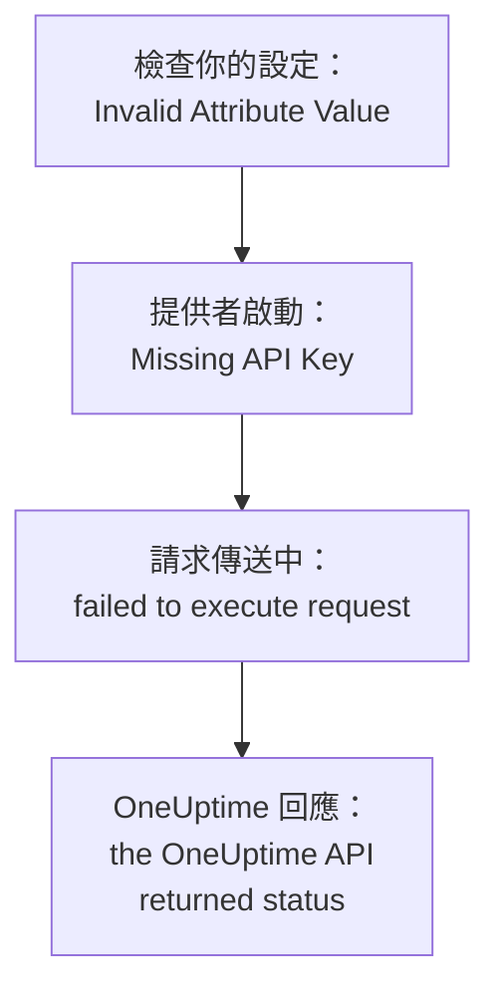

# 疑難排解

在下表中查找 Terraform 印出的訊息或你看到的現象：每一列都會指向對應的修正方式。表格之後的各節依錯誤的來源分組，逐一說明每個錯誤。

:::cards
- [找出你的錯誤](#找出你的錯誤): 本頁的所有訊息和現象，以及修正方式。
- [API 金鑰、權限和方案](#api-金鑰權限和方案): OneUptime 拒絕提供者的金鑰時。
- [無法穩定的計畫](#無法穩定的計畫): 反覆出現的變更，以及離開 state 的資源。
- [連線到自架的 OneUptime](#連線到自架的-oneuptime): 位址、憑證和 Proxy。
:::

## 找出你的錯誤

| 訊息或現象 | 該怎麼做 |
| --- | --- |
| `Missing API Key` | 為提供者提供金鑰：請參閱 [`Missing API Key` 或 `Invalid API Key`](#missing-api-key-或-invalid-api-key) |
| `Invalid API Key` | 重新複製金鑰，或建立一個新金鑰：請參閱 [`Missing API Key` 或 `Invalid API Key`](#missing-api-key-或-invalid-api-key) |
| `ProjectId required` | 使用專案的 API 金鑰，而不是主金鑰：請參閱 [`ProjectId required`](#projectid-required) |
| `You do not have permissions to create Monitor` | 為金鑰授予訊息中提到的權限：請參閱[金鑰缺少權限](#金鑰缺少權限) |
| `API keys need the Growth plan` | 把專案改回 Growth 方案：請參閱[需要付款](#需要付款) |
| 針對單一資源或單項設定的 `402` | 升級方案，或把該設定保留為預設值：請參閱[需要付款](#需要付款) |
| `This project has been blocked` | 請主管理員解除專案的封鎖：請參閱[被封鎖的專案](#被封鎖的專案) |
| `references records that are not in this project` | 使用你自己專案中記錄的 ID：請參閱[來自其他專案的 ID](#來自其他專案的-id) |
| 資料來源傳回的 `Not Found` 或 `Ambiguous Match` | 修正查詢的引數：請參閱[找不到或找到多筆結果的查詢](#找不到或找到多筆結果的查詢) |
| `Cannot import non-existent remote object` | 檢查 ID 和金鑰的權限：請參閱[匯入資源](/docs/terraform/importing-resources#疑難排解) |
| `Provider produced inconsistent result after apply` | 升級提供者：請參閱[apply 之後結果不一致](#apply-之後結果不一致) |
| 計畫建立了一個你沒有新增的資源 | 金鑰已無法讀取它，OneUptime 回應了 `404`：先恢復金鑰的讀取權限，再用 `terraform import` 匯入該資源：請參閱[資源離開 state，下一次 apply 又建立了它](#資源離開-state下一次-apply-又建立了它) |
| apply 之後 `priority` 或 `order` 發生變化 | 為每一項指派一個其他項目都沒有的編號：請參閱[會移動的優先順序或順序](#會移動的優先順序或順序) |
| `Invalid Configuration for Read-Only Attribute` | 從設定中移除該屬性：請參閱[唯讀屬性](#唯讀屬性) |
| `has been renamed to` | 用 `moved` 區塊重新命名資源類型：請參閱[已重新命名的資源類型](#已重新命名的資源類型) |
| 用 Terraform 建立的監測器始終不顯示它的檢查 | 升級 OneUptime：請參閱[步驟 ID 出現之前建立的監測器](#步驟-id-出現之前建立的監測器) |
| `must contain at least 1 elements` | 省略該屬性，而不是留空：請參閱[空值](#空值) |
| `.tf` 檔案中有來自儀表板的 JSON | 把它寫成 HCL：請參閱[來自儀表板的 JSON](#來自儀表板的-json) |
| `no available releases match the given constraints` | 使用版本範圍，而不是單一確切版本：請參閱[從未發佈過的版本](#從未發佈過的版本) |
| `x509: certificate signed by unknown authority` | 信任你的憑證授權單位：請參閱[憑證](#憑證) |
| `invalid character '<' looking for beginning of value` | 讓 `oneuptime_url` 指向 OneUptime 本身：請參閱[傳回網頁而不是 API](#傳回網頁而不是-api) |
| `connection refused` 或 `Client.Timeout exceeded` | 檢查位址、網路和 Proxy：請參閱[連線失敗](#連線失敗) |

## 如何閱讀錯誤

錯誤會指出失敗的步驟，而它的訊息會說明錯誤來自哪裡：



- 在任何請求之前出現的錯誤，例如 `Invalid Attribute Value`，與你的設定有關：提供者在與 OneUptime 通訊之前會檢查設定。
- `failed to execute request` 表示請求始終沒有得到回應：請參閱[連線到自架的 OneUptime](#連線到自架的-oneuptime)。
- `the OneUptime API returned status` 是 OneUptime 的回應：狀態碼和其後的訊息會說明 OneUptime 拒絕了什麼。

提供者會說明它當時在做什麼：變更時是 `Unable to create monitor` 和 `Unable to update monitor`，讀取資源時是 `Unable to parse label response`。OneUptime 拒絕的讀取會以摘要 `Parse Error` 回報，但其後的訊息是 OneUptime 的回應，而不是剖析問題。

## API 金鑰、權限和方案

### `Missing API Key` 或 `Invalid API Key`

`Missing API Key` 會讓提供者在送出任何請求之前就停止：提供者區塊中的 `api_key` 和環境變數 `ONEUPTIME_API_KEY` 都沒有設定。請在你執行 Terraform 的 shell 中匯出該變數，或透過標記為 `sensitive` 的變數傳入金鑰。

`Invalid API Key` 是 OneUptime 對它不認得的金鑰的回應：金鑰輸入有誤、已過期或已刪除，或者屬於另一個 OneUptime，而不是 `oneuptime_url` 指向的那個。請從 **專案設定 → 進階 → API 金鑰** 下的金鑰頁面重新複製金鑰，或建立一個新金鑰。

### `ProjectId required`

提供者需要它所管理專案的 API 金鑰：專案正是由這把金鑰決定的。自架 OneUptime 的主 API 金鑰不屬於任何專案，所以用它進行的每次建立都會失敗並顯示 `ProjectId required`。請依照[建立專案 API 金鑰](/docs/terraform/quick-start#建立專案-api-金鑰)中的方式建立專案的 API 金鑰，並改用它。

### 金鑰缺少權限

`You do not have permissions to create Monitor` 及類似訊息會隨狀態 `422` 傳回：金鑰不能對該類記錄執行這項操作。訊息會列出允許這項操作的權限。請在 **專案設定 → 進階 → API 金鑰** 下開啟金鑰的頁面，為它授予其中一項權限，或授予 **專案管理員**。匯入只需要讀取權限。

### 需要付款

- **每個請求都傳回 402 Payment Required** — `API keys need the Growth plan...`：在 OneUptime Cloud 上，專案低於 **Growth**，而專案的 API 金鑰（包括提供者使用的金鑰）在低於該方案時會停止運作。在專案回到 Growth 之前，提供者的每次呼叫都會被拒絕，`terraform plan` 也不例外；回到之後同一把金鑰又能使用，你的設定不需要任何變更。請在 **專案設定 → 帳單與發票 → 帳單** 中升級，或在這段期間於儀表板中管理專案。請參閱[低於其方案時的 API 金鑰和 SCIM](/docs/api-reference/api-reference#低於其方案時的-api-金鑰和-scim)。
- **402 Payment Required** — 你達到了 OneUptime 方案的某項限制，或者設定開啟了你的方案不包含的設定項目（私人狀態頁、電子郵件報告、公開儀表板、IP 允許清單等），無論 `terraform apply` 是用它建立資源還是之後變更資源。Terraform 會原樣顯示 OneUptime 的訊息。請升級方案，或精簡設定。

把這類設定項目改回預設值（也就是關閉該功能）在任何方案上都可以，所以關閉付費功能的設定在試用期結束或方案降級後也能套用。

你的方案所販售、且專案在降級後仍保留的資源也是如此，包括 SSO 提供者、SCIM 連線、API 金鑰、待命排程，以及 Slack 和 Microsoft Teams 的規則和摘要：在低於方案時（只要專案仍在 Growth 上，因為提供者自己的 API 金鑰需要它），專案已有的這些資源仍然可以讀取（所以 `terraform plan` 和 `import` 可以運作）、可以刪除（所以把它們從設定中移除，或執行 `terraform destroy`，都可以套用），並且在有 `is_enabled` 屬性時可以關閉。建立、變更或重新開啟它們仍然會傳回 402。

你的方案所販售的其他資源，例如範本、自訂欄位和監測器群組，讀取時仍需要該方案，所以重新整理它們的計畫會傳回 402；不過它們仍然可以刪除，例如使用 `terraform destroy -refresh=false`。

在低於 Growth 時，API 金鑰的權限不能逐一刪除，因為刪除一項封鎖類權限會讓金鑰取得更多存取權：請對權限資源執行 `terraform state rm`，然後銷毀金鑰，它的權限會隨之一起刪除。

### 被封鎖的專案

`This project has been blocked. Please contact your administrator.` 會隨狀態 `403` 傳回：主管理員封鎖了該專案，在解除封鎖之前，除了主管理員以外，任何人都不能在專案中執行操作，專案的 API 金鑰也不例外。

## 記錄和查詢

### 來自其他專案的 ID

資源中參照的每個 ID（監測器的標籤、狀態頁群組所屬的狀態頁、網路裝置的站點、上報規則的團隊等）都必須是你的 API 金鑰所屬專案中的記錄。其他專案中記錄的 ID、不存在的 ID，以及金鑰無權讀取的記錄的 ID，得到的回應都相同，回應中會列出欄位和 ID：

```text
This network device references records that are not in this project: Network Site "…". Please pick values from this project and try again.
```

這通常表示某個 ID 是從其他專案的設定或 state 中複製來的，或者該記錄已在 Terraform 之外被刪除。請透過同一份設定中的資源或資料來源（`oneuptime_label.critical.id`）參照記錄，而不是使用字面 ID，然後再次套用。被指定為使用者的人必須是專案成員。

### 找不到或找到多筆結果的查詢

資料來源要嘛剛好找到一筆記錄，要嘛讓計畫停止。`Not Found` 表示沒有記錄具有該 `id`，或者沒有記錄與你設定的引數相符；`Ambiguous Match` 表示有多筆記錄相符。請修正引數，設定更多引數把查詢範圍縮小到一筆，或依 `id` 查詢記錄。[讀取已有的內容](/docs/terraform/complete-guide#讀取已有的內容)中列出了規則。

## 無法穩定的計畫

### apply 之後結果不一致

`Provider produced inconsistent result after apply` 表示提供者傳回的值與它計畫的不同。舊版提供者會在伺服器計算出的值上出現這種情況：伺服器在 `monitor_steps` 中加入的預設值、伺服器以另一種格式寫入的時間戳記、像 `probe_version` 這樣被包裝的值，以及伺服器持續更新的屬性，例如傳入請求監測器最後一次收到心跳的時間。它們也會在 API 以文字形式傳送小數時把它讀成 null，所以狀態頁長條顏色規則的每次 apply 都會在 `uptime_percent_greater_than_or_equal_to` 上失敗。目前的提供者能處理所有這些情況：時間戳記依時間點比較，標籤清單是集合，數字會依你寫的樣子讀回，你沒有設定的屬性會保留計畫值，直到下一次重新整理讀取伺服器的值。

:::steps
1. 升級提供者：在提供者需求中保留 `version = "{{TERRAFORM_PROVIDER_VERSION}}"`，然後執行 `terraform init -upgrade`。
2. 再次套用。失敗的 apply 標記為 tainted 的資源會被取代一次，之後的計畫就是空的。如果想保留資源原樣，請先依位址取消標記：`terraform untaint oneuptime_status_page_history_chart_bar_color.operational`。
:::

如果目前的提供者仍然這樣失敗，請在 [github.com/OneUptime/oneuptime/issues](https://github.com/OneUptime/oneuptime/issues) 回報，並附上提供者版本、資源類型、會失敗的最小 `resource` 區塊，以及完整的錯誤。錯誤中會指出值發生變化的屬性，這是最有用的資訊。

### 資源離開 state，下一次 apply 又建立了它

依 ID 讀取時，對不存在的記錄和 API 金鑰無權讀取的記錄都會回應 `404`：API 對它不向你顯示的記錄不作任何說明。Terraform 會把重新整理時的 `404` 視為在 Terraform 之外被刪除的資源。它會把該資源從 state 中移除，下一次 `terraform apply` 會再建立一個，與仍然存在的那個並存。

當管理某個資源的金鑰無法再讀取它時，就會發生這種情況：它的讀取權限被限制為該資源沒有的標籤，或限制為其團隊擁有的資源，或者某項封鎖拿走了該資源，又或者資源的標籤或擁有者發生了變化。

**在執行計畫之前：**

- 為金鑰管理的每種資源類型授予讀取權限，讓它涵蓋金鑰管理的每個資源：範圍設為 **全部**，或限制為這些資源帶有的標籤。金鑰的更新和刪除權限只能作用於它可以讀取的內容。
- 在套用之前閱讀計畫：一個計畫要建立、而你並沒有新增的資源，就是金鑰已無法讀取的資源。

**當 state 已經遺失某個資源時：** 先恢復金鑰的讀取權限，然後[匯入](/docs/terraform/importing-resources)該資源，而不是直接套用，這樣 Terraform 會接管已存在的那個，而不是再建立一個。如果已經建立了副本，請刪除你不需要的那個。

### 會移動的優先順序或順序

監測器狀態、事件和警示的狀態與嚴重程度，以及你在儀表板中排序的其他清單，每個編號只保存一次。其他項目都沒有的編號會依所寫保留。已被其他項目占用的編號會被接管，擋在中間的項目會像在儀表板中拖曳時那樣依序後移一位。因此，設定了相同編號的兩個項目會在每次 apply 時互換位置。

請為每一項指派各自的編號，並在編號之間留出間隔，例如 `101`、`102` 和 `103`；Terraform 管理的項目請在 Terraform 中調整順序，而不是在儀表板中拖曳。

### 唯讀屬性

當設定指定了只有 OneUptime 才會寫入的屬性時，`Invalid Configuration for Read-Only Attribute` 會讓計畫停止。誰建立了記錄，以及誰封存、解決或確認了它，都是根據請求記錄的：記錄的是已登入的人，而使用 API 金鑰發出的請求不記錄任何人，Terraform 正是用 API 金鑰登入的。因此，`created_by_user_id` 以及其他所有以 `_by_user_id` 結尾的屬性，都可以從資源或資料來源中讀取，但不能設定。`archived_at` 也是如此：設定 `is_archived` 會記錄資源被封存的時間，不做變更再次套用會保留這個時間。請從資源區塊中移除該屬性；資源的其他部分不會改變。

### 已重新命名的資源類型

`has been renamed to` 警告某個資源類型有了新名稱。資源類型現在會保持 IoT 和 vCenter 這類詞的完整：`oneuptime_iot_fleet` 和 `oneuptime_vcenter`，而舊版提供者會把它們拆開（`oneuptime_io_t_fleet`、`oneuptime_v_center`）。舊名稱仍可作為已淘汰的別名使用。若要在不取代任何資源的情況下切換，請在設定中重新命名資源，並告訴 Terraform 它已移動：

```hcl
resource "oneuptime_iot_fleet" "factory" {
  name = "Factory floor"
}

moved {
  from = oneuptime_io_t_fleet.factory
  to   = oneuptime_iot_fleet.factory
}
```

之後 `terraform plan` 只會顯示這次移動，沒有其他變更。在資源類型之間移動需要 Terraform 1.8 或更新版本，或 OpenTofu 1.12 或更新版本；在較舊的版本上，請保留舊名稱，它仍然可用。資料來源也以同樣的方式重新命名了：只需改名，其他都不用改。

### 步驟 ID 出現之前建立的監測器

監測器步驟中的 ID（每個步驟、條件以及事件和警示範本的 ID）由伺服器指派。舊版 OneUptime 只為條件指派 ID，而且每次寫入都指派一組新的，所以透過 API 寫入的監測器（提供者建立的每個監測器都是如此）在儲存時步驟沒有 ID。探測器仍然會檢查它，它的狀態也仍然會變化，但監測器頁面找不到它的檢查，它的事件無法自動解決，而每次變更 `monitor_steps` 的 `terraform apply` 都會讓未結束的事件與其條件脫鉤。

目前的 OneUptime 會在建立時為每一項指派 ID，在每次 apply 時保留它們，並在升級時為現有監測器補上缺少的 ID。你的設定不需要任何變更：仍然沒有需要寫的 ID。舊行為遺留下來的未結束事件，只要開啟它的條件仍然存在，就會在監測器下一次恢復時關閉；條件已被先前的 apply 取代的事件，需要手動解決一次。

## 提供者拒絕的設定

### 空值

提供者會拒絕 `monitor_steps` 及其各部分中的空清單、空對應或空文字，例如 `monitor_steps = []`、`request_headers = {}` 或 `request_body = ""`：

```text
Attribute monitor_steps list must contain at least 1 elements, got: 0
```

請改為省略該屬性：不存在的屬性就是未設定。[監控步驟](/docs/terraform/monitor-steps)列出了每個部分接受的內容。

### 來自儀表板的 JSON

儀表板和 API 為資源顯示的 JSON 是 API 傳送的內容，而不是 Terraform 設定：在 Terraform 中，屬性名稱使用蛇形命名，值的寫法不同，而且很多欄位屬於伺服器。把它貼到 `.tf` 檔案中是無法運作的。

- 若要接管該資源，請[匯入它](/docs/terraform/importing-resources)：儀表板的 **Terraform** 頁面會替你寫出設定。
- 若要撰寫新的資源，請從[範例](/docs/terraform/examples)開始。
- 對於監測器的步驟，請撰寫[監控步驟](/docs/terraform/monitor-steps)中描述的具型別 `monitor_steps` 屬性：拿掉 `{_type, value}` 包裝，把 camelCase 鍵寫成 snake_case，並省略所有 `id`。

## 版本和登錄檔

### 從未發佈過的版本

`no available releases match the given constraints` 表示沒有任何已發佈的版本符合版本限制。並不是每個 OneUptime 發行版本都會發佈提供者：提供者沒有變化的發行版本不會發佈提供者，所以只指定一個確切版本的限制可能會指向一個不存在的版本。請改用範圍：

```hcl
terraform {
  required_providers {
    oneuptime = {
      source  = "oneuptime/oneuptime"
      version = "{{TERRAFORM_PROVIDER_VERSION}}"
    }
  }
}
```

在自架的 OneUptime 上，請把範圍的上限設為你的 OneUptime 版本，如[自架設定](/docs/terraform/self-hosted#選擇提供者版本)所示。[登錄檔使用](/docs/terraform/registry#版本如何編號)說明了版本的編號方式。

## 連線到自架的 OneUptime

### 憑證

`x509: certificate signed by unknown authority` 表示執行 Terraform 的機器不信任你的 OneUptime 出示的憑證，通常是私人憑證授權單位簽發的憑證。提供者會用這台機器的信任存放區來驗證它。請在每台執行 Terraform 的機器和 CI 執行器上把你的憑證授權單位加入其中：請參閱 [TLS 和憑證](/docs/terraform/self-hosted#tls-和憑證)。沒有可以略過驗證的設定。

### 傳回網頁而不是 API

`invalid character '<' looking for beginning of value` 表示在提供者預期 API 的地方，回應的是一個網頁：`oneuptime_url` 在主機之後帶有路徑，例如 `/dashboard`，或者 OneUptime 前面的 Proxy 代為回應了。請把 `oneuptime_url` 設為僅包含你的 OneUptime 位址，例如 `https://oneuptime.example.com`：提供者會自行加上 `/api`。

### 連線失敗

`failed to execute request` 伴隨 `connection refused`、`no such host` 或 `Client.Timeout exceeded`，表示沒有收到回應。請檢查位址和連接埠是否正確，以及從執行 Terraform 的地方能否連到；如果機器透過 Proxy 連上網際網路，請設定 `HTTPS_PROXY`。提供者對每個回應最多等待 60 秒。在沒有回應，或回應為 `429`、`502`、`503` 或 `504` 時，它會對讀取或刪除最多嘗試三次，但從不重試建立或變更：建立以這種方式失敗後，請在再次套用之前先到儀表板查看，以防它其實已經建立。

## 取得更多細節

提供者會把警告寫入 Terraform 的記錄檔。用 `TF_LOG_PROVIDER=WARN` 執行命令即可看到它們，再加上 `TF_LOG_PATH` 可以把它們儲存到檔案：

```bash
TF_LOG_PROVIDER=WARN TF_LOG_PATH=terraform.log terraform plan
```

`OneUptime rejected a column in the select; dropping it and retrying` 指出了 OneUptime 不願傳送給提供者金鑰的欄，通常是因為缺少權限。該屬性在 state 中保持為空，所以在每次計畫中都可能顯示為一項變更。

## 仍然無法解決？

在 [github.com/OneUptime/oneuptime/issues](https://github.com/OneUptime/oneuptime/issues) 提出 issue，並附上提供者版本（`terraform version` 會在 `init` 之後顯示它）、資源區塊和完整的錯誤。提供者是從 OneUptime 的程式碼產生的，所以它的 issue 都在主要存放庫中追蹤。

## 後續步驟

:::cards
- [匯入資源](/docs/terraform/importing-resources): 接管你在儀表板中建立的內容，並修正匯入錯誤。
- [自架設定](/docs/terraform/self-hosted): 你自己的 OneUptime 的位址、版本和憑證。
- [完整指南](/docs/terraform/complete-guide): 驗證、資料來源、state 和升級。
- [監控步驟](/docs/terraform/monitor-steps): 監測器檢查的每個屬性。
:::
