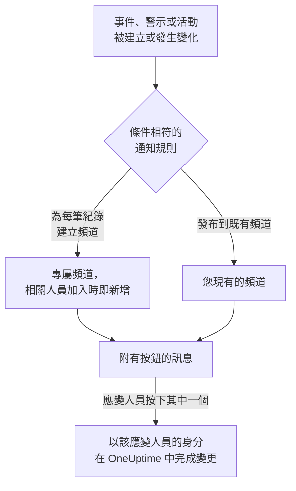

# Mattermost

將 OneUptime 連接到您的 Mattermost 伺服器，即可把事件、警示、片段、排定維護、監測器和待命更新發布到您的頻道，為每個事件提供專屬頻道，並讓應變人員不必離開 Mattermost 就能確認、解決、新增備註和變更狀態。

:::cards
- [連接 Mattermost](#連接-mattermost): 為 OneUptime 建立一個機器人帳戶，然後用它的權杖連接專案。
- [連接您自己的帳戶](#連接您自己的-mattermost-帳戶): 將您的 Mattermost 帳戶連結到您的 OneUptime 帳戶。
- [通知規則](#通知規則): 決定哪些事件發布到哪裡，以及哪些事件擁有專屬頻道。
- [紀錄頻道中的成員](#紀錄頻道中的成員): 在紀錄的頁面上查看頻道中有誰、加入頻道並新增成員。
- [在 Mattermost 中操作](#從-mattermost-處理事件警示和活動): OneUptime 訊息上的按鈕。
- [網路與自行託管](#網路與自行託管): 每台伺服器必須能夠連到什麼。
:::

## 運作方式

這仰賴兩種連接：

- **專案的連接** 只需建立一次：您的 Mattermost 伺服器上的一個機器人帳戶，位於 OneUptime 發布訊息的各個團隊中。它會發布訊息、建立頻道並將人員加入頻道。
- **每個人自己的連接**：此人的 Mattermost 帳戶連結到其 OneUptime 帳戶。按鈕以此人的身分、依其在專案中的權限執行。

一個 Mattermost 團隊可以連接到多個專案，例如正式環境與測試環境。按鈕會在其訊息所涉及紀錄的專案中執行。

## 開始之前

- **可以連接專案的角色：** **專案擁有者**、 **專案管理員** 或 **專案成員**。中斷連接需要 **專案擁有者** 或 **專案管理員**。
- 一台您可以在其中建立機器人帳戶的 **Mattermost 伺服器**，或一位可以為您建立機器人帳戶的 Mattermost 管理員。Mattermost Cloud 和自行託管的 Mattermost 都可以使用。
- 通知規則和摘要需要 **OneUptime Cloud 的 Growth 方案**。

OneUptime 不需要在自己的伺服器上為 Mattermost 做任何設定：每個專案都自備 Mattermost 伺服器和機器人帳戶。

## 連接 Mattermost

:::steps
### 在 Mattermost 中建立機器人帳戶

在 Mattermost 中，開啟 **System Console** > **Integrations** > **Bot Accounts**，確認 **Enable Bot Account Creation** 已開啟。然後前往 **Integrations** > **Bot Accounts** > **Add Bot Account**，將其命名為 `oneuptime` 並儲存。Mattermost 只會顯示一次機器人的存取權杖：請複製它。

### 將機器人新增到您的團隊

像新增一個人那樣，將機器人新增到 OneUptime 應在其中發布訊息的每個團隊： **Main Menu** > **Invite People**，然後邀請 `@oneuptime`。OneUptime 只會在機器人所屬的團隊中建立頻道和發布訊息。

### 連接專案

在 OneUptime 中，前往 **專案設定** > **工作區** > **Mattermost**，按一下 **連線 Mattermost**。輸入您伺服器的網址（例如 `https://chat.example.com`）和機器人的存取權杖。OneUptime 會先向您的伺服器驗證權杖，然後才儲存任何內容。如果機器人屬於多個團隊，OneUptime 會詢問哪個是預設團隊：未指定團隊的通知規則會在預設團隊中建立頻道。在連接工作區之前，事件、警示、排定維護、監測器和待命選單的 **工作區** 區段中有 **連線工作區**，它同樣會帶您來到這裡。

### 新增通知規則

前往 **事件** > **工作區** > **Mattermost**，建立一條規則。例如，一條為每個新事件建立 Mattermost 頻道、並讓所有處理該事件的人加入的規則。請參閱 [通知規則](#通知規則)。
:::

機器人的存取權杖只儲存在 OneUptime 伺服器上，與專案的其他機密一起加密，而且不會再次顯示。伺服器網址、各個團隊和機器人的使用者名稱會在 Mattermost 設定頁面上向專案中的所有人顯示。

一個專案只連接到一台 Mattermost 伺服器。若要將其移到另一台伺服器，請先中斷連接： **專案設定** > **工作區** > **Mattermost**，然後按一下 **⋯** > **中斷 Mattermost 連線**。中斷連接也會中斷每位成員自己的 Mattermost 帳戶的連接，並刪除其 Mattermost 通知方式以及使用這些方式的待命規則。您的通知規則和摘要會被保留，以便您再次連接時使用。

## 多個團隊

OneUptime 會在您的 Mattermost 伺服器上其機器人所屬的每個團隊中運作：

1. 在 Mattermost 中，像新增一個人那樣，將機器人新增到每個需要使用 OneUptime 的團隊：開啟該團隊，然後選擇 **Main Menu** > **Invite People**。
2. **專案設定** > **工作區** > **Mattermost** 上的 **Mattermost 團隊清單** 卡片會列出這些團隊，預設團隊排在最前面。將機器人新增到其他團隊後，按一下 **重新整理**。

- **規則使用哪個團隊。** 通知規則會選擇其頻道所在的 **Mattermost 團隊**。留空時，規則會在預設團隊中建立頻道，並先在那裡尋找它指定的頻道，然後在機器人的其他團隊中尋找。
- **摘要使用哪個團隊。** **事件** 和 **警示** 的 **摘要** 分頁中的摘要，也會選擇其頻道所在的 **Mattermost 團隊**。留空時，摘要會先在預設團隊中尋找它的頻道，然後在機器人的其他團隊中尋找。
- **預設團隊。** 即您連接專案時所用的團隊。可以連接專案的角色可透過卡片上的 **設為預設** 將另一個團隊設為預設團隊。
- **OneUptime 在哪裡運作。** OneUptime 訊息上的按鈕及其開啟的表單，在這些團隊中都能使用。在機器人已被移出的團隊中，按鈕只會提示該團隊已不再連接。
- **機器人已被移出的預設團隊。** 卡片會說明這一點。請在 Mattermost 中重新加入機器人，或將另一個團隊設為預設團隊。
- **規則指定的、機器人已被移出的團隊。** 規則的卡片會說明這一點，規則也不會改用其他團隊。請在 Mattermost 中將機器人重新加入該團隊，或在規則中選擇另一個團隊：規則的表單仍會顯示原來的選擇，方便您變更。

## 連接您自己的 Mattermost 帳戶

Mattermost 沒有可供 OneUptime 將您導向過去的登入頁面，因此 OneUptime 的機器人會改為傳送一則附有連結的私人訊息給您的 Mattermost 帳戶：

:::steps
1. 前往 **使用者設定** > **工作區** > **Mattermost**。OneUptime 會尋找使用您電子郵件地址的 Mattermost 帳戶。如果找到，請按一下 **向 @your-username 傳送連結**。如果沒有找到，請按一下 **傳送連結給我** 並輸入您的 Mattermost 使用者名稱。
2. 在 Mattermost 中開啟 OneUptime 機器人傳來的私人訊息，然後按一下 **Connect my account**。
3. 該連結會開啟 OneUptime，由它連接您的帳戶。
:::

請在您要求連結的同一個瀏覽器中開啟它：它只在那裡有效，只能使用一次，而且只在 15 分鐘內有效。這證明要求連結的人同時持有這兩個帳戶，因此任何人都無法連接他人的 Mattermost 帳戶。如果您沒有要求過連結，請忽略它：在提出要求的瀏覽器中開啟它之前，不會連接任何帳戶。

您帳戶的連接屬於此專案。在連接到同一個 Mattermost 團隊的另一個專案中，也請在那裡連接。

## 在 Mattermost 中接收呼叫

要在待命時透過私人訊息接收呼叫，請將 Mattermost 新增為您的通知方式之一：

:::steps
1. 連接您自己的 Mattermost 帳戶（請參閱 [連接您自己的 Mattermost 帳戶](#連接您自己的-mattermost-帳戶) ）。
2. 前往 **使用者設定** > **通知方式**，開啟 **工作區應用程式** 分頁，然後按一下 **新增 Mattermost 帳戶**。
3. 在其所在列按一下 **Send Test Message**。訊息會以來自專案機器人的私人訊息形式送達。
:::

新增後，它會立即加入您的待命規則，因此從那時起呼叫會透過 Mattermost 送達您。在 **使用者設定** > **如何聯絡我** 中變更它接收哪些呼叫。每次呼叫都帶有一個確認連結和一個升級連結。中斷您的 Mattermost 帳戶連接會刪除此方式以及使用它的待命規則。

## 通知規則

通知規則決定哪些事件發布到 Mattermost，以及發布到哪裡。每個產品都有自己的規則，位於其選單的 **工作區** > **Mattermost** 下： **事件** （附有 **事件片段** 和 **摘要** 分頁）、 **警示** （附有 **警示片段** 和 **摘要** ）、 **排定維護**、 **監測器**、 **待命**、 **安全事件** 和 **SLOs**。它們的運作方式與 Slack 的規則相同：關於條件、目標、規則發布的更新以及誰會加入頻道，請參閱 [通知規則](/docs/workspace-connections/slack#通知規則)。 待命訊息與 Slack 中相同，每次交接一行：請參閱 [待命訊息](/docs/workspace-connections/slack#待命訊息)。訊息中的時間（例如待命班次結束的時間）以 UTC 顯示：Mattermost 無法依每位讀者自己的時區顯示。

規則建立的頻道以其紀錄命名：事件 INC-42 得到 `inc-42`。Mattermost 只接受小寫字母、數字、`-` 和 `_`，最多 64 個字元，而且必須以字母或數字開頭和結尾；規則表單會在您輸入時顯示名稱。如果已有同名頻道（例如已封存的頻道），OneUptime 會加上 `-2`、`-3` 等。私人事件、警示或片段會獲得私人頻道。

若要發布到現有頻道，請輸入其網址中顯示的名稱，例如 `chat.example.com/team/channels/incidents` 中的 `incidents`，或輸入其顯示名稱。OneUptime 第一次在公開頻道發布時會自行加入。在規則向私人頻道發布之前，請先在 Mattermost 中將機器人新增到該頻道。當機器人屬於多個團隊時，規則還會選擇其頻道所在的團隊：請參閱 [多個團隊](#多個團隊)。

人員會透過其已連接的 Mattermost 帳戶加入規則的頻道；否則，當您的伺服器向機器人顯示電子郵件地址時（ **System Console** > **Site Configuration** > **Users and Teams** > **Show Email Address** ），會透過使用其電子郵件地址的 Mattermost 帳戶加入。OneUptime 會在頻道中用一則訊息列出它無法加入的所有人，並附上連接其帳戶的連結。

擁有專屬頻道的事件、警示、片段或維護事件，會在其 OneUptime 頁面標題的狀態按鈕旁顯示 **在 Mattermost 中開啟**。它會在新分頁中開啟您的 Mattermost 伺服器上的該頻道。擁有兩個專屬頻道的紀錄會在按鈕下列出這兩個頻道。同時在 Slack 或 Microsoft Teams 中有頻道的紀錄，會改為只顯示一個 **開啟頻道** 按鈕，列出所有頻道。不會提供您的規則所發布到的現有頻道。

規則所在列的 **測試規則** 會將該規則的測試訊息發布到它指定的頻道，與 Slack 中一樣。

OneUptime 的訊息不會因其引用的內容而通知任何人：包含 `@channel`、`@here` 或 `@someone` 的名稱或描述會照原樣顯示，不會提醒任何人。

## 紀錄頻道中的成員

擁有專屬 Mattermost 頻道的事件、警示、片段或維護事件，在其 OneUptime 頁面上有一張 **Mattermost 頻道** 卡片。卡片顯示該頻道（一個在您的 Mattermost 伺服器上開啟它的連結）、它是否為私人頻道，以及頻道中有誰，您排在最前面。無需 Mattermost 管理員，即可在卡片上：

- **加入頻道** 會在您不在頻道中時把您加入頻道。
- **新增成員** 會開啟專案的人員和團隊清單：選擇一個人即新增此人，選擇一個團隊即新增其中的所有人。

由 OneUptime 的機器人新增他們，就像它為規則的頻道新增人員一樣。機器人會一直留在它建立的頻道中，所以即使所有人都已離開私人頻道，也能這樣重新進入。如果紀錄在 Slack 或 Microsoft Teams 中也有頻道，它們都會列在同一張 **聊天頻道** 卡片上。

- **誰可以新增成員。** 可以編輯該紀錄的人：對於事件，是 **專案擁有者**、 **專案管理員**、 **專案成員**、 **事件管理員** 和 **事件成員**，或自訂角色中的 **Edit Incident**；對於警示、片段或排定維護事件，則是其各自類型的相同權限（例如 **Edit Alert**）。其他人可以看到頻道中有誰，以及如何進入。
- **可以新增誰。** OneUptime 能在 Mattermost 中找到、並且在頻道所在團隊中的人：透過此人已連接的帳戶，否則在您的伺服器向機器人顯示電子郵件地址時，透過此人的電子郵件地址。該團隊中的訪客帳戶也可以新增：Mattermost 允許頻道成員新增訪客。卡片會列出無法新增的人及原因。
- **會記錄什麼。** 誰被新增、由誰新增，都記錄在該紀錄的動態中（ **已新增頻道成員** ），以及 **專案設定** > **通知** > **通知日誌** 的 **工作區** 分頁中。
- **已封存的頻道。** 卡片仍會列出頻道中有誰，但在 Mattermost 中取消封存之前不會新增任何人。
- **機器人已被移出的頻道。** 即使是公開頻道，Mattermost 也只向頻道中的人顯示其成員，因此卡片會說它看不到此頻道。頻道中的成員可以在 Mattermost 中重新加入機器人。OneUptime 下次在公開頻道中發布訊息時，也會自行重新加入。
- **移出某人。** OneUptime 只會新增成員：請在 Mattermost 中將某人移出頻道。

## 從 Mattermost 處理事件、警示和活動

OneUptime 的訊息附有按鈕，以及一個 **More actions** 選單，用於較少人需要的操作。每一項都以您的身分、依您在專案中的權限執行，並以只有您看得到的訊息回覆。

| 紀錄 | 按鈕和選單 |
| --- | --- |
| **事件** | **Acknowledge**、 **Resolve**、 **Add Note**，選單中還有 **Change Severity** 和 **Change State** |
| **警示** | **Acknowledge**、 **Resolve**、 **Add Note**、 **Change State**、 **Execute On-Call Policy** |
| **事件片段、警示片段** | **Acknowledge**、 **Resolve**、 **Add Note**、 **Change State**、 **Execute On-Call Policy** |
| **排定維護** | **Mark as Ongoing**、 **Mark as Complete**、 **Add Note**、 **Change State** |

**Add Note**、 **Change State**、 **Change Severity** 和 **Execute On-Call Policy** 會在 Mattermost 中開啟一個表單。事件或維護事件上的備註可以是公開的（顯示在狀態頁面上），也可以是私人的；私人事件上的備註一律是私人的，警示上的備註也一律是私人的。每則訊息還有一個在 OneUptime 中開啟其紀錄的連結，用於其他所有操作。如果專案的公開備註需要核准，從表單送出的公開備註會等待核准，並有一則只有你能看到的訊息說明它在等待誰：請參閱 [公開備註核准](/docs/incidents/notes-owners-and-feed#公開備註核准)。

如果您的 Mattermost 帳戶尚未連接，按鈕會告訴您這一點，並附上前往 **使用者設定** > **工作區** > **Mattermost** 的連結。連接您的帳戶後，再按一次按鈕。

每次按下都會記錄在 **專案設定** > **通知** > **通知日誌** 的 **工作區** 分頁中，並註明是誰按下的。

## 核准公開備註

當專案的公開備註需要核准，且您在通知設定中為 **公開備註核准** 開啟了 Mattermost 時，每則等待您所核准步驟的公開備註都會送到您與 OneUptime 機器人的私人訊息中：誰傳送了它、它在等待哪一步、備註內容、 **Approve** 、 **Reject** ，以及指向 OneUptime 中該備註的連結。 **Approve** 會為該步驟核准它；在最後一步，它會顯示為 **Approve and publish** ，備註會立即發布。 **Reject** 會開啟一個詢問理由的表單：理由為必填，備註的作者會看到它。這些按鈕以您的身分、依照與 OneUptime 相同的規則運作，並在只有您看得到的訊息中回覆。在別人已做決定之後，或在備註或其步驟變更之後按下按鈕，不會做出任何決定，並會說明發生了什麼事。備註一經決定，每位核准者關於它的訊息（包括您的）都會改為說明發生了什麼事：已就其步驟核准以及它現在在等待誰、已發布、已拒絕、已變更或已重新送出核准、未經核准即已發布，或已刪除。訊息保留指向 OneUptime 中該備註的連結，而 **Approve** 和 **Reject** 會消失。如果您的 Mattermost 帳號尚未連結，請在 **使用者設定** > **工作區** > **Mattermost** 中連結它，然後再按一次按鈕。核准步驟在備註等待期間有所變更時，如果備註不再等待你的步驟，或不再詢問你，你關於它的訊息也會隨之改變，而它現在等待的人會收到屬於自己的訊息。請參閱 [公開備註核准](/docs/incidents/notes-owners-and-feed#公開備註核准)。

## 網路與自行託管

兩台伺服器會互相通訊：

- **OneUptime 向您的 Mattermost 伺服器發出請求**，以發布訊息、建立頻道和新增人員。在 OneUptime Cloud 上，您的 Mattermost 伺服器必須能從網際網路連線。自行託管的 OneUptime 只有在其管理員透過 `ALLOW_PRIVATE_NETWORK_WEBHOOKS` 或 `PRIVATE_NETWORK_WEBHOOK_ALLOWLIST` 允許私人位址之後，才能連到私人網路上的 Mattermost 伺服器。OneUptime 絕不會向其所在機器上的位址或雲端中繼資料位址發出請求，也絕不會跟隨重新導向。
- **您的 Mattermost 伺服器向 OneUptime 發出請求**：在有人按下按鈕或提交表單時，請求 `https://<your OneUptime>/api/mattermost/interactive` 和 `/api/mattermost/dialog`。如果 OneUptime 的位址是私人位址，請在 Mattermost 中將其主機新增到 **System Console** > **Environment** > **Developer** > **Allow untrusted internal connections to**，否則按鈕將無法運作。

OneUptime 發布的每個按鈕都附有一個簽章，對應其發布所在的 Mattermost 團隊，並在按下時進行檢查：未經 OneUptime 簽署的按鈕操作，或從其他團隊傳來的按鈕操作，都不會有任何作用。

## 疑難排解

| 您看到的內容 | 處理方式 |
| --- | --- |
| **Mattermost did not accept the access token** | 重新複製機器人的權杖。Mattermost 只會顯示一次權杖：如有需要，請在 **Integrations** > **Bot Accounts** 下建立新的權杖。 |
| **The bot account is not a member of any team** | 在 Mattermost 中將機器人新增到您的團隊，然後重新連接。 |
| 您新增了機器人的某個團隊不在 **Mattermost 團隊清單** 卡片上 | 按一下卡片上的 **重新整理**。 |
| **OneUptime's bot is not a member of this Mattermost team** | 您選擇的團隊中已沒有該機器人。在 Mattermost 中將機器人新增到該團隊，然後按一下 **重新整理**。 |
| **OneUptime's bot may not create channels in the Mattermost team this rule names** | 在 Mattermost 中將機器人新增到該團隊，或在規則中選擇另一個團隊。 |
| **OneUptime's bot is not a member of the Mattermost team chosen for the channel** | 在 Mattermost 中將機器人新增到該團隊，或在規則中選擇另一個團隊。 |
| **OneUptime's bot is no longer a member of the project's default Mattermost team** | 在 Mattermost 中將機器人重新加入該團隊，或將另一個團隊設為預設團隊。 |
| **OneUptime could not reach the Mattermost server** | 檢查網址，並確認 OneUptime 能夠連到它。請參閱 [網路與自行託管](#網路與自行託管)。 |
| **The bot is not a member of the private Mattermost channel** | 在 Mattermost 中將機器人新增到該頻道。 |
| 按鈕沒有反應，或 Mattermost 提示無法完成該操作 | Mattermost 無法連到 OneUptime。請參閱 [網路與自行託管](#網路與自行託管)。 |
| 沒有收到附有您連結的私人訊息 | 檢查使用者名稱，並確認機器人位於您所在的某個團隊中。 |
| 頻道卡片顯示 OneUptime 看不到此頻道 | 頻道已被刪除，或機器人已被移出該頻道。如果該頻道仍然存在，頻道中的成員可以在 Mattermost 中重新加入機器人。 |
| 頻道卡片顯示某人不在 Mattermost 團隊中 | 在 Mattermost 中將此人新增到頻道所在的團隊，然後再次新增。 |
