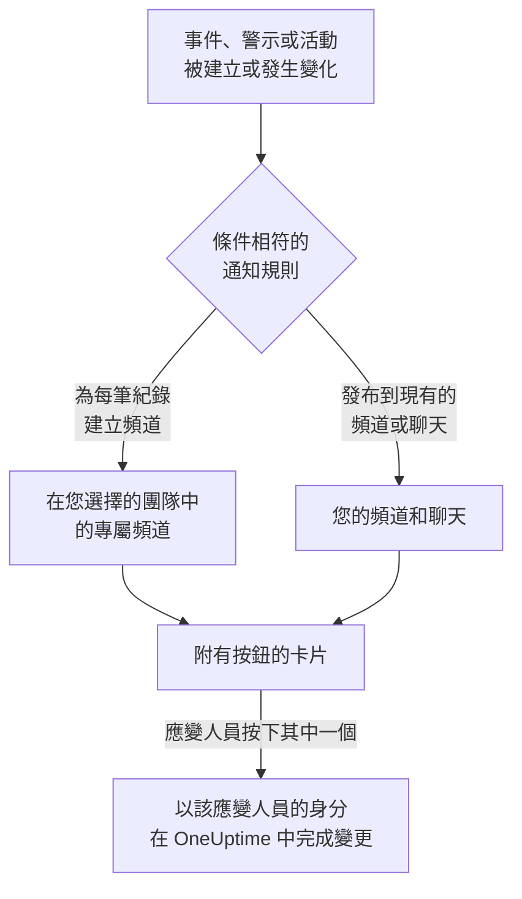

# Microsoft Teams

將 OneUptime 連接到 Microsoft Teams，即可把事件、警示、片段、排定維護、監測器和待命更新發布到您的頻道和聊天，為每個事件提供專屬頻道，並讓應變人員在 Teams 中操作：確認、解決、新增備註、呼叫待命人員、宣告事件以及詢問 OneUptime AI。

:::cards
- [連接 Microsoft Teams](#連接-microsoft-teams): 管理員同意、您的登入，以及每個團隊中的應用程式。
- [請所有人連接帳戶](#請所有人連接帳戶): 一次傳送訊息給每位尚未連接帳戶的成員。
- [通知規則](#通知規則): 決定哪些事件發布到哪裡，以及哪些事件擁有專屬頻道。
- [與 OneUptime 機器人對話](#與-oneuptime-機器人對話): 在與機器人的聊天中使用指令、提問和表單。
- [待命標籤](#待命標籤): 讓團隊的標籤與待命人員保持一致，並呼叫它。
- [從 Microsoft Teams 處理事件、警示和活動](#從-microsoft-teams-處理事件警示和活動): OneUptime 卡片上的按鈕。
:::

## 運作方式

這仰賴三樣東西：

- **專案的連接** 只需建立一次：Microsoft 365 管理員為您的組織同意 OneUptime 應用程式。
- **每個團隊中的 OneUptime 應用程式**，也就是您希望接收通知的每個團隊。Microsoft 只允許機器人在已新增它的團隊中發布訊息。
- **每個人自己的連接**：此人的 Microsoft Teams 帳戶連結到其 OneUptime 帳戶。按鈕、指令和回應都以此人的身分、依其在專案中的權限執行。

一個 Microsoft 365 組織可以連接到多個專案，例如正式環境與測試環境。卡片上的按鈕會在傳送該卡片所針對的專案中執行，例如卡片所涉及事件的專案。傳給機器人的訊息會在其傳送所在頻道（例如事件的頻道）的專案中執行，否則會在傳送者的 Microsoft Teams 帳戶所連接的唯一專案中執行。如果無法據此判斷，機器人會詢問傳送者指的是哪個專案，並為此人所在的每個專案顯示一個按鈕，此人選擇後即在該專案中繼續。在與 OneUptime AI 的對話中，這項選擇對後續提問保持有效，直到一小時內沒有新的提問為止。

## 開始之前

- **可以連接專案的角色：** **專案擁有者**、 **專案管理員** 或 **專案成員**。解除安裝需要 **專案擁有者** 或 **專案管理員**。
- 一位 **Microsoft 365 管理員**，為整個組織授予一次管理員同意。
- 通知規則和摘要需要 **OneUptime Cloud 的 Growth 方案**。請參閱 [低於 Growth 方案時的通知規則](#低於-growth-方案時的通知規則)。
- **在自行託管的伺服器上，** 需要先為其設定好 Teams 機器人。請參閱 [Microsoft Teams 整合](/docs/self-hosted/microsoft-teams-integration)。

## 連接 Microsoft Teams

:::steps
### 授予管理員同意

前往 **專案設定** > **工作區** > **Microsoft Teams**，按一下 **授予管理員同意**。Microsoft 365 管理員登入，並為組織允許 OneUptime 應用程式。之後卡片會顯示 **Admin Consent Completed**。在連接工作區之前，事件、警示、排定維護、監測器和待命選單的 **工作區** 區段中有 **連線 Slack 或 Teams**，它同樣會帶您來到這裡。

### 連接您的帳戶

按一下 **Connect with Microsoft Teams**，並使用您的公司帳戶登入。OneUptime 會讀取您組織的團隊； **檢視團隊** 會列出它們。

### 將 OneUptime 應用程式新增到每個團隊（必要）

只連接您的帳戶還不夠。Microsoft 只允許 OneUptime 機器人在已新增它的團隊中發布訊息，因此請對每個希望接收通知的團隊執行以下操作：

- 在 Microsoft Teams 中，按一下 **團隊名稱** （而不是頻道名稱）旁邊的 "..."。
- 選擇 **Manage team** > **Apps** > **More apps**，找到 **OneUptime**，然後按一下 **Add**。

在 OneUptime Cloud 上， **開啟 Teams 商店** 會在 Microsoft Teams 市集中開啟該應用程式，在那裡使用 **Add to a team** 也能完成同樣的操作。在自行託管的伺服器上，請改為安裝 **下載應用程式資訊清單 Zip** 中的套件：只有它包含您伺服器的機器人。如果測試通知回報 OneUptime 應用程式未安裝在該團隊中，表示遺漏的正是這一步。

### 連接其他所有人

每個人都在 **使用者設定** > **工作區** > **Microsoft Teams** 中透過 **Connect my account with Microsoft Teams** 連結自己的 Microsoft Teams 帳戶，以便以本人身分處理事件並接收私人訊息。專案連接到 Microsoft Teams 後，該區段就會出現。如需讓整個團隊一次完成連接，請參閱 [請所有人連接帳戶](#請所有人連接帳戶)。

### 新增通知規則

前往 **事件** > **工作區** > **Microsoft Teams**。 **工作區** 區段只列出您的專案已連接的聊天工作區，因此 **Microsoft Teams** 會在連接後出現在那裡。建立一條規則（例如在建立事件時發布到 Teams 頻道的規則），然後在其所在列按一下 **測試規則**。
:::

> [!NOTE]
> 為您自己安裝 OneUptime，或將其新增到聊天中，是另一種安裝，並不能讓它向團隊的頻道發布訊息。 **私人頻道** 需要將應用程式新增到頻道本身：開啟頻道 > "..." > **Manage channel** > **Apps** > **Add an app**。 **共用頻道** 無法接收通知：Microsoft Teams 不支援在共用頻道中使用機器人。

## 請所有人連接帳戶

任何人都無法替他人連接 Microsoft Teams 帳戶，管理員也不例外：每個人都必須親自登入自己的帳戶。若要讓整個團隊完成連接，可由 **專案擁有者** 或 **專案管理員** 在 **專案設定** > **工作區** > **Microsoft Teams** 中一次請所有人連接。 **Members' Microsoft Teams accounts** 卡片會顯示已有多少成員完成連接。 **Ask everyone to connect** 會讓 OneUptime 機器人傳送一則訊息給每位尚未連接的成員，並附上一個 **Connect Microsoft Teams account** 按鈕，只要按一下即可連接其帳戶。

- **誰會收到訊息。** 專案中每位尚未連接 Microsoft Teams 帳戶、且所在團隊已新增 OneUptime 應用程式的成員，在該團隊中透過其電子郵件地址或使用者主體名稱（UPN）找到。過去 24 小時內已請求過的人不會再次收到請求，因此隔天再請一次時，只會提醒仍未連接的人。
- **卡片顯示的內容。** 訊息傳送期間顯示傳送進度，之後顯示是誰提出請求，以及有多少成員收到訊息。OneUptime 找不到的成員會在卡片上列出姓名：請將應用程式新增到他們所在的團隊，或請他們自行在 **使用者設定** > **工作區** > **Microsoft Teams** 中連接。
- **按鈕連接的帳戶。** 按下按鈕並登入的人的 Microsoft Teams 帳戶，會連接到此人自己的 OneUptime 帳戶。轉給他人的訊息，不會為原本收到訊息的成員連接任何帳戶。

## 通知規則

通知規則決定哪些事件發布到 Microsoft Teams，以及發布到哪裡。每個產品都有自己的規則，位於其選單的 **工作區** > **Microsoft Teams** 下：

| 產品 | 其 **Microsoft Teams** 頁面上的分頁 |
| --- | --- |
| **事件** | **事件**、 **事件 片段**、 **摘要** |
| **警示** | **警示**、 **警示 片段**、 **摘要** |
| **排定維護** | 一個規則清單 |
| **監測器** | 一個規則清單 |
| **待命** | 一個規則清單 |

建立規則分為四個步驟：

| 步驟 | 您設定的內容 |
| --- | --- |
| **基礎** | **規則名稱** 和 **規則描述**。 |
| **條件** | 規則適用於哪些事件，例如依嚴重程度、狀態、標籤、監測器或標題中的字詞。條件會在事件建立時檢查，並在 OneUptime 每次發布關於它的更新時再次檢查，因此針對已確認事件的規則會在事件被確認時生效。新規則適用於所有事件，例如 **所有事件** 。要縮小範圍，請選擇 **僅符合條件的事件** 並新增條件。有兩個以上條件時， **符合條件** 決定是必須全部相符，還是相符任一個即可。 |
| **目標** | 發布到哪裡：您選擇的團隊中的現有頻道、您選擇的聊天、在您選擇的團隊中為每個事件建立的頻道（警示、片段、排定維護、監測器或待命策略亦同），或其中幾項的組合。步驟下方的 **此規則的作用** 會像規則卡片一樣，用句子說明規則的作用。 |
| **Video Call** | 僅限事件和警示：為每一個開始一次通話。請參閱 [視訊通話](/docs/workspace-connections/video-calls)。 |

規則建立的頻道以其紀錄命名：事件 INC-42 得到 `inc-42`，警示 ALT-7 得到 `alt-7`；在沒有編號前綴的專案中，事件 42 得到 `incident-42`。 **頻道名稱前綴** 中的文字放在名稱前面，因此 `prod-` 會得到 `prod-inc-42`，表單會在您輸入時顯示名稱。對於排定維護事件，前綴會取代其編號前綴：SM-5 得到 `sm-5`，`maint-` 會得到 `maint-5`。OneUptime 只保留字母、數字、空格、`-` 和 `_`，最多為 Microsoft Teams 接受的 50 個字元。如果團隊中已有同名頻道（例如其他專案的頻道或最近 30 天內刪除的頻道），OneUptime 會加上 `-2`、`-3` 等。

規則的頻道會在事件首次符合該規則時建立：在事件建立時，或之後在事件仍未結束時，由某次更新使其符合時。針對已確認事件的規則會在事件被確認時建立頻道。Microsoft Teams 會向團隊中的每個人顯示團隊的頻道，因此 OneUptime 不會逐一把人加入頻道：您選擇的團隊中的每個人都可以開啟頻道，正如規則表單在 **誰會加入頻道** 下所說。私人事件、警示或片段會獲得私人頻道，只有其成員可見；請在 Microsoft Teams 中新增人員。

若要讓待命人員參與進來，請在 **提及待命人員** 下選擇他們的待命排程。建立頻道時，OneUptime 會緊接在紀錄的第一則訊息之後，在頻道中發布一則訊息，在其中 @提及這些待命排程中正在待命的人，因此 Microsoft Teams 會通知他們。不會呼叫任何人。OneUptime 會根據每個人連接到 OneUptime 的 Microsoft Teams 帳戶在團隊中找到此人，否則根據其電子郵件地址尋找。不在該團隊中的人無法開啟團隊的頻道，因此訊息中會改為列出其姓名並說明原因。私人頻道只有其成員才能開啟，因此請在 Microsoft Teams 中將待命人員新增到該頻道。

此後紀錄的每次更新（狀態變化、備註、新擁有者）都會發布到它的頻道，並在規則的條件符合期間發布到其規則指定的現有頻道和聊天。OneUptime 無法封存 Microsoft Teams 頻道，因此紀錄結束後，規則的頻道會保留；請在 Microsoft Teams 中封存或刪除它。

擁有專屬頻道的事件、警示、片段或排定維護事件，會在其 OneUptime 頁面標題的狀態按鈕旁顯示 **在 Microsoft Teams 中開啟**。它會在新分頁中開啟該頻道，進入 Microsoft Teams 應用程式或瀏覽器。擁有兩個專屬頻道的紀錄會在按鈕下列出這兩個頻道。在 Slack 和 Microsoft Teams 中都有頻道的紀錄，會改為只顯示一個 **開啟頻道** 按鈕，列出所有頻道。不會提供您的規則所發布到的現有頻道和聊天。

紀錄的頁面上還有一張 **Microsoft Teams 頻道** 卡片，說明誰可以開啟該頻道：團隊中的所有人，或者對於私人頻道，是其成員，由頻道擁有者在 Microsoft Teams 中新增。OneUptime 不會變更 Microsoft Teams 頻道中的成員。對於 Slack 頻道，卡片會列出頻道中有誰，並可以新增成員：請參閱 [紀錄頻道中的成員](/docs/workspace-connections/slack#紀錄頻道中的成員)。

頻道和聊天保持易讀：每次更新只發布一次，紀錄的第一個狀態寫在宣布該紀錄的卡片裡，而不是單獨發一張卡片。待命策略的一次執行就是一張卡片，隨著上報推進而被編輯：呼叫了誰、呼叫了幾次以及透過什麼方式、誰沒有被呼叫以及原因、誰確認了。只有在需要有人採取行動時才會發布新卡片：某條上報規則沒有呼叫到任何人，或者執行結束時仍沒有人確認。紀錄的擁有者或狀態頁面訂閱者已收到通知這件事，保留在 OneUptime 中該紀錄的動態裡。

**專案設定** > **工作區** > **Microsoft Teams** 列出 OneUptime 在您的團隊中看得到的頻道，以及已新增它的聊天，每一項旁邊都有 **傳送測試**。在 Microsoft Teams 中將 OneUptime 應用程式新增到聊天後，該聊天就會出現； **Refresh Chats** 會取得新的聊天及其目前名稱。

## 測試規則

規則所在列的 **測試規則** 會將該規則的測試訊息發布到它指定的頻道，讓您看到訊息送達。如果規則為每個事件建立頻道，測試也會建立一個頻道並邀請規則的相關人員。

與 **專案設定** > **工作區** > **Microsoft Teams** 中頻道旁的 **傳送測試** 一樣，它需要建立通知規則的權限： **專案擁有者**、 **專案管理員**、 **專案成員**、 **設定管理員**、 **設定成員**，或自訂角色中的 **Create Workspace Notification Rule** 和 **Read Workspace Notification Rule**。對於只能檢視規則的人（例如 **檢視者** ）， **測試規則** 處於鎖定狀態，其工具提示會說明需要什麼；API 會以 "You do not have permission to send test notifications in this project." 拒絕其測試。在 OneUptime Cloud 上，測試規則與新增規則一樣需要 **Growth** 方案。

在 OneUptime Cloud 上，頻道或聊天旁的 **傳送測試** 同樣需要 **Growth** 方案，因為向頻道發布訊息正是規則和摘要所做的事。摘要上的 **立即發送測試** 需要建立摘要的權限（自訂角色中的 **Create Workspace Notification Summary** 和 **Read Workspace Notification Summary** ），在 OneUptime Cloud 上還需要 **Growth** 方案；對其他任何人它都處於鎖定狀態，其工具提示會說明需要什麼。以唯讀權限連接的 MCP 用戶端無法傳送任何測試。

## 摘要

**事件** > **工作區** > **Microsoft Teams** （以及 **警示** ）的 **摘要** 分頁會向您指定的頻道發布定期彙整：有多少事件或警示、它們被確認和解決的速度，以及附連結的清單。新的摘要每週傳送一次，涵蓋最近 7 天。將 **首次報告發送於** 留空，第一份摘要會在下一週、下一天或下一月開始時的 09:00 傳送；表單會顯示確切時間。

摘要依其 **時區** 的時鐘傳送，時區的初始值為您的時區。它全年在該時區維持同一時刻：設定為柏林 09:00 的摘要，在日光節約時間調整時鐘後仍會在柏林時間 09:00 傳送，其訊息中的日期也是柏林的日期。透過 API 時，請以 IANA 時區名稱傳送 `timezone`，例如 `Europe/Berlin`。未指定時區建立的摘要會使用建立者個人資料中的時區；由 API 金鑰建立時使用 UTC。

摘要表單有四個步驟： **基本資訊** （名稱、頻道及其 **團隊名稱** ）、 **排程**、 **內容** （ **要包含的內容** ）和 **篩選器** （統計哪些事件或警示）。

## 低於 Growth 方案時的通知規則

在 OneUptime Cloud 上，通知規則和摘要屬於 **Growth** 以上方案。低於該方案的專案會保留已有的規則和摘要，它們會繼續向 Microsoft Teams 發布。因此，每個產品（事件、警示、排定維護、待命、監測器）的 **Microsoft Teams** 頁面都會顯示方案說明，並在下方列出它們（ **仍在設定中的通知規則**、 **仍在設定中的摘要** ）：刪除規則，或關閉或刪除摘要。新增或變更規則和摘要需要 **Growth**。

## 在 Microsoft Teams 中接收呼叫

要在待命時透過私人訊息接收呼叫，請將 Microsoft Teams 新增為您的通知方式之一：

:::steps
1. 連接您自己的 Microsoft Teams 帳戶（請參閱 [連接 Microsoft Teams](#連接-microsoft-teams) ）。
2. 前往 **使用者設定** > **通知方式**，開啟 **Workspace Apps** 分頁，然後按一下 **Add Microsoft Teams Account**。
3. 在其所在列按一下 **Send Test Message**。訊息會送到您的 Microsoft Teams 聊天。
:::

新增後，它會立即加入您的待命規則，因此從那時起呼叫會透過 Microsoft Teams 送達您。在 **使用者設定** > **待命規則** 中變更它接收哪些呼叫。

## 將訊息儲存為備註

在 OneUptime 為事件、警示、片段或排定維護活動建立的頻道中，對一則訊息或回覆加上回應，OneUptime 就會將其儲存為該紀錄的備註。它會在一分鐘內偵測到回應，並在討論串中回覆確認：

| 回應 | 儲存為 |
| --- | --- |
| 📌 或 📍 | 僅您的團隊可見的私人備註 |
| 📣 或 📢 | 顯示在狀態頁面上的公開備註。僅限事件和排定維護活動。在私人事件上為私人備註，確認訊息會說明原因。 |

備註會保留訊息在 Microsoft Teams 中的樣子：格式、連結和程式碼，以名字顯示的被提及的人，以及指向其檔案和圖片的連結。公開備註會去掉檔案和圖片，因為它們只對您的團隊開放。

備註是寫這則訊息的人的原話：如果此人的 Microsoft Teams 帳戶已連接，顯示其 OneUptime 名稱，否則顯示 Teams 中的名字。私人備註無論多久之後才儲存，都會排在時間軸上訊息發布的時間點。公開備註排在儲存的時間點，狀態頁面也從那時起顯示它。時間軸會顯示是誰儲存的。備註不會再發回頻道，因為訊息已經在那裡了。

備註以您的身分、依您的權限儲存，並且 OneUptime 應用程式必須在該團隊中。如果您的 Microsoft Teams 帳戶尚未連接，OneUptime 會在一則提及您的回覆中請您連接，並附上一個按鈕，您一連接就會儲存該訊息。

## 與 OneUptime 機器人對話

在個人聊天中傳訊息給機器人，或在頻道或群組聊天中 @提及 OneUptime：在頻道和群組聊天中，它只在被提及時回覆。

| 訊息 | 機器人的動作 |
| --- | --- |
| `help` | 列出它能做的事。 |
| `incident [title or number]` | 開啟已填好標題的事件表單。如果寫的是事件編號，例如 `42` 或 `INC-42`，則改為顯示該事件：請參閱 [從 Microsoft Teams 管理一個事件](#從-microsoft-teams-管理一個事件)。 |
| `maintenance [title]` | 開啟已填好標題的排定維護表單。 |
| `oncall` | 列出您看得到的每個待命排程中目前由誰待命、待命到何時，以及下一位是誰。 |
| `page [who] [message]` | 就您的訊息呼叫您 @提及的人，或傳送一張卡片來選擇要呼叫的人。請參閱 [從 Microsoft Teams 呼叫他人](#從-microsoft-teams-呼叫他人)。 |
| `ask [question]`，或任何日常語言的問題 | OneUptime AI 回答有關記錄、追蹤、指標、事件和監測器的問題，例如「現在有哪些監測器停擺了？」。回答只讀取資料。 |
| `show active incidents`、 `show active alerts` | 列出目前尚未結束的項目。 |
| `show scheduled maintenance`、 `show ongoing maintenance` | 列出即將進行或正在進行的維護活動。 |

除 `show` 清單外，這些就是 Slack 中 `/oneuptime` 後面的詞；`create incident` 和 `create maintenance` 仍然可以使用。詢問 OneUptime AI 需要連接您自己的 Microsoft Teams 帳戶，並為專案開啟 AI。如果您的帳戶未連接，機器人會在每個討論串或聊天中請您連接一次，並附上一個 **Connect Microsoft Teams account** 按鈕。請參閱 [詢問 AI](/docs/ai/ask-ai)。

## Microsoft Teams 中的您的首頁

向 OneUptime 機器人輸入 `home`，它會用您的首頁回答：一張依您有權查看的範圍顯示專案中正在發生的事情的卡片。

- **您的待命。** 您目前正在待命的待命排程及其結束時間，否則是您的下一個班次。
- **未解決的內容。** 您有權讀取的最新未解決事件和警示，每一項都連結到它在 OneUptime 中的頁面。
- **按鈕。** **Declare incident** 和 **Page someone** 的回答與 `incident` 和 `page` 相同， **Who's on call** 與 `oncall` 相同， **Refresh** 會在原處重新讀取卡片。

當您為自己新增 OneUptime 應用程式時，機器人會立即傳送您的首頁。首頁和 `show` 清單以您的身分讀取，因此需要連接您自己的 Microsoft Teams 帳戶：在連接之前，機器人會用一個 **Connect Microsoft Teams account** 按鈕回答。 **使用者設定** > **工作區** > **Microsoft Teams** 中的 **在 Microsoft Teams 中開啟 OneUptime** 會在 Teams 中開啟該應用程式。

當應用程式被新增到團隊時，機器人會在那裡打招呼：如何向它提問，以及在哪裡新增發佈到該團隊頻道的通知規則。

## 從 Microsoft Teams 建立事件和維護

向 OneUptime 機器人輸入 `incident` 或 `maintenance`，無論是在個人聊天、頻道還是群組聊天中，都會為輸入的人開啟一個表單。表單以此人的身分填寫：也就是以其 Microsoft Teams 帳戶所連接的 OneUptime 帳戶的身分（請參閱 [連接 Microsoft Teams](#連接-microsoft-teams) ），依該帳戶在專案中的權限提交。帳戶未連接的人，或 OneUptime 帳戶已不再是專案成員的人，會在提及其本人的回覆中收到該怎麼做的說明，而不是表單。

- **誰可以使用。** 能在 OneUptime 中宣告事件或建立排定維護活動的人：對於事件，是 **專案擁有者**、 **專案管理員**、 **專案成員**、 **事件管理員** 和 **事件成員** （自訂角色中的 **Create Incident** ）；對於活動，是 **排定維護管理員** 和 **排定維護成員** （ **Create Scheduled Maintenance** ）。其他任何人都會收到告知，並且得不到表單。
- **表單提供什麼。** 每個清單（嚴重程度、監測器、監測器狀態、待命策略和標籤）都包含要求表單的人可以讀取的內容，與 OneUptime 中的同一清單一致，卡片上的 "not shown" 說明也只計算這些：如果角色僅限於某些標籤，則為帶有這些標籤的監測器和待命策略。此人完全無法讀取的清單會被省略。已封存的待命策略永遠不會提供。
- **表單可以指定什麼。** 在頻道或群組聊天中，任何在場的人都可以提交表單，並且以提交者的身分、依其自己的權限提交。事件或活動以這些權限建立，並記在此人名下。此人無法讀取的監測器、待命策略、標籤、嚴重程度或狀態，或屬於其他專案的，都會像專案中不存在一樣被拒絕，並且不會建立任何內容：機器人會回覆 "One of the values you picked ... is not available in this project any more. Please pick it again."

事件、警示或片段上的 **Execute On-Call Policy** 也以同樣方式運作：它需要執行待命策略的權限（ **專案擁有者**、 **專案管理員**、 **專案成員**、 **待命管理員** 和 **待命成員**，或自訂角色中的 **Create On-Call Duty Policy Execution Log** ）以及讀取該事件、警示或片段的權限，並提供此人可以讀取的有效待命策略。從卡片檢視監測器或待命策略時，也會以按下按鈕的人的身分讀取。

## 從 Microsoft Teams 呼叫他人

在頻道或群組聊天中，`@OneUptime page @Nawaz Dhandala The checkout API is throwing 500s` 會立即呼叫 Nawaz。他會依其本人的待命規則收到電話、簡訊、推播通知或電子郵件，每一則都會告訴他是誰透過哪個團隊或待命排程呼叫了他，以及您的訊息。這次呼叫是關於什麼的，取決於您在哪裡傳送命令：

- **在事件或警示的專屬頻道中**（即 OneUptime 為它建立的頻道），呼叫就是關於該事件或警示的，不會建立任何新內容。在那裡訊息是選填的：`@OneUptime page @Nawaz Dhandala` 就夠了。您呼叫的人會一直被呼叫，直到其中有人回應，可以透過呼叫本身，也可以確認該事件或警示；別人確認它不會停止這次呼叫，而解決它會停止。
- **在其他任何地方**，例如另一個頻道、群組聊天、與機器人的個人聊天，或已解決的事件或警示的頻道中，OneUptime 會建立一則以您的訊息為標題的警示，並一直呼叫，直到有人確認該警示。卡片會說明這一點，對話中顯示的呼叫也會寫明該警示。
- **立即被呼叫的人。** 您 @提及的人，以及您 @提及的標籤所連結待命排程中正在待命的人，前提是其後跟有訊息，或是在事件或警示的專屬頻道中沒有訊息（請參閱 [待命標籤](#待命標籤)）。OneUptime 透過此人的 Microsoft Teams 帳戶所連接的 OneUptime 帳戶識別此人，否則透過此人在 Microsoft Teams 中的電子郵件地址識別。專案以外的人不會被呼叫。
- **其他情況會收到卡片。** 如果沒有 @提及任何人（例如在與機器人的個人聊天中）、在呼叫需要訊息的地方沒有訊息、提及了未連結您可見待命排程的標籤，或有 OneUptime 無法識別的人，機器人會以 **Page someone** 卡片回覆，其中已填入您輸入的內容，並說明哪些人無法選取。在事件或警示的專屬頻道中，卡片會帶著該事件或警示開啟。選擇人員、團隊、待命排程（呼叫此刻在該排程中待命的人）或待命策略（依其上報規則呼叫），然後提交。對話中的任何人都可以以自己的身分提交該卡片。呼叫完成後，卡片會被移除，以免有人用它重複呼叫。
- **顯示位置。** 對話會以一張持續更新的卡片顯示這次呼叫：呼叫了誰、如何呼叫，每個團隊以其名稱顯示、後面跟著其成員，您的訊息，以及誰已確認。機器人無法張貼它時，它的回覆會告訴您呼叫了誰，並附上事件或警示的連結。
- **誰可以呼叫。** 在事件或警示的專屬頻道中，能執行待命策略（ **專案擁有者**、 **專案管理員**、 **專案成員**、 **待命管理員** 和 **待命成員**，或自訂角色中的 **Create On-Call Duty Policy Execution Log** ）並能讀取該事件或警示的人。在其他任何地方，呼叫會建立一則警示，因此還需要建立警示的權限： **專案擁有者**、 **專案管理員** 和 **專案成員**，或同時擁有 **待命成員** 和 **警示成員** 的人（自訂角色中的 **Create On-Call Duty Policy Execution Log** 和 **Create Alert** ）。不經待命策略直接呼叫人員、團隊或待命排程，還需要存取專案中所有待命策略的權限。其他任何人都會在回覆中收到告知，並且不會呼叫任何人。在 OneUptime Cloud 上，呼叫需要 Growth 方案：低於此方案時，OneUptime 會說明所需的方案，並且不會呼叫任何人。

## 待命標籤

讓 Microsoft Teams 標籤（例如 `@Payments on-call`）與一個或多個待命排程中目前正在待命的人保持一致，讓其團隊中的任何人都能 @提及它來聯絡待命人員。OneUptime 會在每次交接和覆寫時變更該標籤的成員，並每 15 分鐘檢查一次。

:::steps
### 將標籤連線到待命排程

在 **待命** > **待命排程** 中開啟該排程。在其 **Microsoft Teams 標籤** 卡片中，點選 **連線標籤**，選擇團隊並輸入標籤名稱：即該團隊中使用此名稱的標籤，或由 OneUptime 建立的新標籤。標籤中的成員會立即換成正在待命的人。

### 同時將其連線到備援待命排程

若要讓一個標籤同時包含主要和備援待命人員，請在備援待命排程的頁面上連線同一個標籤。一個標籤可以連結任意數量的待命排程。
:::

- **卡片顯示的內容。** 每個標籤目前的成員、它所在的團隊、它連結的其他待命排程，以及它是否 **已是最新**。標籤只能包含其團隊的成員：不在該團隊中的待命人員會連同原因一起列出。
- **無人待命時。** OneUptime 會把所有人移出該標籤，直到有人待命。新建標籤需要團隊中有人正在待命，因為 Microsoft Teams 無法建立沒有成員的標籤。
- **呼叫該標籤。** `@OneUptime page @Payments on-call The checkout API is down` 會呼叫該標籤所連結待命排程中正在待命的人。請參閱 [從 Microsoft Teams 呼叫他人](#從-microsoft-teams-呼叫他人)。
- **Microsoft 365 的要求。** 變更標籤需要應用程式的 `TeamworkTag.ReadWrite.All` 權限，由 Microsoft 365 管理員在 **專案設定** > **工作區** > **Microsoft Teams** 中透過 **授予管理員同意** 授予。如果您的組織在 OneUptime 能夠維護標籤之前就已同意，請再同意一次。
- **誰可以連線。** 可以編輯待命排程的角色： **專案擁有者**、 **專案管理員**、 **專案成員**、 **待命管理員** 和 **待命成員**，或自訂角色中的 **Edit On-Call Duty Policy Schedule**。在 OneUptime Cloud 上，連線需要 **Growth** 方案。
- **中斷連線後。** OneUptime 不再變更該標籤。該標籤及其成員會照原樣留在 Microsoft Teams 中。

## 從 Microsoft Teams 管理一個事件

事件的卡片有四個按鈕： **Acknowledge Incident**、 **Resolve Incident**、 **Add Note** 和 **View Incident**，其餘操作在三點按鈕選單中：

| 選單項目 | 作用 |
| --- | --- |
| **Change Severity** | 設定事件的嚴重程度。 |
| **Change Incident State** | 將事件移到之後的狀態。 |
| **Assign Role** | 為某人指派事件中的角色，例如 **Incident Commander**。只能由一人擔任的角色會轉給此人。 |
| **Page Someone** | 就該事件呼叫人員、團隊、某個待命排程中目前待命的人或某個待命策略，可附帶一則選填訊息。人員會一直被呼叫，直到其中有人回應；策略會一直呼叫，直到有人確認該事件。 |
| **Edit Custom Fields** | 設定事件的自訂欄位，每個欄位都已填入事件的現有值。留空的欄位會被清除。 |

向機器人輸入的 `incident 42` 會用事件 42、這些按鈕和它的選單來回答。依 OneUptime 顯示的樣子輸入編號： `42`、 `#42` 或 `INC-42`。在事件自己的頻道中，只輸入 `incident` 就會顯示該事件。

- **誰可以使用。** 與 Slack 中相同，能在 OneUptime 中做同樣變更的人：請參閱 [從 Slack 管理一個事件](/docs/workspace-connections/slack#從-slack-管理一個事件)。每個選單項目都會用一張卡片回答，卡片依按下它的人能看到的事件內容填寫。對話中的任何人都可以以本人身分、用自己的權限提交該卡片。
- **之後會發生什麼。** 變更會像在 OneUptime 中一樣以提交卡片的人的身分進行，事件的動態會說明變更了什麼。機器人會在提及此人的回覆中說明，並移除該卡片，以免有人提交兩次。 **Page Someone** 會說明呼叫了誰，或為什麼沒有呼叫任何人；已經解決的事件不會呼叫任何人。
- **Microsoft Teams 的不同之處。** 卡片無法在欄位下方說明哪裡有問題：不合適的值會在回覆中說明，卡片會保留，以便修改後再次提交。日期和時間欄位是您自己時區中的日期和時間。較舊的 Teams 用戶端會把選單顯示為更多按鈕。 `incident 42` 會在對話中回答，對話中的每個人都能看到該事件。
- **選單出現之前張貼的卡片。** 它們保留 **Execute On-Call Policy** 按鈕，並且仍然有效： **Page Someone** 也能呼叫待命策略。警示和片段保留它們自己的按鈕。

## 從 Microsoft Teams 處理事件、警示和活動

OneUptime 卡片上的按鈕以按下者的身分執行，無論是在個人聊天、頻道還是群組聊天中：也就是以其 Microsoft Teams 帳戶所連接的 OneUptime 帳戶的身分，依該帳戶在專案中的權限執行。事件、警示或片段上的 **Acknowledge**、 **Resolve**、 **Change State**、 **Add Note** 和 **Execute On-Call Policy**，以及排定維護活動上的 **Mark as Ongoing**、 **Mark as Complete**、 **Change State** 和 **Add Note**，各自會做出與 OneUptime 中相同操作一樣的變更，並在那裡記在此人名下：紀錄的狀態時間軸和動態會顯示是誰變更了其狀態，備註也歸此人所有。透過回應從訊息儲存的備註也以同樣方式發布。

- **誰可以使用。** 能在 OneUptime 中做出同樣變更的人。確認、解決事件或變更其狀態需要變更其狀態的權限： **專案擁有者**、 **專案管理員**、 **專案成員**、 **事件管理員** 和 **事件成員**，或自訂角色中的 **Create Incident State Timeline**。警示、片段或排定維護活動需要其自身類型的同等權限（例如 **Create Alert State Timeline** ），備註需要發布該類備註的權限。與 OneUptime 中的狀態面板一樣，它們不要求編輯事件或警示本身的權限。其他任何人都會收到告知，並且不會有任何變更。
- **哪些紀錄。** 與在 OneUptime 中一樣，是此人可以讀取的紀錄：如果角色僅限於某些標籤，則為帶有這些標籤的事件、警示、片段和活動。任何其他紀錄上的按鈕都會說明原因，並且不會有任何變更：對於此人的角色無法觸及的事件，回覆 "your access in this project does not include this incident. Ask a project admin for access to it."；對於此人不是負責人的私人事件，回覆 "this incident is private, so only its owners and the project's owners and admins can see it. Ask one of them to add you as an owner."；對於之後已刪除的事件，回覆 "the incident was not found. It may have been deleted." 在 OneUptime Cloud 上，專案方案不包含的變更會被拒絕，並說明所需的方案。
- **Change State 提供什麼。** 依專案的順序，提供此人可以讀取、紀錄接下來可以轉入的狀態：不會提供早於其目前狀態的狀態，片段與事件、警示或排定維護活動一樣，因為狀態變更永遠不會讓紀錄在其清單中回退（請參閱 [順序是真正的限制，而不是顯示偏好](/docs/incidents/states-and-severities#順序是真正的限制而不是顯示偏好) ）。如果此人一個都無法讀取，機器人會說 "No incident states are available to you in this project. Ask a project admin for access to them."；如果紀錄處於它能到達的最後一個狀態，則會說 "There is no later state to move this incident to."。這兩種情況都不會顯示空白卡片。
- **私人事件上的 Add Note。** 私人事件不能新增公開備註，因此它的卡片不會詢問備註類型，而是新增一則私人備註。在它設為私人之前送出的卡片也會新增私人備註，並說明這一點。請參閱[私人事件只能新增私人備註](/docs/incidents/notes-owners-and-feed#私人事件只能新增私人備註)。
- **Escalate.** 卡片上的 **Escalate** 會針對卡片所涉及的事件、警示或片段執行其待命策略，以按下者的身分，並使用與 **Execute On-Call Policy** 相同的權限。不涉及其中任何一種的卡片會得到 "This on-call policy can only be executed for an incident, an alert or an episode. Open the record you are paging about and use Execute On-Call Policy there." 的回覆，並且不會呼叫任何人。
- **在哪裡收到回覆。** 在同一個對話中（在頻道中即卡片的討論串中）以提及此人的回覆答覆，因此 Microsoft Teams 會通知此人。按得太晚的按鈕會說明誰先操作了、何時操作的，例如 "Incident INC-2 was already acknowledged by Simon Lee at 6:07 PM."
- **如果此人的帳戶未連接。** 回覆會請此人連接，並附上一個 **Connect Microsoft Teams account** 按鈕。該按鈕會開啟此人在 OneUptime 中自己的 Microsoft Teams 設定，並在視需要登入 OneUptime 後一步連接帳戶。隨後 OneUptime 會以此人的身分完成其按下的操作，並在同一個對話中回覆；對於開啟表單的按鈕或命令，它會請此人再按一次或再輸入一次。該按鈕只能使用一次，有效 30 分鐘，並且只對按下它的 Microsoft 帳戶有效。

## 中斷連接

- **中斷連線** 只解除您自己的 Microsoft Teams 帳戶的連結，並同時移除您的 Microsoft Teams 通知方式。
- **專案設定** > **工作區** > **Microsoft Teams** 上的 **Uninstall OneUptime from Microsoft Teams** 會中斷專案的連接。OneUptime 停止向 Microsoft Teams 發布，並且 **工作區** 選單不再列出它。通知規則和摘要會被保留，以便您再次連接時使用。

> [!WARNING]
> 解除安裝也會解除專案中每位成員自己的 Microsoft Teams 帳戶的連結，並移除 Microsoft Teams 通知方式以及使用它們的待命規則。一個專案只連接到一個 Microsoft 365 組織：要將其移到另一個組織，請先解除安裝。

## 疑難排解

:::details 測試提示 OneUptime 應用程式未安裝在該團隊中
Microsoft 拒絕了發布，因為機器人不在該團隊中。將應用程式新增到該團隊（請參閱 [連接 Microsoft Teams](#連接-microsoft-teams) ），如果是私人頻道，則新增到頻道本身。新增到一個團隊對其他團隊沒有任何作用。
:::

:::details Microsoft Teams 未連接
當 Microsoft 未完成連接就把您送回時，您開始的頁面會顯示 **Microsoft Teams 未連接**，並用一句話說明原因：您缺少權限、連結已被使用或已過期、您登入了另一個 Microsoft 365 組織，或您的組織還沒有團隊。每句話的含義和處理方法請參閱 [連接未完成](/docs/self-hosted/microsoft-teams-integration#連接未完成)。
:::

:::details 機器人提示我的帳戶未連接
在機器人的回覆中按 **Connect Microsoft Teams account** 即可一步連接，或在 **使用者設定** > **工作區** > **Microsoft Teams** 中透過 **Connect my account with Microsoft Teams** 連結它。無論哪種方式，您都會登入專案所連接的組織；如果您是該組織的來賓，則以來賓身分登入。如果您是來賓，而且之前連結的是您自己組織的帳戶，請重新連接。
:::

:::details 在自行託管的伺服器上所有通知都失敗
安裝在您團隊中的 Teams 應用程式必須是您的伺服器產生的套件，並且 Microsoft 必須能夠存取您伺服器的機器人端點。請參閱 [Microsoft Teams 整合](/docs/self-hosted/microsoft-teams-integration#疑難排解) 的疑難排解。
:::

## 後續步驟

:::cards
- [Slack](/docs/workspace-connections/slack): 在 Slack 中使用相同的通知和操作。
- [視訊通話](/docs/workspace-connections/video-calls): 為每個事件提供一次通話，並隨其更新一起發布。
- [Microsoft Teams 整合](/docs/self-hosted/microsoft-teams-integration): 在自行託管的伺服器上設定 Teams 機器人。
- [宣告事件](/docs/incidents/declaring-incidents): 事件開始的所有方式，以及開始時會執行什麼。
:::
