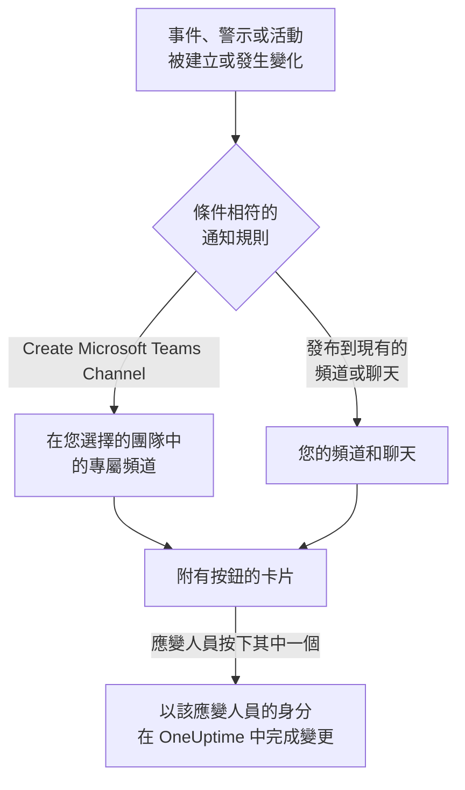

# Microsoft Teams

將 OneUptime 連接到 Microsoft Teams，即可把事件、警示、片段、排定維護、監測器和待命更新發布到您的頻道和聊天，為每個事件提供專屬頻道，並讓應變人員在 Teams 中操作：確認、解決、新增備註、呼叫待命人員、宣告事件以及詢問 OneUptime AI。

:::cards
- [連接 Microsoft Teams](#連接-microsoft-teams): 管理員同意、您的登入，以及每個團隊中的應用程式。
- [通知規則](#通知規則): 決定哪些事件發布到哪裡，以及哪些事件擁有專屬頻道。
- [與 OneUptime 機器人對話](#與-oneuptime-機器人對話): 在與機器人的聊天中使用指令、提問和表單。
- [從 Microsoft Teams 處理事件、警示和活動](#從-microsoft-teams-處理事件警示和活動): OneUptime 卡片上的按鈕。
:::

## 運作方式

這仰賴三樣東西：

- **專案的連接** 只需建立一次：Microsoft 365 管理員為您的組織同意 OneUptime 應用程式。
- **每個團隊中的 OneUptime 應用程式**，也就是您希望接收通知的每個團隊。Microsoft 只允許機器人在已新增它的團隊中發布訊息。
- **每個人自己的連接**：此人的 Microsoft Teams 帳戶連結到其 OneUptime 帳戶。按鈕、指令和回應都以此人的身分、依其在專案中的權限執行。

## 開始之前

- **可以連接專案的角色：** **Project Owner**、 **Project Admin** 或 **Project Member**。解除安裝需要 **Project Owner** 或 **Project Admin**。
- 一位 **Microsoft 365 管理員**，為整個組織授予一次管理員同意。
- 通知規則和摘要需要 **OneUptime Cloud 的 Growth 方案**。請參閱 [低於 Growth 方案時的通知規則](#低於-growth-方案時的通知規則)。
- **在自行託管的伺服器上，** 需要先為其設定好 Teams 機器人。請參閱 [Microsoft Teams 整合](/docs/self-hosted/microsoft-teams-integration)。

## 連接 Microsoft Teams

:::steps
### 授予管理員同意

前往 **專案設定** > **工作區** > **Microsoft Teams**，按一下 **授予管理員同意**。Microsoft 365 管理員登入，並為組織允許 OneUptime 應用程式。之後卡片會顯示 **Admin Consent Completed**。在連接工作區之前，事件、警示、排定維護、監測器和待命選單的 **工作區** 區段中有 **連線 Slack 或 Teams**，它同樣會帶您來到這裡。

### 連接您的帳戶

按一下 **Connect with Microsoft Teams**，並使用您的公司帳戶登入。OneUptime 會讀取您組織的團隊； **檢視團隊** 會列出它們。

### 將 OneUptime 應用程式新增到每個團隊（必要）

只連接您的帳戶還不夠。Microsoft 只允許 OneUptime 機器人在已新增它的團隊中發布訊息，因此請對每個希望接收通知的團隊執行以下操作：

- 在 Microsoft Teams 中，按一下 **團隊名稱** （而不是頻道名稱）旁邊的 "..."。
- 選擇 **Manage team** > **Apps** > **More apps**，找到 **OneUptime**，然後按一下 **Add**。

在 OneUptime Cloud 上， **開啟 Teams 商店** 會在 Microsoft Teams 市集中開啟該應用程式，在那裡使用 **Add to a team** 也能完成同樣的操作。在自行託管的伺服器上，請改為安裝 **下載應用程式資訊清單 Zip** 中的套件：只有它包含您伺服器的機器人。如果測試通知回報 OneUptime 應用程式未安裝在該團隊中，表示遺漏的正是這一步。

### 連接其他所有人

每個人都在 **使用者設定** > **工作區** > **Microsoft Teams** 中透過 **Connect my account with Microsoft Teams** 連結自己的 Microsoft Teams 帳戶，以便以本人身分處理事件並接收私人訊息。專案連接到 Microsoft Teams 後，該區段就會出現。

### 新增通知規則

前往 **事件** > **工作區** > **Microsoft Teams**。 **工作區** 區段只列出您的專案已連接的聊天工作區，因此 **Microsoft Teams** 會在連接後出現在那裡。建立一條規則（例如在建立事件時發布到 Teams 頻道的規則），然後在其所在列按一下 **測試規則**。
:::

> [!NOTE]
> 為您自己安裝 OneUptime，或將其新增到聊天中，是另一種安裝，並不能讓它向團隊的頻道發布訊息。 **私人頻道** 需要將應用程式新增到頻道本身：開啟頻道 > "..." > **Manage channel** > **Apps** > **Add an app**。 **共用頻道** 無法接收通知：Microsoft Teams 不支援在共用頻道中使用機器人。

## 通知規則

通知規則決定哪些事件發布到 Microsoft Teams，以及發布到哪裡。每個產品都有自己的規則，位於其選單的 **工作區** > **Microsoft Teams** 下：

| 產品 | 其 **Microsoft Teams** 頁面上的分頁 |
| --- | --- |
| **事件** | **事件**、 **事件 片段**、 **Summary** |
| **警示** | **警示**、 **警示 片段**、 **Summary** |
| **排定維護** | 一個規則清單 |
| **監測器** | 一個規則清單 |
| **待命** | 一個規則清單 |

建立規則分為四個步驟：

| 步驟 | 您設定的內容 |
| --- | --- |
| **基礎** | **規則名稱** 和 **規則描述**。 |
| **條件** | 規則針對哪些事件觸發，例如依嚴重程度、狀態、標籤、監測器或標題中的字詞。沒有條件時，規則對每個事件都會觸發。有兩個以上條件時， **符合條件** 決定是必須全部相符，還是相符任一個即可。 |
| **目標** | 發布到哪裡：您選擇的團隊中的現有頻道、您選擇的聊天、在您選擇的團隊中新建的頻道，或其中幾項的組合。 |
| **Video Call** | 僅限事件和警示：為每一個開始一次通話。請參閱 [視訊通話](/docs/workspace-connections/video-calls)。 |

規則建立的頻道以 **New Microsoft Teams Channel Name** 加上紀錄編號命名，例如 `oneuptime-incident-42`。只有建立的頻道才會接收規則邀請的人員。私人事件、警示或片段會獲得私人頻道。此後紀錄的每次更新（狀態變化、備註、新擁有者）都會發布到它的頻道和聊天。

**專案設定** > **工作區** > **Microsoft Teams** 列出 OneUptime 在您的團隊中看得到的頻道，以及已新增它的聊天，每一項旁邊都有 **傳送測試**。在 Microsoft Teams 中將 OneUptime 應用程式新增到聊天後，該聊天就會出現； **Refresh Chats** 會取得新的聊天及其目前名稱。

## 測試規則

規則所在列的 **測試規則** 會將該規則的測試訊息發布到它指定的頻道，讓您看到訊息送達。如果規則為每個事件建立頻道，測試也會建立一個頻道並邀請規則的相關人員。

與 **專案設定** > **工作區** > **Microsoft Teams** 中頻道旁的 **傳送測試** 一樣，它需要建立通知規則的權限： **Project Owner**、 **Project Admin**、 **Project Member**、 **Settings Admin**、 **Settings Member**，或自訂角色中的 **Create Workspace Notification Rule** 和 **Read Workspace Notification Rule**。對於只能檢視規則的人（例如 **Viewer** ）， **測試規則** 處於鎖定狀態，其工具提示會說明需要什麼；API 會以 "You do not have permission to send test notifications in this project." 拒絕其測試。在 OneUptime Cloud 上，測試規則與新增規則一樣需要 **Growth** 方案。

在 OneUptime Cloud 上，頻道或聊天旁的 **傳送測試** 同樣需要 **Growth** 方案，因為向頻道發布訊息正是規則和摘要所做的事。摘要上的 **立即發送測試** 需要建立摘要的權限（自訂角色中的 **Create Workspace Notification Summary** 和 **Read Workspace Notification Summary** ），在 OneUptime Cloud 上還需要 **Growth** 方案；對其他任何人它都處於鎖定狀態，其工具提示會說明需要什麼。以唯讀權限連接的 MCP 用戶端無法傳送任何測試。

## 摘要

**事件** > **工作區** > **Microsoft Teams** （以及 **警示** ）的 **Summary** 分頁會向您指定的頻道發布定期彙整：有多少事件或警示、它們被確認和解決的速度，以及附連結的清單。新的摘要每週傳送一次，涵蓋最近 7 天。將 **首次報告發送於** 留空，第一份摘要會在下一週、下一天或下一月開始時的 09:00 傳送；表單會顯示確切時間。

摘要依其 **時區** 的時鐘傳送，時區的初始值為您的時區。它全年在該時區維持同一時刻：設定為柏林 09:00 的摘要，在日光節約時間調整時鐘後仍會在柏林時間 09:00 傳送，其訊息中的日期也是柏林的日期。透過 API 時，請以 IANA 時區名稱傳送 `timezone`，例如 `Europe/Berlin`。未指定時區建立的摘要會使用建立者個人資料中的時區；由 API 金鑰建立時使用 UTC。

摘要表單有四個步驟： **基本資訊** （名稱、頻道及其 **團隊名稱** ）、 **排程**、 **內容** （ **要包含的內容** ）和 **篩選器** （統計哪些事件或警示）。

## 低於 Growth 方案時的通知規則

在 OneUptime Cloud 上，通知規則和摘要屬於 **Growth** 以上方案。低於該方案的專案會保留已有的規則和摘要，它們會繼續向 Microsoft Teams 發布。因此，每個產品（事件、警示、排定維護、待命、監測器）的 **Microsoft Teams** 頁面都會顯示方案說明，並在下方列出它們（ **仍在設定中的通知規則**、 **仍在設定中的摘要** ）：刪除規則，或關閉或刪除摘要。新增或變更規則和摘要需要 **Growth**。

## 在 Microsoft Teams 中接收呼叫

要在待命時透過私人訊息接收呼叫，請將 Microsoft Teams 新增為您的通知方式之一：

:::steps
1. 連接您自己的 Microsoft Teams 帳戶（請參閱 [連接 Microsoft Teams](#連接-microsoft-teams) ）。
2. 前往 **使用者設定** > **通知方式**，開啟 **Workspace Apps** 分頁，然後按一下 **Add Microsoft Teams Account**。
3. 在其所在列按一下 **Send Test Message**。訊息會送到您的 Microsoft Teams 聊天。
:::

新增後，它會立即加入您的待命規則，因此從那時起呼叫會透過 Microsoft Teams 送達您。在 **使用者設定** > **待命規則** 中變更它接收哪些呼叫。

## 將訊息儲存為備註

在 OneUptime 為事件、警示、片段或排定維護活動建立的頻道中，對一則訊息或回覆加上回應，OneUptime 就會將其儲存為該紀錄的備註。它會在一分鐘內偵測到回應，並在討論串中回覆確認：

| 回應 | 儲存為 |
| --- | --- |
| 📌 或 📍 | 僅您的團隊可見的私人備註 |
| 📣 或 📢 | 顯示在狀態頁面上的公開備註。僅限事件和排定維護活動。 |

備註以您的身分、依您的權限儲存，因此您自己的 Microsoft Teams 帳戶必須已連接，並且 OneUptime 應用程式必須在該團隊中。

## 與 OneUptime 機器人對話

在個人聊天中傳訊息給機器人，或在頻道或群組聊天中 @提及 OneUptime：在頻道和群組聊天中，它只在被提及時回覆。

| 訊息 | 機器人的動作 |
| --- | --- |
| `help` | 列出它能做的事。 |
| `ask <question>`，或任何日常語言的問題 | OneUptime AI 回答有關記錄、追蹤、指標、事件和監測器的問題，例如「現在有哪些監測器停擺了？」。回答只讀取資料。 |
| `create incident [title]` | 開啟已填好標題的事件表單。 |
| `create maintenance [title]` | 開啟已填好標題的排定維護表單。 |
| `show active incidents`、 `show active alerts` | 列出目前尚未結束的項目。 |
| `show scheduled maintenance`、 `show ongoing maintenance` | 列出即將進行或正在進行的維護活動。 |

詢問 OneUptime AI 需要為專案開啟 AI。請參閱 [詢問 AI](/docs/ai/ask-ai)。

## 從 Microsoft Teams 建立事件和維護

向 OneUptime 機器人輸入 `create incident` 或 `create maintenance`，無論是在個人聊天、頻道還是群組聊天中，都會為輸入的人開啟一個表單。表單以此人的身分填寫：也就是以其 Microsoft Teams 帳戶所連接的 OneUptime 帳戶的身分（請參閱 [連接 Microsoft Teams](#連接-microsoft-teams) ），依該帳戶在專案中的權限提交。帳戶未連接的人，或 OneUptime 帳戶已不再是專案成員的人，會收到該怎麼做的說明，而不是表單。

- **誰可以使用。** 能在 OneUptime 中宣告事件或建立排定維護活動的人：對於事件，是 **Project Owner**、 **Project Admin**、 **Project Member**、 **Incident Admin** 和 **Incident Member** （自訂角色中的 **Create Incident** ）；對於活動，是 **Scheduled Maintenance Admin** 和 **Scheduled Maintenance Member** （ **Create Scheduled Maintenance** ）。其他任何人都會收到告知，並且得不到表單。
- **表單提供什麼。** 每個清單（嚴重程度、監測器、監測器狀態、待命策略和標籤）都包含要求表單的人可以讀取的內容，與 OneUptime 中的同一清單一致，卡片上的 "not shown" 說明也只計算這些：如果角色僅限於某些標籤，則為帶有這些標籤的監測器和待命策略。此人完全無法讀取的清單會被省略。已封存的待命策略永遠不會提供。
- **表單可以指定什麼。** 在頻道或群組聊天中，任何在場的人都可以提交表單，並且以提交者的身分、依其自己的權限提交。事件或活動以這些權限建立，並記在此人名下。此人無法讀取的監測器、待命策略、標籤、嚴重程度或狀態，或屬於其他專案的，都會像專案中不存在一樣被拒絕，並且不會建立任何內容：機器人會回覆 "One of the values you picked ... is not available in this project any more. Please pick it again."

事件、警示或片段上的 **Execute On-Call Policy** 也以同樣方式運作：它需要執行待命策略的權限（ **Project Owner**、 **Project Admin**、 **Project Member**、 **On-Call Admin** 和 **On-Call Member**，或自訂角色中的 **Create On-Call Duty Policy Execution Log** ）以及讀取該事件、警示或片段的權限，並提供此人可以讀取的有效待命策略。從卡片檢視監測器或待命策略時，也會以按下按鈕的人的身分讀取。

## 從 Microsoft Teams 處理事件、警示和活動

OneUptime 卡片上的按鈕以按下者的身分執行，無論是在個人聊天、頻道還是群組聊天中：也就是以其 Microsoft Teams 帳戶所連接的 OneUptime 帳戶的身分，依該帳戶在專案中的權限執行。事件、警示或片段上的 **Acknowledge**、 **Resolve**、 **Change State**、 **Add Note** 和 **Execute On-Call Policy**，以及排定維護活動上的 **Mark as Ongoing**、 **Mark as Complete**、 **Change State** 和 **Add Note**，各自會做出與 OneUptime 中相同操作一樣的變更，並在那裡記在此人名下：紀錄的狀態時間軸和動態會顯示是誰變更了其狀態，備註也歸此人所有。透過回應從訊息儲存的備註也以同樣方式發布。

- **誰可以使用。** 能在 OneUptime 中做出同樣變更的人。確認、解決事件或變更其狀態需要變更其狀態的權限： **Project Owner**、 **Project Admin**、 **Project Member**、 **Incident Admin** 和 **Incident Member**，或自訂角色中的 **Create Incident State Timeline**。警示、片段或排定維護活動需要其自身類型的同等權限（例如 **Create Alert State Timeline** ），備註需要發布該類備註的權限。與 OneUptime 中的狀態面板一樣，它們不要求編輯事件或警示本身的權限。其他任何人都會收到告知，並且不會有任何變更。
- **哪些紀錄。** 與在 OneUptime 中一樣，是此人可以讀取的紀錄：如果角色僅限於某些標籤，則為帶有這些標籤的事件、警示、片段和活動。任何其他紀錄或其他專案的紀錄上的按鈕，都會得到該紀錄 "was not found in this project, or you do not have access to it." 的回覆，並且不會有任何變更。在 OneUptime Cloud 上，專案方案不包含的變更會被拒絕，並說明所需的方案。
- **Change State 提供什麼。** 依專案的順序，提供此人可以讀取、紀錄接下來可以轉入的狀態：不會提供早於其目前狀態的狀態，片段與事件、警示或排定維護活動一樣，因為狀態變更永遠不會讓紀錄在其清單中回退（請參閱 [順序是真正的限制，而不是顯示偏好](/docs/incidents/states-and-severities#順序是真正的限制而不是顯示偏好) ）。如果此人一個都無法讀取，機器人會說 "No incident states are available to you in this project. Ask a project admin for access to them."；如果紀錄處於它能到達的最後一個狀態，則會說 "There is no later state to move this incident to."。這兩種情況都不會顯示空白卡片。
- **Escalate.** 卡片上的 **Escalate** 會針對卡片所涉及的事件、警示或片段執行其待命策略，以按下者的身分，並使用與 **Execute On-Call Policy** 相同的權限。不涉及其中任何一種的卡片會得到 "This on-call policy can only be executed for an incident, an alert or an episode. Open the record you are paging about and use Execute On-Call Policy there." 的回覆，並且不會呼叫任何人。

## 中斷連接

- **Disconnect** 只解除您自己的 Microsoft Teams 帳戶的連結，並同時移除您的 Microsoft Teams 通知方式。
- **專案設定** > **工作區** > **Microsoft Teams** 上的 **Uninstall OneUptime from Microsoft Teams** 會中斷專案的連接。OneUptime 停止向 Microsoft Teams 發布，並且 **工作區** 選單不再列出它。通知規則和摘要會被保留，以便您再次連接時使用。

> [!WARNING]
> 解除安裝也會解除專案中每位成員自己的 Microsoft Teams 帳戶的連結，並移除 Microsoft Teams 通知方式以及使用它們的待命規則。一個專案只連接到一個 Microsoft 365 組織：要將其移到另一個組織，請先解除安裝。

## 疑難排解

:::details 測試提示 OneUptime 應用程式未安裝在該團隊中
Microsoft 拒絕了發布，因為機器人不在該團隊中。將應用程式新增到該團隊（請參閱 [連接 Microsoft Teams](#連接-microsoft-teams) ），如果是私人頻道，則新增到頻道本身。新增到一個團隊對其他團隊沒有任何作用。
:::

:::details Microsoft Teams 未連接
當 Microsoft 未完成連接就把您送回時，您開始的頁面會顯示 **Microsoft Teams 未連接**，並用一句話說明原因：您缺少權限、連結已被使用或已過期、您登入了另一個 Microsoft 365 組織，或您的組織還沒有團隊。每句話的含義和處理方法請參閱 [連接未完成](/docs/self-hosted/microsoft-teams-integration#連接未完成)。
:::

:::details 機器人提示我的帳戶未連接
在登入專案所連接的組織的情況下，在 **使用者設定** > **工作區** > **Microsoft Teams** 中透過 **Connect my account with Microsoft Teams** 連結它。來自其他組織的來賓帳戶不是同一個帳戶。
:::

:::details 在自行託管的伺服器上所有通知都失敗
安裝在您團隊中的 Teams 應用程式必須是您的伺服器產生的套件，並且 Microsoft 必須能夠存取您伺服器的機器人端點。請參閱 [Microsoft Teams 整合](/docs/self-hosted/microsoft-teams-integration#疑難排解) 的疑難排解。
:::

## 後續步驟

:::cards
- [Slack](/docs/workspace-connections/slack): 在 Slack 中使用相同的通知和操作。
- [視訊通話](/docs/workspace-connections/video-calls): 為每個事件提供一次通話，並隨其更新一起發布。
- [Microsoft Teams 整合](/docs/self-hosted/microsoft-teams-integration): 在自行託管的伺服器上設定 Teams 機器人。
- [宣告事件](/docs/incidents/declaring-incidents): 事件開始的所有方式，以及開始時會執行什麼。
:::
