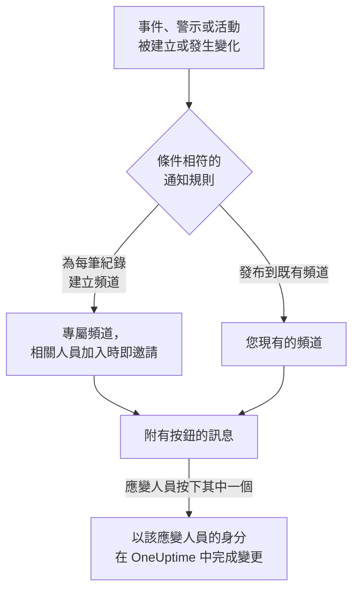

# Slack

將 OneUptime 連接到 Slack，即可把事件、警示、片段、排定維護、監測器和待命更新發布到您的頻道，為每個事件提供專屬頻道，並讓應變人員不必離開 Slack 就能操作：確認、解決、新增備註、呼叫待命人員以及宣告事件。

:::cards
- [連接 Slack](#連接-slack): 在您的工作區中安裝 OneUptime，然後連結您自己的帳戶。
- [請所有人連接帳戶](#請所有人連接帳戶): 一次傳送訊息給每位尚未連接帳戶的成員。
- [通知規則](#通知規則): 決定哪些事件發布到哪裡，以及哪些事件擁有專屬頻道。
- [紀錄頻道中的成員](#紀錄頻道中的成員): 在紀錄的頁面上查看頻道中有誰、加入頻道並新增成員。
- [/oneuptime 指令](#oneuptime-指令): 宣告事件、排定維護、查看誰在待命，以及詢問 AI。
- [待命使用者群組](#待命使用者群組): 讓使用者群組與待命人員保持一致，並呼叫它。
- [從 Slack 處理事件、警示和活動](#從-slack-處理事件警示和活動): OneUptime 訊息上的按鈕。
:::

## 運作方式

這仰賴兩種連接：

- **專案的連接** 只需建立一次：安裝在您的 Slack 工作區中的 OneUptime 應用程式。它會發布訊息、建立頻道並邀請人員。
- **每個人自己的連接**：此人的 Slack 帳戶連結到其 OneUptime 帳戶。按鈕、指令和表情符號回應都以此人的身分、依其在專案中的權限執行。

一個 Slack 工作區可以連接到多個專案，例如正式環境與測試環境。按鈕或表單會在其所涉及紀錄的專案中執行。指令或傳給 OneUptime 的訊息會在其所在頻道（例如事件的頻道）的專案中執行，否則會在您的 Slack 帳戶所連接的唯一專案中執行。如果無法據此判斷，OneUptime 會詢問您指的是哪個專案，並為您所在的每個專案顯示一個按鈕，您選擇後即在該專案中繼續。在與 OneUptime AI 的對話中，您的選擇在該討論串的其餘部分中保持有效。

## 開始之前

- **可以連接專案的角色：** **專案擁有者**、 **專案管理員** 或 **專案成員**。解除安裝應用程式需要 **專案擁有者** 或 **專案管理員**。
- 一個您可以安裝應用程式的 **Slack 工作區**。
- 通知規則和摘要需要 **OneUptime Cloud 的 Growth 方案**。請參閱 [低於 Growth 方案時的通知規則](#低於-growth-方案時的通知規則)。
- **在自行託管的伺服器上，** 需要先為其設定好 Slack 應用程式。請參閱 [Slack 整合](/docs/self-hosted/slack-integration)。

## 連接 Slack

:::steps
### 在您的 Slack 工作區中安裝 OneUptime

前往 **專案設定** > **工作區** > **Slack**，按一下 **Connect with Slack**。選擇工作區並授權 OneUptime。Slack 會將您送回同一頁面，頁面上現在會顯示專案所連接的工作區。在連接工作區之前，事件、警示、排定維護、監測器和待命選單的 **工作區** 區段中有 **連線 Slack 或 Teams**，它同樣會帶您來到這裡。

### 連接您自己的 Slack 帳戶

安裝應用程式會連結安裝者的帳戶。其他所有人都在 **使用者設定** > **工作區** > **Slack** 中透過 **Connect my account with Slack** 連結自己的 Slack 帳戶，以便以本人身分處理事件並接收私人訊息。專案連接到 Slack 後，該區段就會出現。如需讓整個團隊一次完成連接，請參閱 [請所有人連接帳戶](#請所有人連接帳戶)。

### 新增通知規則

前往 **事件** > **工作區** > **Slack**。 **工作區** 區段只列出您的專案已連接的聊天工作區，因此 **Slack** 會在連接後出現在那裡。建立一條規則，例如為每個新事件建立一個 Slack 頻道，並讓所有處理它的人加入：被呼叫的人員、事件指揮官和擁有者。請參閱 [通知規則](#通知規則)。

### 測試這條規則

在規則所在列按一下 **測試規則**。測試訊息會送到規則指定的頻道。請參閱 [測試規則](#測試規則)。
:::

## 請所有人連接帳戶

任何人都無法替他人連接 Slack 帳戶，管理員也不例外：每個人都必須親自登入自己的帳戶。若要讓整個團隊完成連接，可由 **專案擁有者** 或 **專案管理員** 在 **專案設定** > **工作區** > **Slack** 中一次請所有人連接。 **Members' Slack accounts** 卡片會顯示已有多少成員完成連接。 **Ask everyone to connect** 會由 OneUptime 在 Slack 中傳送一則私人訊息給每位尚未連接的成員，並附上一個 **Connect Slack account** 按鈕，只要按一下即可連接其帳戶。

- **誰會收到訊息。** 專案中每位尚未連接 Slack 帳戶的成員，透過其電子郵件地址在 Slack 中找到。過去 24 小時內已請求過的人不會再次收到請求，因此隔天再請一次時，只會提醒仍未連接的人。
- **卡片顯示的內容。** 訊息傳送期間顯示傳送進度，之後顯示是誰提出請求，以及有多少成員收到訊息。OneUptime 無法透過電子郵件地址在 Slack 中找到的成員，會在卡片上列出姓名：他們需要自行在 **使用者設定** > **工作區** > **Slack** 中連接。
- **按鈕連接的帳戶。** 按下按鈕並登入的人的 Slack 帳戶，會連接到此人自己的 OneUptime 帳戶。轉給他人的訊息，不會為原本收到訊息的成員連接任何帳戶。

## 通知規則

通知規則決定哪些事件發布到 Slack，以及發布到哪裡。每個產品都有自己的規則，位於其選單的 **工作區** > **Slack** 下：

| 產品 | 其 **Slack** 頁面上的分頁 |
| --- | --- |
| **事件** | **事件**、 **事件 片段**、 **摘要** |
| **警示** | **警示**、 **警示 片段**、 **摘要** |
| **排定維護** | 一個規則清單 |
| **監測器** | 一個規則清單 |
| **待命** | 一個規則清單 |

建立規則分為四個步驟：

| 步驟 | 您設定的內容 |
| --- | --- |
| **基礎** | **規則名稱** 和 **規則描述**。 |
| **條件** | 規則適用於哪些事件，例如依嚴重程度、狀態、標籤、監測器或標題中的字詞。條件會在事件建立時檢查，並在 OneUptime 每次發布關於它的更新時再次檢查，因此針對已確認事件的規則會在事件被確認時生效。新規則適用於所有事件，例如 **所有事件** 。要縮小範圍，請選擇 **僅符合條件的事件** 並新增條件。有兩個以上條件時， **符合條件** 決定是必須全部相符，還是相符任一個即可。 |
| **目標** | 發布到哪裡：附頻道名稱的 **發布到既有頻道** 、附加入人員的 **為每個事件建立頻道** （警示、片段、排定維護、監測器或待命策略亦同），或兩者兼有。步驟下方的 **此規則的作用** 會像規則卡片一樣，用句子說明規則的作用。 |
| **Video Call** | 僅限事件和警示：為每一個開始一次通話。請參閱 [視訊通話](/docs/workspace-connections/video-calls)。 |

規則建立的頻道以其紀錄命名：事件 INC-42 得到 `inc-42`，警示 ALT-7 得到 `alt-7`；在沒有編號前綴的專案中，事件 42 得到 `incident-42`。 **頻道名稱前綴** 中的文字放在名稱前面，因此 `prod-` 會得到 `prod-inc-42`，表單會在您輸入時顯示名稱。對於排定維護事件，前綴會取代其編號前綴：SM-5 得到 `sm-5`，`maint-` 會得到 `maint-5`。Slack 只接受小寫字母、數字、`-` 和 `_`，最多 80 個字元。如果已有同名頻道（例如其他專案的頻道或已封存的頻道），OneUptime 會加上 `-2`、`-3` 等。

規則的頻道會在事件首次符合該規則時建立：在事件建立時，或之後在事件仍未結束時，由某次更新使其符合時。針對已確認事件的規則會在事件被確認時建立頻道。私人事件、警示或片段會獲得私人頻道。

**誰會加入頻道** 列出規則會把哪些人加入其頻道，每個人在加入紀錄時就會被加入，而不只是在建立頻道時： **待命回應人員（被呼叫時）** 、 **事件指揮官及其他事件角色（被指派時）** （事件和事件片段）和 **擁有者（被新增時）** ，新規則中預設全部勾選；另外， **另外邀請** 中的人員、團隊和待命排程會在建立頻道時加入。事件指揮官通常在有人首次確認事件時被指派，並在那時加入其頻道。在事件角色有自己的核取方塊之前儲存的規則，會在新增擁有者或待命回應人員時一併新增事件角色，其核取方塊顯示為已勾選。規則發布到的現有頻道不會加入任何人。

對於 **另外邀請** 中的待命排程，建立頻道時該排程中正在待命的人會加入頻道（以該待命排程頁面上顯示的為準），且不會被呼叫。如果只想把某些人加入部分事件的頻道，請為第二條規則設定這些條件和這些人員，並使用與第一條規則相同的 **頻道名稱前綴**：在事件的頻道建立時符合該事件的規則會共用該頻道，並各自加入自己的人員。

此後紀錄的每次更新（狀態變化、備註、新擁有者）都會發布到它的頻道，並在規則的條件符合期間發布到其規則指定的現有頻道。開啟 **事件解決後封存頻道** （或警示、片段、排定維護、監測器和待命策略的同類開關）後，建立頻道的規則會在紀錄解決、完成或刪除時封存該頻道，無論屆時其條件如何。建立時即已解決的事件、警示或片段不會獲得專屬頻道；其建立訊息仍會送到您的規則指定的頻道。請參閱 [宣告時即已確認或已解決](/docs/incidents/declaring-incidents#宣告時即已確認或已解決)。

擁有專屬頻道的事件、警示、片段或排定維護事件，會在其 OneUptime 頁面標題的狀態按鈕旁顯示 **在 Slack 中開啟**。它會在新分頁中開啟該頻道，進入 Slack 應用程式或瀏覽器。擁有兩個專屬頻道的紀錄會在按鈕下列出這兩個頻道。在 Slack 和 Microsoft Teams 中都有頻道的紀錄，會改為只顯示一個 **開啟頻道** 按鈕，列出所有頻道。不會提供您的規則所發布到的現有頻道。

頻道保持易讀：每次更新只發布一次，紀錄的第一個狀態寫在宣布該紀錄的訊息裡，而不是單獨發一則訊息。待命策略的一次執行就是一則訊息，隨著上報推進而被編輯：呼叫了誰、呼叫了幾次以及透過什麼方式、誰沒有被呼叫以及原因、誰確認了。只有在需要有人採取行動時才會發布新訊息：某條上報規則沒有呼叫到任何人，或者執行結束時仍沒有人確認。Slack 帳戶未連接到 OneUptime 的人，OneUptime 會加入使用其電子郵件地址的那個 Slack 帳戶。OneUptime 用這兩種方式都找不到的人，或在 Slack 中是訪客的人，無法被加入頻道；OneUptime 在每個頻道中只說一次，用一則列出所有這些人的訊息，名單變長時編輯這則訊息。把該訊息中的 **Connect Slack account** 連結傳給他們，即可一步連接帳戶。紀錄的擁有者或狀態頁面訂閱者已收到通知這件事，保留在 OneUptime 中該紀錄的動態裡。

**專案設定** > **工作區** > **Slack** 列出 OneUptime 看得到的頻道，每個頻道旁邊都有 **傳送測試**。OneUptime 第一次在公開頻道發布時會自行加入。私人頻道只有在 Slack 中邀請 OneUptime 應用程式加入後，才會被列出並可以發布訊息。

## 紀錄頻道中的成員

擁有專屬 Slack 頻道的事件、警示、片段或排定維護事件，在其 OneUptime 頁面上有一張 **Slack 頻道** 卡片。卡片顯示該頻道（一個在 Slack 中開啟它的連結）、它是否為私人頻道，以及頻道中有誰，您排在最前面。無需 Slack 管理員，即可在卡片上：

- **加入頻道** 會在您不在頻道中時把您加入頻道。
- **新增成員** 會開啟專案的人員和團隊清單：選擇一個人即新增此人，選擇一個團隊即新增其中的所有人。

由 OneUptime 應用程式新增他們，就像它為規則的頻道新增人員一樣。應用程式會一直留在它建立的頻道中，所以即使所有人都已離開私人頻道，也能這樣重新進入。

- **誰可以新增成員。** 可以編輯該紀錄的人：對於事件，是 **專案擁有者**、 **專案管理員**、 **專案成員**、 **事件管理員** 和 **事件成員**，或自訂角色中的 **Edit Incident**；對於警示、片段或排定維護事件，則是其各自類型的相同權限（例如 **Edit Alert**）。其他人可以看到頻道中有誰，以及如何進入。
- **可以新增誰。** OneUptime 能在 Slack 中找到的人：透過此人已連接的 Slack 帳戶，否則透過 Slack 中此人的電子郵件地址。卡片會列出無法新增的人及原因，例如被 Slack 擋在頻道之外的訪客。
- **會記錄什麼。** 誰被新增、由誰新增，都記錄在該紀錄的動態中（ **已新增頻道成員** ），以及 **專案設定** > **通知** > **通知日誌** 的 **工作區** 分頁中。
- **移出某人。** OneUptime 只會新增成員：請在 Slack 中將某人移出頻道。

## 測試規則

規則所在列的 **測試規則** 會將該規則的測試訊息發布到它指定的頻道，讓您看到訊息送達。如果規則為每個事件建立頻道，測試也會建立一個頻道並邀請規則的相關人員。

與 **專案設定** > **工作區** > **Slack** 中頻道旁的 **傳送測試** 一樣，它需要建立通知規則的權限： **專案擁有者**、 **專案管理員**、 **專案成員**、 **設定管理員**、 **設定成員**，或自訂角色中的 **Create Workspace Notification Rule** 和 **Read Workspace Notification Rule**。對於只能檢視規則的人（例如 **檢視者** ）， **測試規則** 處於鎖定狀態，其工具提示會說明需要什麼；API 會以 "You do not have permission to send test notifications in this project." 拒絕其測試。在 OneUptime Cloud 上，測試規則與新增規則一樣需要 **Growth** 方案。

在 OneUptime Cloud 上，頻道旁的 **傳送測試** 同樣需要 **Growth** 方案，因為向頻道發布訊息正是規則和摘要所做的事。摘要上的 **立即發送測試** 需要建立摘要的權限（自訂角色中的 **Create Workspace Notification Summary** 和 **Read Workspace Notification Summary** ），在 OneUptime Cloud 上還需要 **Growth** 方案；對其他任何人它都處於鎖定狀態，其工具提示會說明需要什麼。以唯讀權限連接的 MCP 用戶端無法傳送任何測試。

## 摘要

**事件** > **工作區** > **Slack** （以及 **警示** ）的 **摘要** 分頁會向您指定的頻道發布定期彙整：有多少事件或警示、它們被確認和解決的速度，以及附連結的清單。新的摘要每週傳送一次，涵蓋最近 7 天。將 **首次報告發送於** 留空，第一份摘要會在下一週、下一天或下一月開始時的 09:00 傳送；表單會顯示確切時間。

摘要依其 **時區** 的時鐘傳送，時區的初始值為您的時區。它全年在該時區維持同一時刻：設定為柏林 09:00 的摘要，在日光節約時間調整時鐘後仍會在柏林時間 09:00 傳送，其訊息中的日期也是柏林的日期。透過 API 時，請以 IANA 時區名稱傳送 `timezone`，例如 `Europe/Berlin`。未指定時區建立的摘要會使用建立者個人資料中的時區；由 API 金鑰建立時使用 UTC。

摘要表單有四個步驟： **基本資訊** （名稱和頻道）、 **排程**、 **內容** （ **要包含的內容** ）和 **篩選器** （統計哪些事件或警示）。

## 低於 Growth 方案時的通知規則

在 OneUptime Cloud 上，通知規則和摘要屬於 **Growth** 以上方案。低於該方案的專案會保留已有的規則和摘要，它們會繼續向 Slack 發布。因此，每個產品（事件、警示、排定維護、待命、監測器）的 **Slack** 頁面都會顯示方案說明，並在下方列出它們（ **仍在設定中的通知規則**、 **仍在設定中的摘要** ）：刪除規則，或關閉或刪除摘要。新增或變更規則和摘要需要 **Growth**。

## 在 Slack 中接收呼叫

要在待命時透過私人訊息接收呼叫，請將 Slack 新增為您的通知方式之一：

:::steps
1. 連接您自己的 Slack 帳戶（請參閱 [連接 Slack](#連接-slack) ）。
2. 前往 **使用者設定** > **通知方式**，開啟 **Workspace Apps** 分頁，然後按一下 **Add Slack Account**。
3. 在其所在列按一下 **Send Test Message**。訊息會送到您的 Slack 私人訊息。
:::

新增後，它會立即加入您的待命規則，因此從那時起呼叫會透過 Slack 送達您。在 **使用者設定** > **待命規則** 中變更它接收哪些呼叫。

## 將訊息儲存為備註

在事件、警示、片段或排定維護活動的頻道中對一則訊息加上表情符號回應，OneUptime 就會將該訊息儲存為該紀錄的備註，然後在討論串中回覆確認：

| 回應 | 儲存為 |
| --- | --- |
| 📌 圖釘表情符號，或 Slack 內建的 **Pin to channel** | 僅您的團隊可見的私人備註 |
| 📢 擴音器或喇叭表情符號 | 顯示在狀態頁面上的公開備註。僅限事件和排定維護活動。在私人事件上為私人備註，確認訊息會說明原因。 |

備註會保留訊息在 Slack 中的樣子：格式、連結和程式碼，以名字顯示的被提及的人和頻道，以及指向其檔案和圖片的連結。公開備註會去掉檔案和圖片，因為它們只對您的團隊開放。

備註是寫這則訊息的人的原話：如果此人的 Slack 帳戶已連接，顯示其 OneUptime 名稱，否則顯示 Slack 中的名字。私人備註無論多久之後才儲存，都會排在時間軸上訊息發布的時間點。公開備註排在儲存的時間點，狀態頁面也從那時起顯示它。時間軸會顯示是誰儲存的。備註不會再發回頻道，因為訊息已經在那裡了。

備註以您的身分、依您的權限儲存。如果您的 Slack 帳戶尚未連接，OneUptime 會在一則只有您能看到的訊息中請您連接，並附上一個按鈕，您一連接就會儲存該訊息。無論多少人回應，一則訊息只會儲存一次。

## /oneuptime 指令

OneUptime 在 Slack 中只有一個指令：`/oneuptime`。在它後面輸入的詞決定要做什麼；後面的其他任何內容都是向 OneUptime AI 提出的問題。

| 指令 | 作用 |
| --- | --- |
| `/oneuptime help` | 列出所有指令，並附範例。 |
| `/oneuptime incident [title or number]` | 開啟已填好標題的事件表單。如果寫的是事件編號，例如 `42` 或 `INC-42`，則改為顯示該事件：請參閱 [從 Slack 管理一個事件](#從-slack-管理一個事件)。 |
| `/oneuptime maintenance [title]` | 開啟已填好標題的排定維護表單。 |
| `/oneuptime oncall` | 列出您看得到的每個待命排程中目前由誰待命、待命到何時，以及下一位是誰。 |
| `/oneuptime page [who] [message]` | 就您的訊息呼叫您 @提及的人，或開啟一個表單來選擇要呼叫的人。請參閱 [從 Slack 呼叫他人](#從-slack-呼叫他人)。 |
| `/oneuptime ask [question]`，或任何問題 | OneUptime AI 回答有關記錄、追蹤、指標、事件和監測器的問題。 |

對 `help` 和 `oncall` 的回答是只有您看得到的訊息，顯示在指令下方。如果第一個詞看起來像拼錯的指令，例如 `incidnet`，您會收到與它相似的指令，而不是 OneUptime AI 的回答。事件和維護表單以您本人的身分操作：請參閱 [從 Slack 建立事件和維護](#從-slack-建立事件和維護)。

> [!NOTE]
> `/oneuptime incident` 和 `/oneuptime maintenance` 取代了 `/incident` 和 `/maintenance`，後兩者可能與其他 Slack 應用程式的同名指令衝突。用較早的資訊清單建立的 Slack 應用程式會保留它們，在應用程式更新之前，它們會開啟相同的表單：請參閱 [用較舊資訊清單建立的應用程式](/docs/self-hosted/slack-integration#用較舊資訊清單建立的應用程式)。

## Slack 中的 OneUptime 首頁

在 Slack 側邊欄的 **Apps** 下開啟 OneUptime，它的 **Home** 分頁會依您有權查看的範圍顯示專案中正在發生的事情，每次開啟時都會重新讀取。

- **您的待命。** 您目前正在待命的待命排程及其結束時間，否則是您的下一個班次。
- **未解決的內容。** 您有權讀取的最新未解決事件和警示，每一項都連結到它在 OneUptime 中的頁面。
- **按鈕。** **Declare incident** 、 **Schedule maintenance** 和 **Page someone** 開啟的表單與 `/oneuptime incident` 、 `/oneuptime maintenance` 和 `/oneuptime page` 相同， **Who's on call** 的回答與 `/oneuptime oncall` 相同。

首頁以您的身分讀取，因此需要連接您自己的 Slack 帳戶。在連接之前，首頁上會有一個 **Connect Slack account** 按鈕，連接後會立即顯示您的首頁。

當有人把 OneUptime 新增到頻道時，它會在那裡發佈一則問候：如何向它提問，以及在哪裡新增發佈到該頻道的通知規則。第一次開啟它的 **Messages** 分頁時，它會在那裡歡迎您：說明它在 Slack 中做什麼，以及如何開始。

## 從 Slack 詢問 OneUptime AI

用日常語言詢問有關記錄、追蹤、指標、事件和監測器的問題。在頻道中 @提及 OneUptime，或傳送私人訊息給它，它會在討論串中回答。 `/oneuptime ask which monitors are down?` 會將答案發布到頻道中。兩種方式都需要連接您自己的 Slack 帳戶，並為專案開啟 AI。Slack 中的回答只讀取資料：要變更內容，請使用按鈕。請參閱 [詢問 AI](/docs/ai/ask-ai)。

OneUptime 只回答傳給它的內容。

- **在您自己的對話中，直接回覆即可。** 在頻道中（而不是在討論串中）提出的問題，會在其下方的討論串中開始一段對話：在那裡回覆即可繼續提問，無需再次提及 OneUptime；其他人提及它即可加入對話。
- **在其他任何討論串中，請提及 OneUptime。** 例如在事件訊息下方的討論串中，請每次都提及它：人們在那裡互相傳送的內容不會得到回答。
- **如果您的 Slack 帳戶未連接。** OneUptime 會在每段對話中請您連接一次，以只有您看得到的訊息，並附上一個 **Connect Slack account** 按鈕。

## 從 Slack 建立事件和維護

`/oneuptime incident` 和 `/oneuptime maintenance` 會開啟一個表單，由您以本人身分填寫並提交：也就是以您的 Slack 帳戶所連接的 OneUptime 帳戶的身分（請參閱 [連接 Slack](#連接-slack) ），依該帳戶在專案中的權限提交。如果您的 Slack 帳戶未連接，或您的 OneUptime 帳戶已不再是專案成員，OneUptime 會在您執行命令的地方，以只有您看得到的訊息告訴您該怎麼做，並且不會開啟表單。 **Create New Incident** 和 **Create Scheduled Event** 捷徑會開啟相同的表單。

- **誰可以使用。** 能在 OneUptime 中宣告事件或建立排定維護活動的人：對於事件，是 **專案擁有者**、 **專案管理員**、 **專案成員**、 **事件管理員** 和 **事件成員** （自訂角色中的 **Create Incident** ）；對於活動，是 **排定維護管理員** 和 **排定維護成員** （ **Create Scheduled Maintenance** ）。其他任何人都會在執行命令的地方收到告知，並且不會開啟表單。
- **表單提供什麼。** 每個清單（嚴重程度、監測器、監測器狀態、待命策略和標籤）都包含您可以讀取的內容，與 OneUptime 中的同一清單一致：如果角色僅限於某些標籤，則為帶有這些標籤的監測器和待命策略。您完全無法讀取的清單不會出現在表單中。已封存的待命策略永遠不會提供。
- **表單可以指定什麼。** 事件或活動以您自己的權限建立，並記在您名下。您無法讀取的監測器、待命策略、標籤、嚴重程度或狀態，或屬於其他專案的，都會像專案中不存在一樣被拒絕，即使表單是在您的權限變化之前開啟的，也不會建立任何內容。OneUptime 會在頻道中，以只有您看得到的訊息告訴您原因。

事件、警示或片段上的 **Execute On-Call Policy** 也以同樣方式運作：它需要執行待命策略的權限（ **專案擁有者**、 **專案管理員**、 **專案成員**、 **待命管理員** 和 **待命成員**，或自訂角色中的 **Create On-Call Duty Policy Execution Log** ）以及讀取該事件、警示或片段的權限，並提供您可以讀取的有效待命策略。

## 從 Slack 呼叫他人

`/oneuptime page @nawaz The checkout API is throwing 500s` 會立即呼叫 Nawaz。OneUptime 會建立一則以您的訊息為標題的警示，您 @提及的每個人都會依其本人的待命規則收到電話、簡訊、推播通知或電子郵件，直到有人確認該警示。

- **立即被呼叫的人。** 您 @提及的人，以及您 @提及的使用者群組所連結待命排程中正在待命的人，前提是其後跟有訊息（請參閱 [待命使用者群組](#待命使用者群組)）。OneUptime 透過此人的 Slack 帳戶所連接的 OneUptime 帳戶識別此人，否則透過 Slack 中此人的電子郵件地址識別。專案以外的人不會被呼叫。
- **其他情況會開啟表單。** 如果沒有 @提及任何人、沒有訊息、提及了 `@here` 或未連結您可見待命排程的使用者群組，或有 OneUptime 無法識別的人，就會開啟 **Page someone** 表單，其中已填入您輸入的內容，並說明哪些人無法選取。選擇人員、團隊、待命排程（呼叫此刻在該排程中待命的人）或待命策略（依其上報規則呼叫），然後提交。最先輸入的名稱，例如 `/oneuptime page Primary The disk is full` 中的名稱，會選取同名的待命排程、團隊或策略。
- **顯示位置。** 頻道會以一則持續更新的訊息顯示這次呼叫：呼叫了誰、如何呼叫，以及誰已確認。在 OneUptime 無法張貼的地方，例如未邀請它加入的私人頻道，一則只有您看得到的訊息會告訴您呼叫了誰，並附上警示的連結。
- **誰可以呼叫。** 既能執行待命策略又能建立警示的人： **專案擁有者**、 **專案管理員** 和 **專案成員**，或同時擁有 **待命成員** 和 **警示成員** 的人（自訂角色中的 **Create On-Call Duty Policy Execution Log** 和 **Create Alert** ）。不經待命策略直接呼叫人員、團隊或待命排程，還需要存取專案中所有待命策略的權限。其他任何人都會在執行命令的地方收到告知，並且不會呼叫任何人。在 OneUptime Cloud 上，呼叫需要 Growth 方案：低於此方案時，OneUptime 會說明所需的方案，並且不會呼叫任何人。

## 待命使用者群組

讓 Slack 使用者群組（例如 `@payments-oncall`）與一個或多個待命排程中目前正在待命的人保持一致，讓任何人都能 @提及它來聯絡待命人員。OneUptime 會在每次交接和覆寫時變更該群組的成員，並每 15 分鐘檢查一次。

:::steps
### 將使用者群組連線到待命排程

在 **待命** > **待命排程** 中開啟該排程。在其 **Slack 使用者群組** 卡片中，點選 **連線使用者群組**，然後選擇工作區中的某個使用者群組，或以名稱和識別碼 **建立新的使用者群組**。群組中的成員會立即換成正在待命的人。

### 同時將其連線到備援待命排程

若要讓一個群組同時包含主要和備援待命人員，請在備援待命排程的頁面上連線同一個群組。一個群組可以連結任意數量的待命排程。
:::

- **卡片顯示的內容。** 每個群組目前的成員、它連結的其他待命排程，以及它是否 **已是最新**。無法加入該群組的待命人員會連同原因一起列出：OneUptime 透過已連接的 Slack 帳戶尋找人員，否則透過 Slack 中此人的電子郵件地址尋找，而 Slack 不允許訪客加入使用者群組。
- **無人待命時。** Slack 無法保留沒有成員的使用者群組，因此 OneUptime 會停用該群組，直到有人待命後再重新啟用。
- **呼叫該群組。** `/oneuptime page @payments-oncall The checkout API is down` 會呼叫該群組所連結待命排程中正在待命的人。請參閱 [從 Slack 呼叫他人](#從-slack-呼叫他人)。
- **Slack 的要求。** 使用者群組屬於 Slack 付費方案的功能，而且工作區可能只允許擁有者和管理員變更使用者群組：卡片會說明屬於哪種情況以及該怎麼做。如果在 OneUptime 能夠維護使用者群組之前就已連線 Slack，請在 **專案設定** > **工作區** > **Slack** 中重新連線一次。
- **誰可以連線。** 可以編輯待命排程的角色： **專案擁有者**、 **專案管理員**、 **專案成員**、 **待命管理員** 和 **待命成員**，或自訂角色中的 **Edit On-Call Duty Policy Schedule**。在 OneUptime Cloud 上，連線需要 **Growth** 方案。
- **中斷連線後。** OneUptime 不再變更該群組。該群組及其成員會照原樣留在 Slack 中。

## 從 Slack 管理一個事件

事件的訊息有四個按鈕： **Acknowledge Incident**、 **Resolve Incident**、 **Add Note** 和 **View Incident**，其餘操作在它們後面的三點按鈕選單中：

| 選單項目 | 作用 |
| --- | --- |
| **Change Severity** | 設定事件的嚴重程度。 |
| **Change Incident State** | 將事件移到之後的狀態。 |
| **Assign Role** | 為某人指派事件中的角色，例如 **Incident Commander**。只能由一人擔任的角色會轉給此人。 |
| **Page Someone** | 就該事件呼叫人員、團隊、某個待命排程中目前待命的人或某個待命策略，直到有人確認。 |
| **Edit Custom Fields** | 設定事件的自訂欄位，每個欄位都已填入事件的現有值。留空的欄位會被清除。 |

`/oneuptime incident 42` 會在只有您看得到的訊息中顯示事件 42，以及這些按鈕和它的選單。依 OneUptime 顯示的樣子輸入編號： `42`、 `#42` 或 `INC-42`。在事件自己的頻道中，只輸入 `/oneuptime incident` 就會顯示該事件。

- **誰可以使用。** 能在 OneUptime 中做同樣變更的人。 **Change Severity** 和 **Edit Custom Fields** 需要編輯事件的權限： **專案擁有者**、 **專案管理員**、 **專案成員**、 **事件管理員** 和 **事件成員**，或自訂角色中的 **Edit Incident**。 **Assign Role** 需要 **Create Incident Member**，轉移只能由一人擔任的角色還需要 **Delete Incident Member**。 **Page Someone** 需要的權限與 **Execute On-Call Policy** 相同。其他任何人都會被告知原因，並且不會開啟表單。
- **表單提供的內容。** 您在專案中可以讀取的內容。從事件的監視器複製的自訂欄位不會出現在表單中，因為它會被再次複製；一個表單最多容納 40 個欄位，其餘欄位請在 OneUptime 中編輯。
- **之後會發生什麼。** 表單會關閉，變更會像在 OneUptime 中一樣以您本人的身分進行：事件的動態，以及隨之而來的事件頻道，會說明變更了什麼，每個自訂欄位都會附上新值。不適合其欄位的值，例如數字欄位中的文字，會在該欄位下方說明，表單保持開啟。 **Page Someone** 會說明呼叫了誰，或為什麼沒有呼叫任何人；已經解決的事件不會呼叫任何人。
- **選單出現之前張貼的訊息。** 它們保留 **Execute On-Call Policy** 按鈕，並且仍然有效： **Page Someone** 也能呼叫待命策略。警示和片段保留它們自己的按鈕。

## 從 Slack 處理事件、警示和活動

OneUptime 的 Slack 訊息上的按鈕同樣以您的身分執行：也就是以您的 Slack 帳戶所連接的 OneUptime 帳戶的身分，依該帳戶在專案中的權限執行。事件、警示或片段上的 **Acknowledge**、 **Resolve**、 **Change State**、 **Add Note** 和 **Execute On-Call Policy**，以及排定維護活動上的 **Mark as Ongoing**、 **Mark as Complete**、 **Change State** 和 **Add Note**，各自會做出與 OneUptime 中相同操作一樣的變更，並在那裡記在您名下：紀錄的狀態時間軸和動態會顯示是您變更了其狀態，備註也歸您所有。透過表情符號回應從訊息儲存的備註也以同樣方式發布。

- **誰可以使用。** 能在 OneUptime 中做出同樣變更的人。確認、解決事件或變更其狀態需要變更其狀態的權限： **專案擁有者**、 **專案管理員**、 **專案成員**、 **事件管理員** 和 **事件成員**，或自訂角色中的 **Create Incident State Timeline**。警示、片段或排定維護活動需要其自身類型的同等權限（例如 **Create Alert State Timeline** ），備註需要發布該類備註的權限。其他任何人都會收到告知，並且不會有任何變更。
- **哪些紀錄。** 與在 OneUptime 中一樣，是您可以讀取的紀錄：如果角色僅限於某些標籤，則為帶有這些標籤的事件、警示、片段和活動。任何其他紀錄上的按鈕都會說明原因，並且不會有任何變更：對於您的角色無法觸及的事件，回覆 "your access in this project does not include this incident. Ask a project admin for access to it."；對於您不是負責人的私人事件，回覆 "this incident is private, so only its owners and the project's owners and admins can see it. Ask one of them to add you as an owner."；對於之後已刪除的事件，回覆 "the incident was not found. It may have been deleted." 在 OneUptime Cloud 上，專案方案不包含的變更會被拒絕，並說明所需的方案。
- **Change State 提供什麼。** 依專案的順序，提供您可以讀取、紀錄接下來可以轉入的狀態：不會提供早於其目前狀態的狀態，片段與事件、警示或排定維護活動一樣，因為狀態變更永遠不會讓紀錄在其清單中回退（請參閱 [順序是真正的限制，而不是顯示偏好](/docs/incidents/states-and-severities#順序是真正的限制而不是顯示偏好) ）。如果您一個都無法讀取，會收到 "No incident states are available to you in this project. Ask a project admin for access to them."；如果紀錄處於它能到達的最後一個狀態，會收到 "There is no later state to move this incident to."。這兩種情況都不會開啟空白表單。
- **私人事件或片段上的 Add Note。** 私人事件或片段不能新增公開備註，因此它的表單不會詢問備註類型，而是新增一則私人備註。在它設為私人之前開啟的表單也會新增私人備註，並說明這一點。請參閱[私人事件只能新增私人備註](/docs/incidents/notes-owners-and-feed#私人事件只能新增私人備註)。
- **在哪裡收到回覆。** 在帶有按鈕的訊息下方，以只有您看得到的訊息回覆；只有當 Slack 拒絕時，才會改用私人訊息。按得太晚的按鈕會說明誰先操作了、何時操作的，例如 "Incident INC-2 was already acknowledged by Simon Lee at 6:07 PM."
- **如果您的 Slack 帳戶未連接。** 回覆會請您連接它，並附上一個 **Connect Slack account** 按鈕。該按鈕會開啟您在 OneUptime 中自己的 Slack 設定，並在您視需要登入 OneUptime 後一步連接您的帳戶。隨後 OneUptime 會以您的身分完成您按下的操作，並在同一則訊息下方回覆；對於開啟表單的按鈕或命令，它會請您再按一次或再執行一次。該按鈕只能使用一次，有效 30 分鐘，並且只對按下它的 Slack 帳戶有效：以其他人的身分登入 Slack 時，它不會連接任何帳戶。

## 中斷連接

- **中斷連線** 只解除您自己的 Slack 帳戶的連結，並同時移除您的 Slack 通知方式。
- **專案設定** > **工作區** > **Slack** 上的 **Uninstall OneUptime from Slack** 會中斷專案的連接。OneUptime 停止向 Slack 發布，並且 **工作區** 選單不再列出它。通知規則和摘要會被保留，以便您再次連接時使用。

> [!WARNING]
> 解除安裝也會解除專案中每位成員自己的 Slack 帳戶的連結，並移除 Slack 通知方式以及使用它們的待命規則。原本透過 Slack 接收呼叫的人，在重新新增 Slack 之前，會透過其他通知方式接收呼叫。

## 您的 Slack 資料

OneUptime 只從 Slack 讀取這些功能所需的內容，並且僅限於您安裝它時授予的權限：

- **傳給 OneUptime 的訊息。** @提及它的訊息、您透過私人訊息傳給它的訊息，以及您在與它的對話中的回覆，連同該討論串或私人訊息中先前的訊息，讓 OneUptime AI 能夠回答。Slack 也會把它所在頻道和群組私人訊息中的其他訊息傳給它；OneUptime 既不回覆這些訊息，也不保留它們。
- **您儲存為備註的訊息。** 在事件、警示、片段或排定維護活動的頻道中，您用 📌 或 📢 回應或釘選的訊息，會連同作者的名字儲存為該紀錄的備註。
- **頻道和人員的名稱。** 它可以發布到的頻道，讓您能夠選擇；人員的名字，用來顯示誰寫了或做了什麼；以及紀錄的專屬頻道中有誰，在紀錄的頁面顯示時讀取。
- **電子郵件地址。** Slack 中某人的電子郵件地址，用來在此人尚未連接 Slack 帳戶時，將其 Slack 帳戶與 OneUptime 帳戶對應起來：以便呼叫此人、將此人加入待命使用者群組、將此人新增到紀錄的頻道，或請此人連接其帳戶。
- **使用者群組。** 您工作區的使用者群組，讓您能為待命排程選擇一個；以及您連接的群組中的人員，讓群組與正在待命的人保持一致。

OneUptime 保留的內容（工作區名稱、其頻道、人員連接的 Slack 帳戶、備註和使用者群組）會與您的專案一起儲存。[隱私權政策](https://oneuptime.com/legal/privacy) 說明 OneUptime 如何處理您的資料。

## 疑難排解

:::details 規則沒有發布任何內容
用 **測試規則** 檢查規則的條件：如果測試訊息送達，表示規則的條件與該事件不相符。如果沒有送達，Slack 頁面會顯示原因。對於私人頻道，請先在 Slack 中邀請 OneUptime 應用程式加入該頻道。OneUptime 發布的每則訊息，以及 Slack 拒絕的每則訊息，都列在 **專案設定** > **通知** > **通知日誌** 的 **工作區** 分頁中。
:::

:::details 規則的頻道裡少了某人
規則卡片的 **然後** 下方說明規則會邀請誰。每類人員在加入紀錄時加入頻道：被呼叫的人員在被呼叫時，事件指揮官在被指派時，擁有者在被新增時，而建立頻道時已在紀錄中的人員在建立時加入。如果 OneUptime 既無法透過此人已連接的帳戶、也無法透過其電子郵件地址在 Slack 中找到此人，就無法將其加入；OneUptime 會在頻道中提及其姓名，並附上連結帳戶的連結。如需立即新增某人，請在紀錄的 **Slack 頻道** 卡片上點選 **新增成員**。
:::

:::details 所有人都離開了私人頻道
在 OneUptime 中開啟該事件、警示、片段或排定維護事件，在其 **Slack 頻道** 卡片上點選 **加入頻道**，然後點選 **新增成員** 把其他人重新加入。這需要編輯該紀錄的權限，而不需要 Slack 管理員：OneUptime 應用程式仍在頻道中，由它來新增。如果卡片顯示 OneUptime 無法看到該頻道，表示頻道已被刪除，或應用程式已被移出頻道：頻道中的人可以輸入 `/invite @OneUptime` 重新新增應用程式。
:::

:::details Slack 未連接
當 Slack 未完成連接就把您送回時，您開始的頁面會顯示 **Slack 未連接**，並用一句話說明原因：您缺少權限、連結已被使用或已過期、您登入了另一個工作區，或伺服器未為 Slack 設定好。每句話的含義和處理方法請參閱 [連接沒有完成](/docs/self-hosted/slack-integration#連接沒有完成)。
:::

:::details 按鈕或指令提示我的 Slack 帳戶未連接
在該回覆中按 **Connect Slack account** 即可一步連接，或在 **使用者設定** > **工作區** > **Slack** 中透過 **Connect my account with Slack** 連結它。如果您已不再是專案成員，OneUptime 會改為告知這一點，並且不會替您執行任何操作。
:::

:::details OneUptime 不回答討論串中的回覆
沒有提及的回覆，只有在您自己與 OneUptime AI 的對話中才會得到回答：也就是您在頻道中向它提出的問題下方的討論串。在其他任何討論串中，例如事件訊息下方的討論串，請 @提及 OneUptime。如果您的 Slack 帳戶未連接，OneUptime 只會在每段對話中請您連接一次，而不是每則訊息都提示：在該訊息中按 **Connect Slack account**，或在 **使用者設定** > **工作區** > **Slack** 中連結它。請參閱 [從 Slack 詢問 OneUptime AI](#從-slack-詢問-oneuptime-ai)。
:::

:::details 通知能送達，但按鈕和指令沒有反應
在自行託管的伺服器上，Slack 必須能夠存取 OneUptime，按鈕、表單和指令才能運作；通知只需要對外的存取。請參閱 [自行託管部署的網路存取](/docs/self-hosted/slack-integration#自行託管部署的網路存取)。
:::

## 後續步驟

:::cards
- [Microsoft Teams](/docs/workspace-connections/microsoft-teams): 在 Microsoft Teams 中使用相同的通知和操作。
- [視訊通話](/docs/workspace-connections/video-calls): 為每個事件提供一次通話，並隨其更新一起發布。
- [Slack 整合](/docs/self-hosted/slack-integration): 在自行託管的伺服器上設定 Slack 應用程式。
- [宣告事件](/docs/incidents/declaring-incidents): 事件開始的所有方式，以及開始時會執行什麼。
:::
