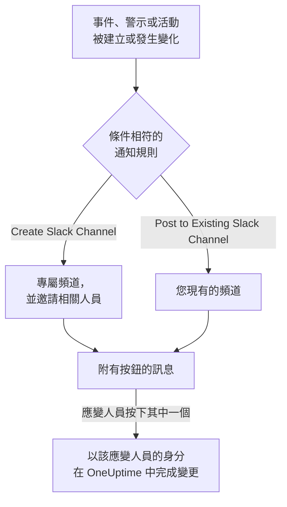

# Slack

將 OneUptime 連接到 Slack，即可把事件、警示、片段、排定維護、監測器和待命更新發布到您的頻道，為每個事件提供專屬頻道，並讓應變人員不必離開 Slack 就能操作：確認、解決、新增備註、呼叫待命人員以及宣告事件。

:::cards
- [連接 Slack](#連接-slack): 在您的工作區中安裝 OneUptime，然後連結您自己的帳戶。
- [通知規則](#通知規則): 決定哪些事件發布到哪裡，以及哪些事件擁有專屬頻道。
- [從 Slack 建立事件和維護](#從-slack-建立事件和維護): 以您本人的身分使用 `/incident` 和 `/maintenance`。
- [從 Slack 處理事件、警示和活動](#從-slack-處理事件警示和活動): OneUptime 訊息上的按鈕。
:::

## 運作方式

這仰賴兩種連接：

- **專案的連接** 只需建立一次：安裝在您的 Slack 工作區中的 OneUptime 應用程式。它會發布訊息、建立頻道並邀請人員。
- **每個人自己的連接**：此人的 Slack 帳戶連結到其 OneUptime 帳戶。按鈕、指令和表情符號回應都以此人的身分、依其在專案中的權限執行。

## 開始之前

- **可以連接專案的角色：** **Project Owner**、 **Project Admin** 或 **Project Member**。解除安裝應用程式需要 **Project Owner** 或 **Project Admin**。
- 一個您可以安裝應用程式的 **Slack 工作區**。
- 通知規則和摘要需要 **OneUptime Cloud 的 Growth 方案**。請參閱 [低於 Growth 方案時的通知規則](#低於-growth-方案時的通知規則)。
- **在自行託管的伺服器上，** 需要先為其設定好 Slack 應用程式。請參閱 [Slack 整合](/docs/self-hosted/slack-integration)。

## 連接 Slack

:::steps
### 在您的 Slack 工作區中安裝 OneUptime

前往 **專案設定** > **工作區** > **Slack**，按一下 **Connect with Slack**。選擇工作區並授權 OneUptime。Slack 會將您送回同一頁面，頁面上現在會顯示專案所連接的工作區。在連接工作區之前，事件、警示、排定維護、監測器和待命選單的 **工作區** 區段中有 **連線 Slack 或 Teams**，它同樣會帶您來到這裡。

### 連接您自己的 Slack 帳戶

安裝應用程式會連結安裝者的帳戶。其他所有人都在 **使用者設定** > **工作區** > **Slack** 中透過 **Connect my account with Slack** 連結自己的 Slack 帳戶，以便以本人身分處理事件並接收私人訊息。專案連接到 Slack 後，該區段就會出現。

### 新增通知規則

前往 **事件** > **工作區** > **Slack**。 **工作區** 區段只列出您的專案已連接的聊天工作區，因此 **Slack** 會在連接後出現在那裡。建立一條規則，例如為每個新事件建立一個 Slack 頻道並邀請事件擁有者的規則。請參閱 [通知規則](#通知規則)。

### 測試這條規則

在規則所在列按一下 **測試規則**。測試訊息會送到規則指定的頻道。請參閱 [測試規則](#測試規則)。
:::

## 通知規則

通知規則決定哪些事件發布到 Slack，以及發布到哪裡。每個產品都有自己的規則，位於其選單的 **工作區** > **Slack** 下：

| 產品 | 其 **Slack** 頁面上的分頁 |
| --- | --- |
| **事件** | **事件**、 **事件 片段**、 **Summary** |
| **警示** | **警示**、 **警示 片段**、 **Summary** |
| **排定維護** | 一個規則清單 |
| **監測器** | 一個規則清單 |
| **待命** | 一個規則清單 |

建立規則分為四個步驟：

| 步驟 | 您設定的內容 |
| --- | --- |
| **基礎** | **規則名稱** 和 **規則描述**。 |
| **條件** | 規則針對哪些事件觸發，例如依嚴重程度、狀態、標籤、監測器或標題中的字詞。沒有條件時，規則對每個事件都會觸發。有兩個以上條件時， **符合條件** 決定是必須全部相符，還是相符任一個即可。 |
| **目標** | 發布到哪裡：附頻道名稱的 **Post to Existing Slack Channel**、附新頻道名稱和受邀人員的 **Create Slack Channel**，或兩者兼有。 |
| **Video Call** | 僅限事件和警示：為每一個開始一次通話。請參閱 [視訊通話](/docs/workspace-connections/video-calls)。 |

規則建立的頻道以 **New Slack Channel Name** 加上紀錄編號命名，例如 `oneuptime-incident-42`。只有建立的頻道才會接收規則邀請的人員：紀錄的擁有者、所選的團隊和使用者，以及對於事件和警示，在被呼叫時加入的待命人員。私人事件、警示或片段會獲得私人頻道。此後紀錄的每次更新（狀態變化、備註、新擁有者）都會發布到它的頻道，以及其規則指定的現有頻道。建立時即已解決的事件、警示或片段不會獲得專屬頻道；其建立訊息仍會送到您的規則指定的頻道。請參閱 [宣告時即已確認或已解決](/docs/incidents/declaring-incidents#宣告時即已確認或已解決)。

**專案設定** > **工作區** > **Slack** 列出 OneUptime 看得到的頻道，每個頻道旁邊都有 **傳送測試**。OneUptime 第一次在公開頻道發布時會自行加入。私人頻道只有在 Slack 中邀請 OneUptime 應用程式加入後，才會被列出並可以發布訊息。

## 測試規則

規則所在列的 **測試規則** 會將該規則的測試訊息發布到它指定的頻道，讓您看到訊息送達。如果規則為每個事件建立頻道，測試也會建立一個頻道並邀請規則的相關人員。

與 **專案設定** > **工作區** > **Slack** 中頻道旁的 **傳送測試** 一樣，它需要建立通知規則的權限： **Project Owner**、 **Project Admin**、 **Project Member**、 **Settings Admin**、 **Settings Member**，或自訂角色中的 **Create Workspace Notification Rule** 和 **Read Workspace Notification Rule**。對於只能檢視規則的人（例如 **Viewer** ）， **測試規則** 處於鎖定狀態，其工具提示會說明需要什麼；API 會以 "You do not have permission to send test notifications in this project." 拒絕其測試。在 OneUptime Cloud 上，測試規則與新增規則一樣需要 **Growth** 方案。

在 OneUptime Cloud 上，頻道旁的 **傳送測試** 同樣需要 **Growth** 方案，因為向頻道發布訊息正是規則和摘要所做的事。摘要上的 **立即發送測試** 需要建立摘要的權限（自訂角色中的 **Create Workspace Notification Summary** 和 **Read Workspace Notification Summary** ），在 OneUptime Cloud 上還需要 **Growth** 方案；對其他任何人它都處於鎖定狀態，其工具提示會說明需要什麼。以唯讀權限連接的 MCP 用戶端無法傳送任何測試。

## 摘要

**事件** > **工作區** > **Slack** （以及 **警示** ）的 **Summary** 分頁會向您指定的頻道發布定期彙整：有多少事件或警示、它們被確認和解決的速度，以及附連結的清單。新的摘要每週傳送一次，涵蓋最近 7 天。將 **首次報告發送於** 留空，第一份摘要會在下一週、下一天或下一月開始時的 09:00 傳送；表單會顯示確切時間。

摘要依其 **時區** 的時鐘傳送，時區的初始值為您的時區。它全年在該時區維持同一時刻：設定為柏林 09:00 的摘要，在日光節約時間調整時鐘後仍會在柏林時間 09:00 傳送，其訊息中的日期也是柏林的日期。透過 API 時，請以 IANA 時區名稱傳送 `timezone`，例如 `Europe/Berlin`。未指定時區建立的摘要會使用建立者個人資料中的時區；由 API 金鑰建立時使用 UTC。

摘要表單有四個步驟： **基本資訊** （名稱和頻道）、 **排程**、 **內容** （ **要包含的內容** ）和 **篩選器** （統計哪些事件或警示）。

## 低於 Growth 方案時的通知規則

在 OneUptime Cloud 上，通知規則和摘要屬於 **Growth** 以上方案。低於該方案的專案會保留已有的規則和摘要，它們會繼續向 Slack 發布。因此，每個產品（事件、警示、排定維護、待命、監測器）的 **Slack** 頁面都會顯示方案說明，並在下方列出它們（ **仍在設定中的通知規則**、 **仍在設定中的摘要** ）：刪除規則，或關閉或刪除摘要。新增或變更規則和摘要需要 **Growth**。

## 在 Slack 中接收呼叫

要在待命時透過私人訊息接收呼叫，請將 Slack 新增為您的通知方式之一：

:::steps
1. 連接您自己的 Slack 帳戶（請參閱 [連接 Slack](#連接-slack) ）。
2. 前往 **使用者設定** > **通知方式**，開啟 **Workspace Apps** 分頁，然後按一下 **Add Slack Account**。
3. 在其所在列按一下 **Send Test Message**。訊息會送到您的 Slack 私人訊息。
:::

新增後，它會立即加入您的待命規則，因此從那時起呼叫會透過 Slack 送達您。在 **使用者設定** > **待命規則** 中變更它接收哪些呼叫。

## 將訊息儲存為備註

在事件、警示、片段或排定維護活動的頻道中對一則訊息加上表情符號回應，OneUptime 就會將該訊息儲存為該紀錄的備註，然後在討論串中回覆確認：

| 回應 | 儲存為 |
| --- | --- |
| 📌 圖釘表情符號，或 Slack 內建的 **Pin to channel** | 僅您的團隊可見的私人備註 |
| 📢 擴音器或喇叭表情符號 | 顯示在狀態頁面上的公開備註。僅限事件和排定維護活動。 |

備註以您的身分、依您的權限儲存，因此您自己的 Slack 帳戶必須已連接。無論多少人回應，一則訊息只會儲存一次。

## 從 Slack 詢問 OneUptime AI

用日常語言詢問有關記錄、追蹤、指標、事件和監測器的問題。在頻道中 @提及 OneUptime，或傳送私人訊息給它，它會在討論串中回答；在那裡回覆即可繼續提問。 `/oneuptime ask which monitors are down?` 會將答案發布到頻道中。兩種方式都需要連接您自己的 Slack 帳戶，並為專案開啟 AI。Slack 中的回答只讀取資料：要變更內容，請使用按鈕。請參閱 [詢問 AI](/docs/ai/ask-ai)。

## 從 Slack 建立事件和維護

`/incident` 和 `/maintenance` 會開啟一個表單，由您以本人身分填寫並提交：也就是以您的 Slack 帳戶所連接的 OneUptime 帳戶的身分（請參閱 [連接 Slack](#連接-slack) ），依該帳戶在專案中的權限提交。如果您的 Slack 帳戶未連接，或您的 OneUptime 帳戶已不再是專案成員，OneUptime 會透過私人訊息告訴您該怎麼做，並且不會開啟表單。 **Create New Incident** 和 **Create Scheduled Event** 捷徑會開啟相同的表單。

- **誰可以使用。** 能在 OneUptime 中宣告事件或建立排定維護活動的人：對於事件，是 **Project Owner**、 **Project Admin**、 **Project Member**、 **Incident Admin** 和 **Incident Member** （自訂角色中的 **Create Incident** ）；對於活動，是 **Scheduled Maintenance Admin** 和 **Scheduled Maintenance Member** （ **Create Scheduled Maintenance** ）。其他任何人都會收到私人訊息告知，並且不會開啟表單。
- **表單提供什麼。** 每個清單（嚴重程度、監測器、監測器狀態、待命策略和標籤）都包含您可以讀取的內容，與 OneUptime 中的同一清單一致：如果角色僅限於某些標籤，則為帶有這些標籤的監測器和待命策略。您完全無法讀取的清單不會出現在表單中。已封存的待命策略永遠不會提供。
- **表單可以指定什麼。** 事件或活動以您自己的權限建立，並記在您名下。您無法讀取的監測器、待命策略、標籤、嚴重程度或狀態，或屬於其他專案的，都會像專案中不存在一樣被拒絕，即使表單是在您的權限變化之前開啟的，也不會建立任何內容。OneUptime 會透過私人訊息告訴您原因。

事件、警示或片段上的 **Execute On-Call Policy** 也以同樣方式運作：它需要執行待命策略的權限（ **Project Owner**、 **Project Admin**、 **Project Member**、 **On-Call Admin** 和 **On-Call Member**，或自訂角色中的 **Create On-Call Duty Policy Execution Log** ）以及讀取該事件、警示或片段的權限，並提供您可以讀取的有效待命策略。

## 從 Slack 處理事件、警示和活動

OneUptime 的 Slack 訊息上的按鈕同樣以您的身分執行：也就是以您的 Slack 帳戶所連接的 OneUptime 帳戶的身分，依該帳戶在專案中的權限執行。事件、警示或片段上的 **Acknowledge**、 **Resolve**、 **Change State**、 **Add Note** 和 **Execute On-Call Policy**，以及排定維護活動上的 **Mark as Ongoing**、 **Mark as Complete**、 **Change State** 和 **Add Note**，各自會做出與 OneUptime 中相同操作一樣的變更，並在那裡記在您名下：紀錄的狀態時間軸和動態會顯示是您變更了其狀態，備註也歸您所有。透過表情符號回應從訊息儲存的備註也以同樣方式發布。

- **誰可以使用。** 能在 OneUptime 中做出同樣變更的人。確認、解決事件或變更其狀態需要變更其狀態的權限： **Project Owner**、 **Project Admin**、 **Project Member**、 **Incident Admin** 和 **Incident Member**，或自訂角色中的 **Create Incident State Timeline**。警示、片段或排定維護活動需要其自身類型的同等權限（例如 **Create Alert State Timeline** ），備註需要發布該類備註的權限。其他任何人都會收到私人訊息告知，並且不會有任何變更。
- **哪些紀錄。** 與在 OneUptime 中一樣，是您可以讀取的紀錄：如果角色僅限於某些標籤，則為帶有這些標籤的事件、警示、片段和活動。任何其他紀錄或其他專案的紀錄上的按鈕，都會得到該紀錄 "was not found in this project, or you do not have access to it." 的回覆，並且不會有任何變更。在 OneUptime Cloud 上，專案方案不包含的變更會被拒絕，並說明所需的方案。
- **Change State 提供什麼。** 依專案的順序，提供您可以讀取、紀錄接下來可以轉入的狀態：不會提供早於其目前狀態的狀態，片段與事件、警示或排定維護活動一樣，因為狀態變更永遠不會讓紀錄在其清單中回退（請參閱 [順序是真正的限制，而不是顯示偏好](/docs/incidents/states-and-severities#順序是真正的限制而不是顯示偏好) ）。如果您一個都無法讀取，會收到 "No incident states are available to you in this project. Ask a project admin for access to them."；如果紀錄處於它能到達的最後一個狀態，會收到 "There is no later state to move this incident to."。這兩種情況都不會開啟空白表單。

## 中斷連接

- **Disconnect** 只解除您自己的 Slack 帳戶的連結，並同時移除您的 Slack 通知方式。
- **專案設定** > **工作區** > **Slack** 上的 **Uninstall OneUptime from Slack** 會中斷專案的連接。OneUptime 停止向 Slack 發布，並且 **工作區** 選單不再列出它。通知規則和摘要會被保留，以便您再次連接時使用。

> [!WARNING]
> 解除安裝也會解除專案中每位成員自己的 Slack 帳戶的連結，並移除 Slack 通知方式以及使用它們的待命規則。原本透過 Slack 接收呼叫的人，在重新新增 Slack 之前，會透過其他通知方式接收呼叫。

## 疑難排解

:::details 規則沒有發布任何內容
用 **測試規則** 檢查規則的條件：如果測試訊息送達，表示規則的條件與該事件不相符。如果沒有送達，Slack 頁面會顯示原因。對於私人頻道，請先在 Slack 中邀請 OneUptime 應用程式加入該頻道。OneUptime 發布的每則訊息，以及 Slack 拒絕的每則訊息，都列在 **專案設定** > **通知** > **通知日誌** 的 **工作區** 分頁中。
:::

:::details Slack 未連接
當 Slack 未完成連接就把您送回時，您開始的頁面會顯示 **Slack 未連接**，並用一句話說明原因：您缺少權限、連結已被使用或已過期、您登入了另一個工作區，或伺服器未為 Slack 設定好。每句話的含義和處理方法請參閱 [連接沒有完成](/docs/self-hosted/slack-integration#連接沒有完成)。
:::

:::details 按鈕或指令提示我的 Slack 帳戶未連接
在 **使用者設定** > **工作區** > **Slack** 中透過 **Connect my account with Slack** 連結它。如果您已不再是專案成員，OneUptime 會改為告知這一點，並且不會替您執行任何操作。
:::

:::details 通知能送達，但按鈕和指令沒有反應
在自行託管的伺服器上，Slack 必須能夠存取 OneUptime，按鈕、表單和指令才能運作；通知只需要對外的存取。請參閱 [自行託管部署的網路存取](/docs/self-hosted/slack-integration#自行託管部署的網路存取)。
:::

## 後續步驟

:::cards
- [Microsoft Teams](/docs/workspace-connections/microsoft-teams): 在 Microsoft Teams 中使用相同的通知和操作。
- [視訊通話](/docs/workspace-connections/video-calls): 為每個事件提供一次通話，並隨其更新一起發布。
- [Slack 整合](/docs/self-hosted/slack-integration): 在自行託管的伺服器上設定 Slack 應用程式。
- [宣告事件](/docs/incidents/declaring-incidents): 事件開始的所有方式，以及開始時會執行什麼。
:::
