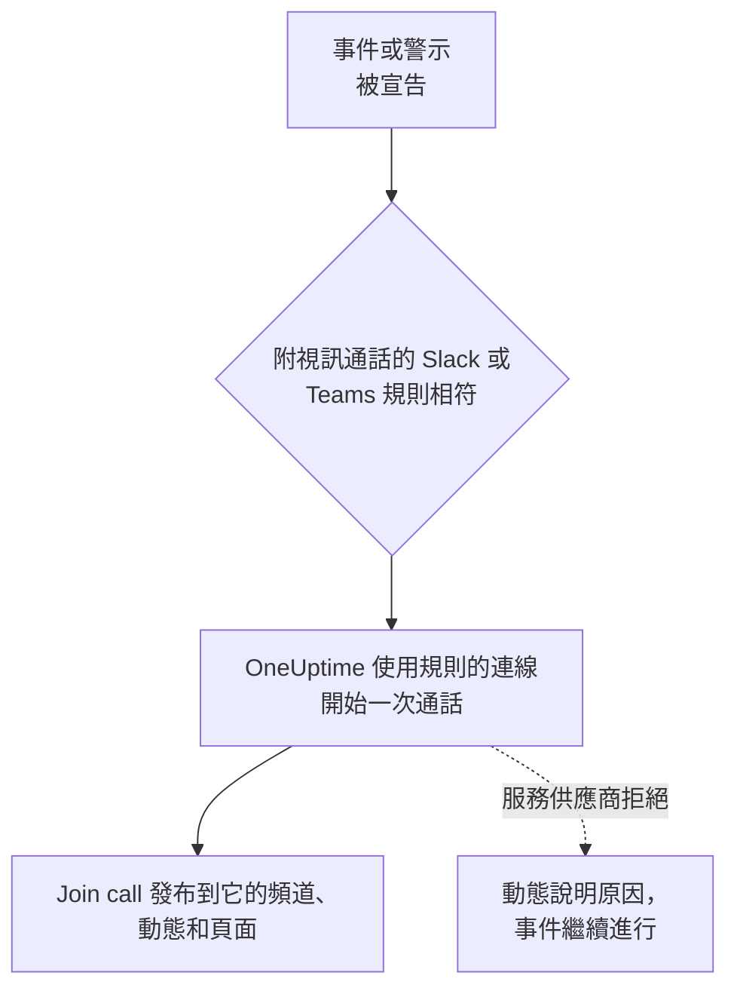

# 視訊通話

為每個事件和警示提供專屬通話。當 Slack 或 Microsoft Teams 通知規則針對新事件或警示觸發時，OneUptime 會開始一場專屬會議（Zoom 會議、Google Meet、Microsoft Teams 會議，或事件 Slack 頻道的 huddle），並在事件更新所到之處發布一個 **Join call** 按鈕。應變人員一鍵即可加入，沒有人需要在凌晨 3 點建立會議並四處轉傳連結。

:::cards
- [運作方式](#運作方式): 規則開始通話，應變人員在任何地方都能加入。
- [一鍵連接](#一鍵連接): 只要登入即可連接 Zoom、Google Meet 或 Microsoft Teams。
- [服務供應商](#服務供應商): 您自己應用程式的服務身分、固定的會議連結或 Slack huddle。
- [手動開始通話](#手動開始通話): 從事件或警示的頁面開始。
:::

## 運作方式



:::steps
### 連接服務供應商

前往 **專案設定** > **工作區** > **Video Calls**，連接 Zoom、Google Meet 或 Microsoft Teams，或新增一個固定的會議連結。在 OneUptime Cloud 上，連接 Zoom、Google Meet 或 Microsoft Teams 只需一鍵：登入並允許 OneUptime 建立會議（請參閱 [一鍵連接](#一鍵連接) ）。Slack huddle 只需要專案的 Slack 連接，不需要其他任何東西。

### 在規則中開啟

開啟一條針對事件或警示的 Slack 或 Microsoft Teams 通知規則（例如 **事件** > **工作區** > **Slack** ）。在規則的 **Video Call** 步驟中，開啟 **Start a video call for the incident**，並選擇通話在哪裡進行。

### 一鍵加入

規則觸發時，OneUptime 會為事件開始一次通話，並附上 **Join call** 按鈕將其發布到事件更新所發往的頻道以及事件的動態中。事件頁面會在其 **Video Call** 卡片中顯示該通話，並在頁首顯示 **Join call** 按鈕。
:::

規則的條件決定哪些事件會獲得通話。若只想為 Sev1 事件開啟電話會議，請為規則設定 **嚴重程度** 條件。通話會為宣告為進行中的事件和警示開始。建立時即已解決的事件不會獲得通話。

### 每個事件一次通話

對於每個進行通話的地點，每個事件只會開始一次通話。選擇同一連線的規則共用一次通話，並且對於已經有該連線通話的事件，規則永遠不會再開始第二次通話。選擇不同地點的規則會各自開始自己的通話，例如為應變人員開設的 Zoom 會議，以及事件 Slack 頻道的 huddle。

### 通話無法開始時

宣告事件從不等待視訊通話服務供應商。通話在事件建立之後才開始，因此緩慢或出錯的服務供應商永遠不會延誤事件或其待命呼叫。

如果服務供應商拒絕（密鑰過期、缺少權限、主持人已被刪除），事件的動態會說明規則的通話無法開始，並附上服務供應商提供的原因，讓應變人員知道需要從事件頁面開始一次通話。規則的執行會以 **開始視訊通話** 記錄在工作區通知日誌中，並且 **專案設定** > **工作區** > **Video Calls** 中該連線所在列會一直顯示錯誤，直到再次成功開始通話。

### 私人事件

會議以其所屬事件的編號和標題命名，其描述會連結回該事件。對於私人事件，會省略標題，因為所有受邀參加會議的人都能看到會議名稱。

## 一鍵連接

在 OneUptime Cloud 上，連接 Zoom、Google Meet 或 Microsoft Teams 只需一鍵，不需要在服務供應商處進行任何設定：

:::steps
1. 前往 **專案設定** > **工作區** > **Video Calls**，在 Zoom、Google Meet 或 Microsoft Teams 上按一下 **連線**。
2. 按一下 **Continue to Zoom** （或 Google、Microsoft），登入並允許 OneUptime 建立會議。
3. 您會回到視訊通話頁面，連線已建立。用 **Start a test meeting** 進行端對端檢查，然後在 Slack 或 Microsoft Teams 通知規則中選擇該連線。
:::

每場會議都以您登入所用的帳戶建立，並由該帳戶主持。請使用共用帳戶（例如 incidents@example.com）而不是您自己的帳戶登入，這樣有人離職後通話仍能照常開始。連線所在列會顯示它以哪個帳戶登入。

| 服務供應商 | 用於登入的帳戶 | OneUptime 可以做什麼 |
| --- | --- | --- |
| Zoom | 一個 Zoom 使用者。由 Basic（免費）使用者主持的會議會在 40 分鐘後結束。 | 為該使用者建立會議（ `meeting:write:meeting` ）並讀取其身分（ `user:read:user` ）。 |
| Google Meet | 一個可以使用 Google Meet 的 Google 帳戶。 | 以該帳戶建立 Meet 空間（ `meetings.space.created` ）並讀取其電子郵件地址。 |
| Microsoft Teams | 一個擁有 Microsoft Teams 的公司或學校帳戶。個人 Microsoft 帳戶無法建立 Teams 會議。 | 以該帳戶建立線上會議（委派權限 `OnlineMeetings.ReadWrite` ）並維持登入（ `offline_access` ）。 |

透過登入建立的連線仍然有決定誰需要等待的設定：Google Meet 的 **Who can join** 和 Microsoft Teams 的 **Who skips the lobby**。在連線所在列使用 **編輯** 變更它們。

### 維持登入

OneUptime 會加密保存登入的重新整理權杖，並至少每週更新一次，因此無論專案多久沒有發生事件，權杖都不會因閒置而過期。如果登入失效（帳戶移除了 OneUptime、帳戶被刪除或停用，或您組織的原則要求重新登入），連線所在列會在 OneUptime 發現的當天顯示 **Not working** 及原因，而不是等到下一個事件。該列上的 **Reconnect** 會重新登入。

以同一帳戶登入的連線在所有專案中共用一次登入：Zoom 每個帳戶只保留一次登入，因此再次連接同一個 Zoom 使用者會取代所有這些連線的登入。

### 重新連接和移除

連線所在列的 **Reconnect** 會以同一帳戶或其他帳戶重新登入。在帳戶移除 OneUptime 之後，或要把事件會議轉到其他帳戶時使用它。

刪除連線後，一旦沒有其他連線使用該登入，OneUptime 在 Zoom 和 Google 的存取權就會被撤銷。對於 Microsoft，請在該帳戶的 **My Apps** （myapps.microsoft.com）中移除 OneUptime。在 Zoom App Marketplace 中從您的 Zoom 帳戶移除 OneUptime，會從所有以該帳戶登入的連線中刪除其登入，這些連線在重新連接之前都會顯示 **Not working**。

### 如果 Microsoft 要求管理員

有些 Microsoft 365 組織只允許管理員核准應用程式。如果 Microsoft 提示您需要管理員核准，請請 Microsoft 365 管理員連接 Microsoft Teams，或在 [Microsoft Entra 系統管理中心](https://entra.microsoft.com/) 的 **Enterprise applications** > **Admin consent requests** 中核准 OneUptime。

### 改用您自己的應用程式

要使用服務身分而不是個人的登入進行連接（Zoom 的 Server-to-Server OAuth 應用程式、具有全網域委派的 Google 服務帳戶，或 Microsoft Entra 應用程式註冊），請在連接對話方塊中按一下 **Use your own Zoom app** （或 Google、Microsoft）。[服務供應商](#服務供應商) 會逐一說明。在沒有設定一鍵應用程式的自行託管伺服器上， **連線** 會直接開啟此表單；設定方法請參閱 [在自行託管的伺服器上一鍵連接](#在自行託管的伺服器上一鍵連接)。

## 手動開始通話

事件或警示頁面上的 **Video Call** 卡片有 **Start call** （已有通話時為 **Start another** ）。選擇專案的某個連線、事件 Slack 頻道的 huddle，或貼上您自己的會議連結。該通話會像規則開始的通話一樣發布到事件的頻道和動態中。

卡片上的 **移除** 會把通話從事件頁面上移除。會議本身不會被刪除，擁有連結的任何人仍然可以加入。

開始和移除通話需要處理事件（或警示）的權限： **Project Owner**、 **Project Admin**、 **Project Member**、 **Incident Admin** 或 **Incident Member**，或自訂角色中的 **Create Incident Video Call** 和 **Delete Incident Video Call**。能讀取該事件的每個人都能看到它的通話。

## 服務供應商

本節介紹如何使用您自己應用程式的服務身分連接服務供應商：Zoom 的 Server-to-Server OAuth 應用程式、Google 服務帳戶、Microsoft Entra 應用程式註冊。服務身分從不依賴於某個人，因此無論誰離職都能繼續運作。若要改為透過登入連接，請參閱 [一鍵連接](#一鍵連接)。

認證資訊在儲存時加密，並且 API 從不傳回它們。編輯連線時，留空的認證資訊會保留已儲存的值。

連線表單中的 **Start test meeting** 和連線所在列的 **測試** 會使用連線的設定建立一場真實的會議並顯示其連結。這是唯一能證明認證資訊、服務供應商端的權限以及主持人可以協同運作的檢查。不會向任何地方發布任何內容。

連接服務供應商需要 **Project Owner**、 **Project Admin** 或 **Settings Admin**，或自訂角色中的 **Create Video Call Connection** 和 **Edit Video Call Connection**。

### Zoom

OneUptime 透過 Zoom **Server-to-Server OAuth** 應用程式為每個事件建立 Zoom 會議，由您選擇的已授權 Zoom 使用者主持。

:::steps
1. 在 [Zoom App Marketplace](https://marketplace.zoom.us/) 中，選擇 **Develop** > **Build App**，建立一個 **Server-to-Server OAuth** 應用程式。建立它需要 Zoom 帳戶管理員，或允許 Server-to-Server OAuth 應用程式的角色。
2. 在應用程式的 **Scopes** 頁面，新增 **meeting:write:meeting:admin** （為使用者建立會議）。在細部權限範圍出現之前建立的應用程式可以改用 **meeting:write:admin**。
3. 按一下 **Activate** 啟用應用程式，然後將其 **App Credentials** 頁面上的 **Account ID**、 **Client ID** 和 **Client secret** 複製到連線表單中。
4. 填寫 **Meeting host**：一個已授權 Zoom 使用者的電子郵件，最好是 incidents@example.com 之類的服務帳戶，這樣有人離職後會議仍能正常進行。由 Basic（免費）使用者主持的會議會在 40 分鐘後結束。
5. 由於主持人是一個永遠不會加入的服務帳戶，應變人員不必等待主持人即可加入。請確認您 Zoom 帳戶的 **Waiting room** 設定沒有被鎖定為開啟，否則誰都無法進入。
:::

| 欄位 | 在哪裡找到 |
| --- | --- |
| Account ID | 應用程式的 **App Credentials** 頁面 |
| Client ID | 應用程式的 **App Credentials** 頁面 |
| Client secret | 應用程式的 **App Credentials** 頁面 |
| Meeting host | 主持每場會議的已授權 Zoom 使用者的電子郵件 |

### Google Meet

OneUptime 透過一個藉由全網域委派以 Google Workspace 使用者身分操作的 Google Cloud 服務帳戶，使用 Google Meet REST API 為每個事件建立 Google Meet。

:::steps
1. 在 [Google Cloud 主控台](https://console.cloud.google.com/) 中，選擇或建立一個專案，並為其啟用 **Google Meet REST API**。
2. 在 **IAM & Admin** > **Service accounts** 下建立一個服務帳戶。開啟它，前往 **Keys** > **Add key** > **Create new key**，選擇 **JSON**，並將下載的檔案貼到連線表單的 **Service account JSON key** 中。
3. 在 [Google 管理控制台](https://admin.google.com/) 中，開啟 **Security** > **Access and data control** > **API controls** > **Manage Domain Wide Delegation** 並按一下 **Add new**。輸入服務帳戶的數字 **Client ID** 以及權限範圍 `https://www.googleapis.com/auth/meetings.space.created`。
4. 在 **Create meetings as** 中填寫服務帳戶所代表的 Google Workspace 使用者：一個專用帳戶，例如 incidents@example.com。每場會議都歸此使用者所有。
:::

**Who can join** 決定誰不必請求即可加入：選擇 **People in your organization join directly, others ask to join** （預設）時，您的 Google Workspace 之外的人需要請求加入，由通話中的某個人准許他們。選擇 **Anyone with the link joins directly** 時，任何人都不必等待。

全網域委派可能需要幾分鐘才會開始生效。如果剛新增委派後測試就回報 Google 不允許服務帳戶以該使用者身分操作，請等待幾分鐘後再測試。

### Microsoft Teams

OneUptime 透過一個代表已授權 Teams 使用者召集會議的 Microsoft Entra 應用程式註冊，使用 Microsoft Graph 為每個事件建立 Microsoft Teams 會議。

:::steps
1. 在 [Microsoft Entra 系統管理中心](https://entra.microsoft.com/) 中，開啟 **App registrations** > **New registration**，註冊一個單一租用戶應用程式。複製其 **Directory (tenant) ID** 和 **Application (client) ID**。
2. 在 **API permissions** 下，新增 Microsoft Graph 的 **application** 權限 **OnlineMeetings.ReadWrite.All**，然後按一下 **Grant admin consent**。
3. 在 **Certificates & secrets** 下建立一個用戶端密碼，並將其 **Value** （不是 Secret ID）貼到連線表單的 **Client secret** 中。
4. 選擇召集人：一個已授權的 Teams 使用者，最好是服務帳戶。從 Entra 系統管理中心的 **Users** 中複製其 **Object ID** 到 **Organizer object ID**。
5. 使用應用程式存取原則允許該應用程式為召集人建立會議。在 Teams PowerShell 中，執行 `Connect-MicrosoftTeams` 之後，執行下面兩個指令。
:::

```powershell
New-CsApplicationAccessPolicy -Identity OneUptime-Meetings -AppIds "<application-client-id>"
Grant-CsApplicationAccessPolicy -PolicyName OneUptime-Meetings -Identity "<organizer-object-id>"
```

該原則最多可能需要 30 分鐘才會生效。在此之前，測試會回報該應用程式不允許為召集人建立會議。

**Who skips the lobby** 決定誰不必等待即可加入：選擇 **People in your organization skip the lobby** （預設）時，其他所有人都要在大廳中等待，直到會議中的某個人准許他們。選擇 **Everyone skips the lobby** 時，任何人都不必等待。

### 會議連結

固定的會議連結對每個事件都是同一個會議室：Zoom 個人會議室、週期性的 Microsoft Teams 或 Google Meet 會議、Webex 個人會議室或 Jitsi 會議室。不會為每個事件建立任何內容，因此沒有需要授權的東西。

:::steps
1. 在您的團隊已經在使用的工具中建立一場永不過期的會議。
2. 將其 https 加入連結貼到連線表單的 **Meeting link** 中。
:::

使用此連線開始的每個事件和警示都共用這個會議室，因此同時發生的兩個事件也會共用它。請確認會議允許在主持人不在時加入。

### Slack huddle

Slack 規則可以改為開始事件 Slack 頻道的 huddle。沒有需要連接的東西：在規則的 **Video Call** 步驟中選擇 **Slack huddle** 即可。

huddle 在規則為事件建立的頻道中進行；如果規則改為發布到現有頻道，則在其中第一個頻道中進行。因此，規則必須建立頻道或發布到現有頻道。 **Join huddle** 按鈕會在 Slack 中開啟頻道的 huddle。第一個開啟它的應變人員開始 huddle，之後的每個人都加入其中。Slack 沒有提供讓應用程式開始 huddle 的方式，因此在有人開啟之前，huddle 中沒有任何人。

Slack huddle 僅適用於 Slack 規則。Microsoft Teams 規則使用專案的某個視訊通話連線開始其通話。

## 使用 API

通話是事件（ `IncidentVideoCall` ）或警示（ `AlertVideoCall` ）上的一筆紀錄。使用事件的 `_id` 以及以下其中之一來建立：

- `videoCallConnectionId`：使用該連線開始新的會議。
- 設定為 `SlackHuddle` 的 `provider`：事件 Slack 頻道的 huddle。
- `joinUrl` （以及選用的 `title` ）：您自己的會議連結。

```json
{
  "data": {
    "projectId": "<project-id>",
    "incidentId": "<incident-id>",
    "videoCallConnectionId": "<connection-id>"
  }
}
```

`POST /api/video-call-connection/test` 會使用已儲存的連線（ `{ "connectionId": "..." }` ）或尚未儲存的設定（ `{ "provider": "Zoom", "config": { ... }, "secrets": { ... } }` ）開始一場測試會議，並傳回其 `joinUrl`。

連線的 `authMethod` 說明它的登入方式：透過登入建立的連線為 `OAuth`，使用您自己應用程式認證資訊的連線為 `AppCredentials`，會議連結則沒有值。透過登入建立的連線只能在儀表板中透過登入建立。透過 API，您可以重新命名它並變更其 `config`，而其 `connectedAccount` 說明它以哪個帳戶登入。

## 在自行託管的伺服器上一鍵連接

OneUptime Cloud 擁有自己的 Zoom、Google 和 Microsoft 應用程式，用於一鍵連接。自行託管的伺服器會為您設定了應用程式的每個服務供應商提供一鍵連接。沒有設定時， **連線** 會開啟用於您自己應用程式的表單。

為每個服務供應商建立一個 OAuth 應用程式，並使用您伺服器的主機在其上註冊以下重新導向 URI：

| 服務供應商 | 重新導向 URI | 環境變數 | Helm 值 |
| --- | --- | --- | --- |
| Zoom | `https://<host>/api/video-call-oauth/zoom/callback` | `ZOOM_APP_CLIENT_ID`, `ZOOM_APP_CLIENT_SECRET`, `ZOOM_APP_WEBHOOK_SECRET_TOKEN` | `zoomApp.clientId`, `zoomApp.clientSecret`, `zoomApp.webhookSecretToken` |
| Google Meet | `https://<host>/api/video-call-oauth/google-meet/callback` | `GOOGLE_MEET_APP_CLIENT_ID`, `GOOGLE_MEET_APP_CLIENT_SECRET` | `googleMeetApp.clientId`, `googleMeetApp.clientSecret` |
| Microsoft Teams | `https://<host>/api/video-call-oauth/microsoft-teams/callback` | `MICROSOFT_TEAMS_MEETINGS_APP_CLIENT_ID`, `MICROSOFT_TEAMS_MEETINGS_APP_CLIENT_SECRET` | `microsoftTeamsMeetingsApp.clientId`, `microsoftTeamsMeetingsApp.clientSecret` |

- **Zoom**：在 [Zoom App Marketplace](https://marketplace.zoom.us/) 中，選擇 **Develop** > **Build App**，建立一個由使用者管理的 **General App**。在 **Basic Information** 下，將重新導向 URI 作為 OAuth Redirect URL 新增到 **Development** 和 **Production** 兩個分頁以及 OAuth 允許清單中，並在 **Production** 分頁上將 **Deauthorization Notification** 端點 URL 設定為 `https://<host>/api/video-call-oauth/zoom/events`。在 **Scopes** 下新增 `meeting:write:meeting` 和 `user:read:user`。 **Features** > **Access** 下的 **Secret Token** 就是 `ZOOM_APP_WEBHOOK_SECRET_TOKEN`。 **Development** 認證資訊僅適用於您自己 Zoom 帳戶中的使用者； **Production** 認證資訊在 Zoom 審查並發布應用程式後對所有人有效。
- **Google Meet**：在 [Google Cloud 主控台](https://console.cloud.google.com/) 中啟用 **Google Meet REST API**，使用權限範圍 `openid`、 `email` 和 `https://www.googleapis.com/auth/meetings.space.created` 設定 OAuth 同意畫面（ **Google Auth Platform** ），並使用重新導向 URI 建立一個 **Web application** 類型的 OAuth 用戶端。將應用程式發布到正式環境：停留在測試狀態的應用程式會在七天後失去其登入。Google 會審查要求 Meet 權限範圍的應用程式；在審查完成之前，使用者在登入前會看到一則警告。
- **Microsoft Teams**：在 [Microsoft Entra 系統管理中心](https://entra.microsoft.com/) 中，為 **Accounts in any organizational directory** 註冊一個應用程式，將重新導向 URI 新增為 **Web** 重新導向 URI，新增 Microsoft Graph 委派權限 `openid`、 `profile`、 `email`、 `offline_access` 和 `OnlineMeetings.ReadWrite`，並建立一個用戶端密碼。請使用獨立的註冊，而不是 Microsoft Teams 機器人的註冊（ `MICROSOFT_TEAMS_APP_CLIENT_ID` ）。在應用程式擁有經過驗證的發行者之前，大多數組織都需要管理員對其表示同意。

用戶端 ID 是公開的：它們會被傳送到儀表板，讓儀表板知道哪些服務供應商可以一鍵連接。請對密碼和 webhook 秘密權杖保密。worker 每天更新到了更新時間的登入，因此它需要與應用程式相同的值。

## 疑難排解

:::details 沒有為事件開始通話
檢查規則是否與事件相符（ **測試規則** ）、其 **Video Call** 步驟是否已開啟，以及事件是否被宣告為進行中：建立時即已解決的事件不會獲得通話。已經用該連線為事件開始過通話的規則不會再開始另一次通話。
:::

:::details 動態顯示無法開始通話
服務供應商拒絕了，動態提供了原因。在此期間，請從事件頁面開始通話。然後在連線所在列執行 **測試**：在您修正服務供應商處的設定（例如過期的用戶端密碼或缺少的權限）時，它會顯示同樣的原因。
:::

:::details 連線顯示 Not working
它的登入已失效：帳戶移除了 OneUptime、帳戶被刪除或停用，或需要重新登入。在其所在列按一下 **Reconnect**。在此之前，它原本應該開始的通話都無法開始。
:::

:::details 有人在大廳或等候室中等待
在連線所在列使用 **編輯** 變更 **Who can join** （Google Meet）或 **Who skips the lobby** （Microsoft Teams）。對於 Zoom，請確認帳戶的 **Waiting room** 設定沒有被鎖定為開啟。
:::

## 後續步驟

:::cards
- [Slack](/docs/workspace-connections/slack): 開始通話的規則，以及它們發布到的頻道。
- [Microsoft Teams](/docs/workspace-connections/microsoft-teams): 在 Microsoft Teams 中使用相同的規則和通話。
- [Microsoft Teams 整合](/docs/self-hosted/microsoft-teams-integration): 在自行託管的伺服器上設定 Teams 機器人。
- [宣告事件](/docs/incidents/declaring-incidents): 事件開始時會發生什麼。
:::
