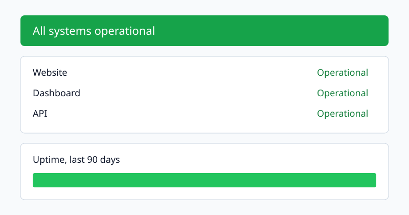

# Reading a status page during an incident

Author: [oneuptime](https://www.github.com/oneuptime)

Tags: Status Page, Incident Management

Description: What each part of a status page tells the people who depend on you, and what to write there while an incident is open.

A status page is where your customers go when something feels wrong. During an incident it answers three questions: **is it broken**, **is anyone working on it**, and **when will it be fixed**. Everything on the page should help answer one of them.

## The parts of a status page

Most status pages share the same layout, from the top down:

1. The overall status, in one sentence.
2. Each component, with its own status.
3. Open incidents and scheduled maintenance.
4. The history: how each component did over the last ninety days.



### Components

Name components the way your customers name them. "Checkout" means something to a customer; "payments-api-v2" does not.

| Component | What it covers           | Who notices first |
| --------- | ------------------------ | ----------------- |
| Website   | The marketing site       | Prospects         |
| Dashboard | Signing in and the app   | Customers         |
| API       | Every public endpoint    | Integrations      |

### Incidents

> An incident update that says "we are investigating" every thirty minutes is better than silence, even when nothing has changed.

Write updates for someone who has not read the previous ones: what is affected, what you know, and when the next update will come.

## Automating the boring parts

Status changes can follow your monitors, so the page turns red when the check does. A monitor's criteria decide when that happens:

```yaml
monitor:
  name: Checkout
  type: website
  url: https://example.com/checkout
  criteria:
    - when: response-status-code
      is-not: 200
      for: 2 minutes
      then: degraded
```

To post an update from a script, call the API with your project's API key:

```bash
curl -X POST https://oneuptime.com/api/incident-public-note \
  -H "ApiKey: $ONEUPTIME_API_KEY" \
  -H "Content-Type: application/json" \
  -d '{"data": {"incidentId": "<incident id>", "note": "We have found the cause and are rolling out a fix."}}'
```

Keep the `note` short: a sentence or two your customers can act on.

## Further reading

- [Status pages in the docs](https://oneuptime.com/docs/en/status-pages/index)
- [Incident notes and owners](https://oneuptime.com/docs/en/incidents/notes-owners-and-feed)
