# Mobile experience v2 screenshots

These are screenshots of the actual Expo / React Native Web application using
synthetic projects, accounts and incident data. They are not native iOS or
Android device captures. Authentication codes and calendar URLs are deliberately
non-production fixtures.

The browser journeys cover every screen that can run on web, plus search,
recovery, project switching and bottom-scroll states. Biometric lock is covered
by native-platform component tests, not a fabricated browser capability.

This second redesign introduces the paper-and-ink theme, five-tab navigation,
a unified Inbox, compact response layouts and simpler authentication. These
captures replace the earlier navy design and wait for navigation to settle.

| Project-focused overview      | Remembered project switcher                         | Incident inbox                          |
| ----------------------------- | --------------------------------------------------- | --------------------------------------- |
| 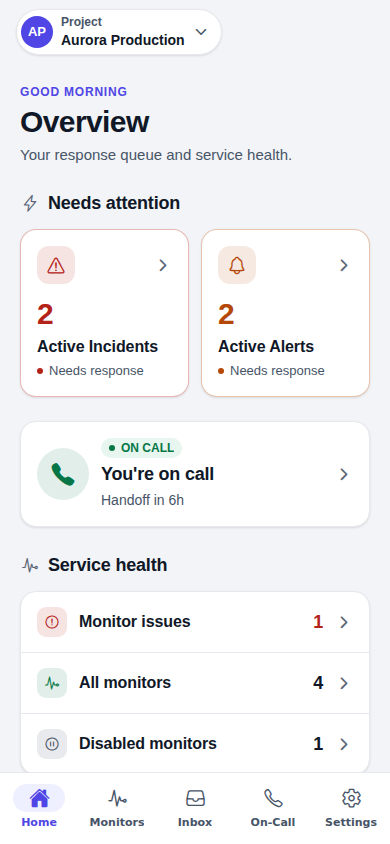 | 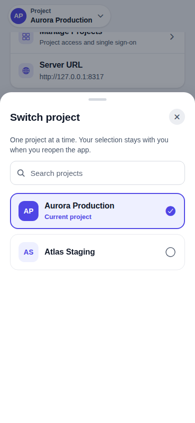 | 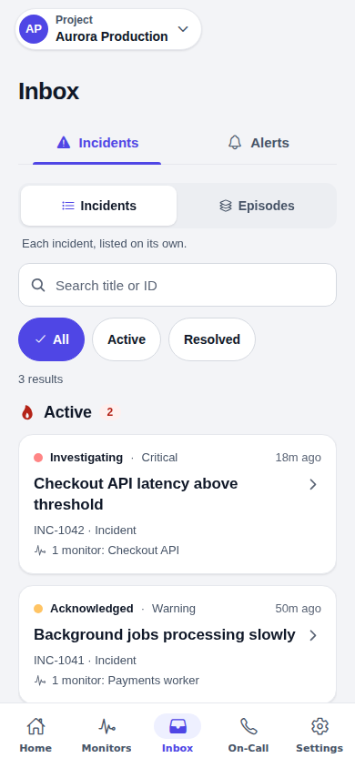 |

| Incident response                                   | On-call hub                                 | Coverage review                                     |
| --------------------------------------------------- | ------------------------------------------- | --------------------------------------------------- |
| 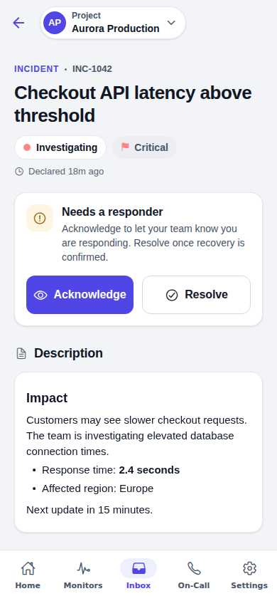 | 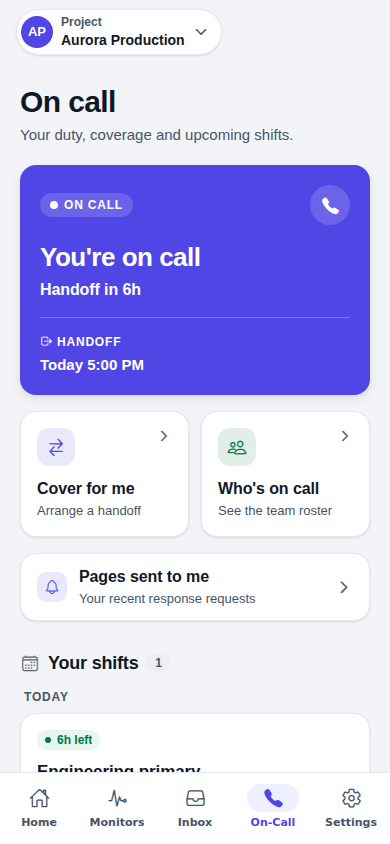 | 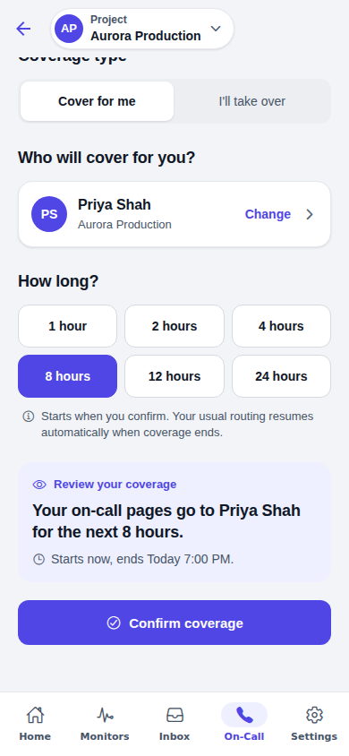 |

| Sign in                         | Settings                              | Bottom clearance                                                |
| ------------------------------- | ------------------------------------- | --------------------------------------------------------------- |
| 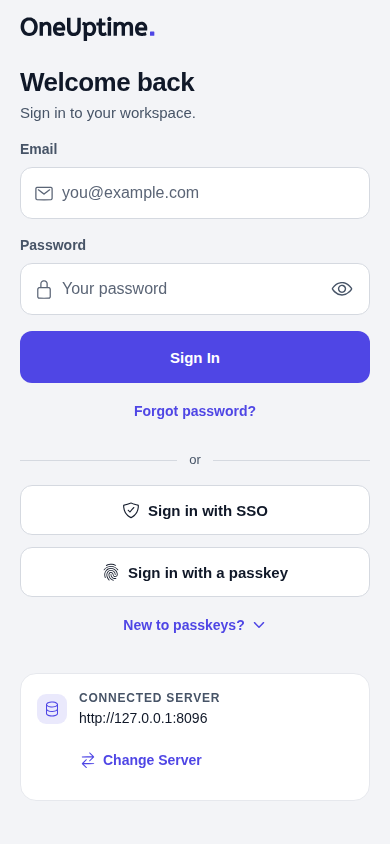 | 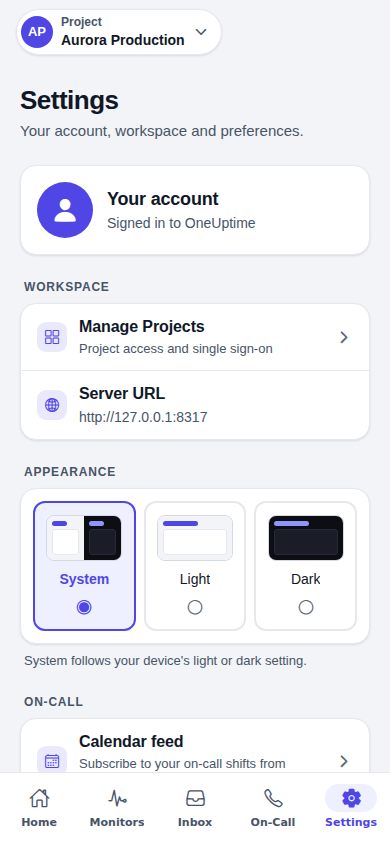 | 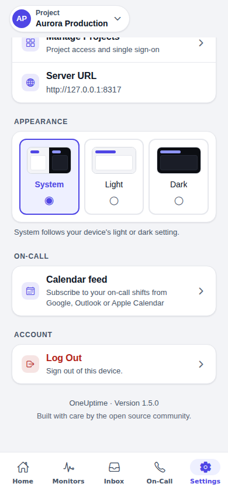 |

All images use one of four viewport prefixes:

- `small-phone`: 320 × 740
- `iphone-size`: 390 × 844
- `android-size`: 412 × 915
- `tablet`: 768 × 1024

## Foldables and wide windows

The `foldables-` images come from `tests/ui/foldables.spec.js`, which sets its
own windows and folds them mid-task: the Galaxy Z Fold's cover screen
(344 × 882) and inner screen (884 × 1104, or 1104 × 884 on its side), the
iPhone Duo held open (951 × 669) and a phone on its side (852 × 393).

| Cover screen                                           | Unfolded: list beside its detail                       | iPhone Duo held open                                   |
| ------------------------------------------------------ | ------------------------------------------------------ | ------------------------------------------------------ |
| 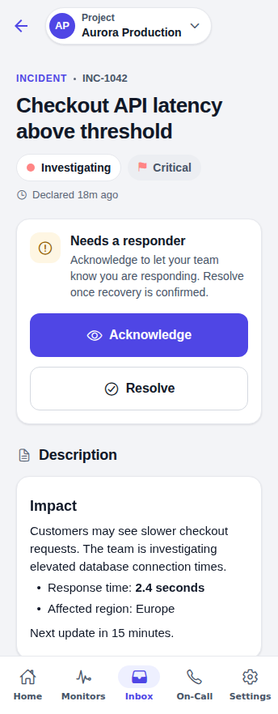 | 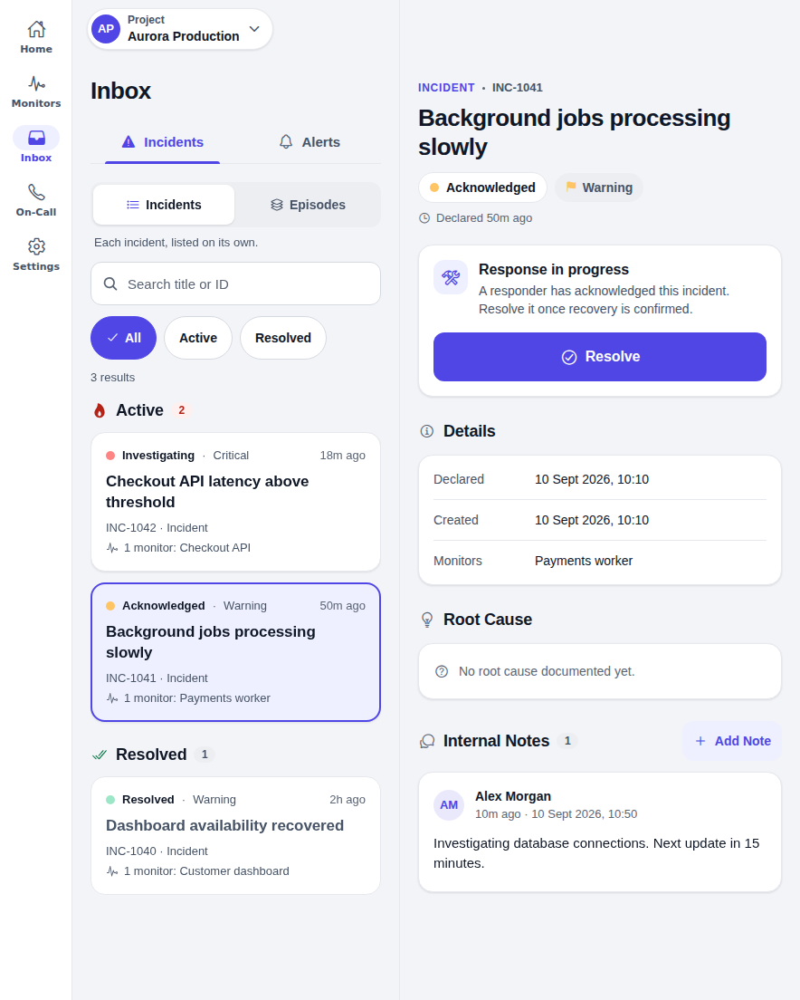 | 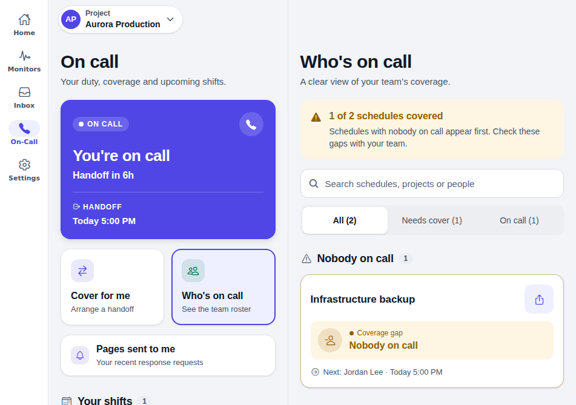 |

| Folded mid-note                                            | Unfolded again, nothing lost                               | On its side: Home in two columns                           |
| ---------------------------------------------------------- | ---------------------------------------------------------- | ---------------------------------------------------------- |
| 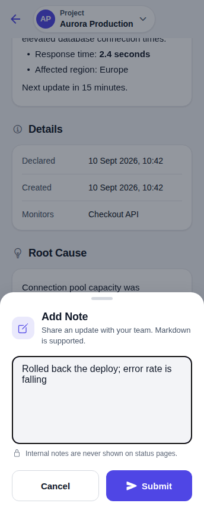 | 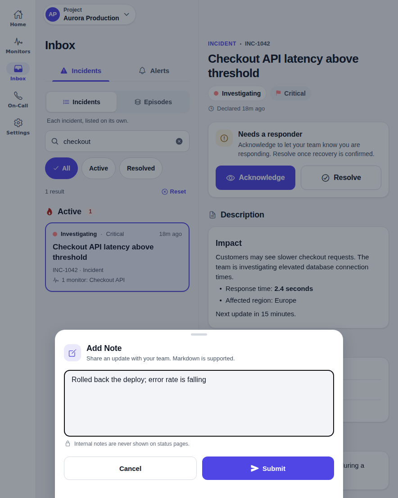 | 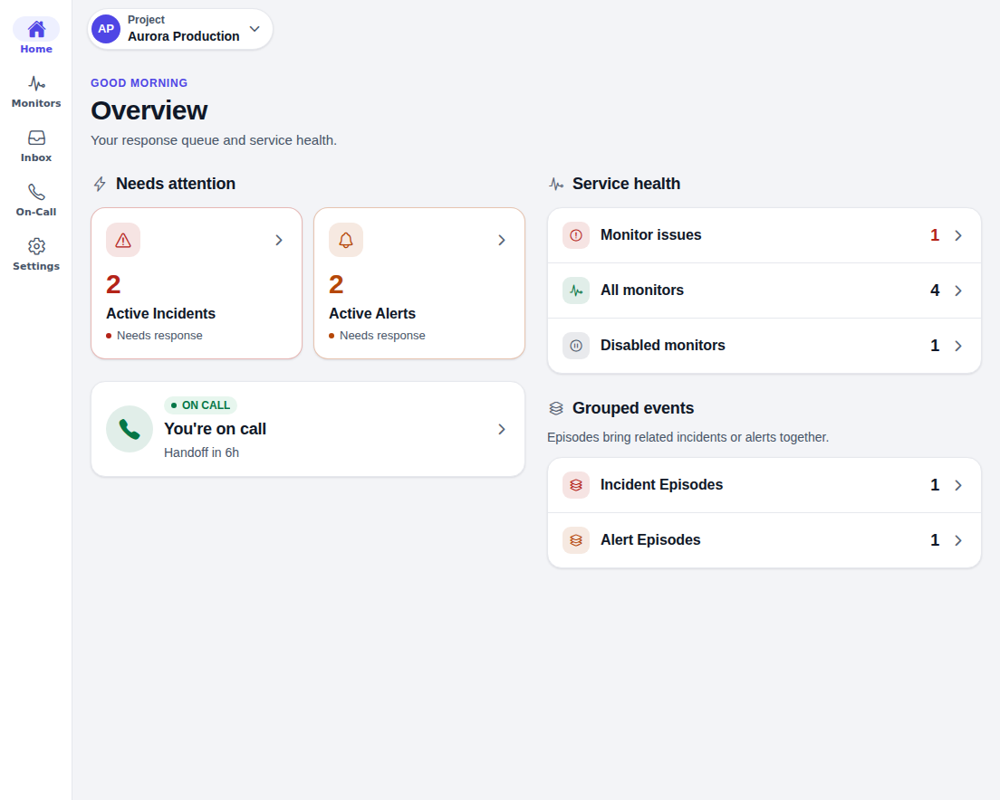 |

| Dark: cover screen                                      | Dark: unfolded                                          | A phone on its side                                       |
| ------------------------------------------------------- | ------------------------------------------------------- | --------------------------------------------------------- |
| 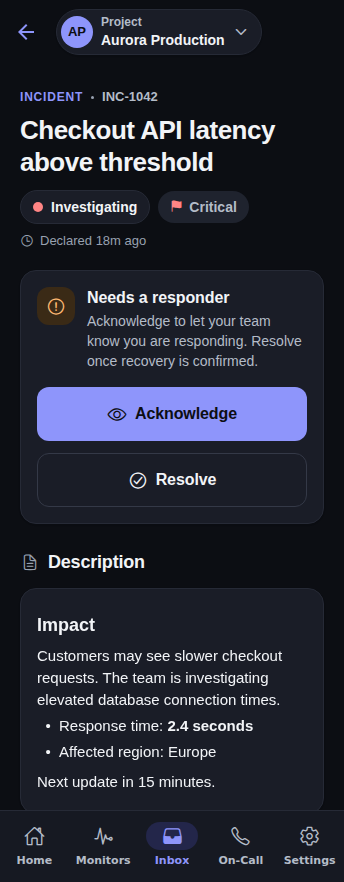 | 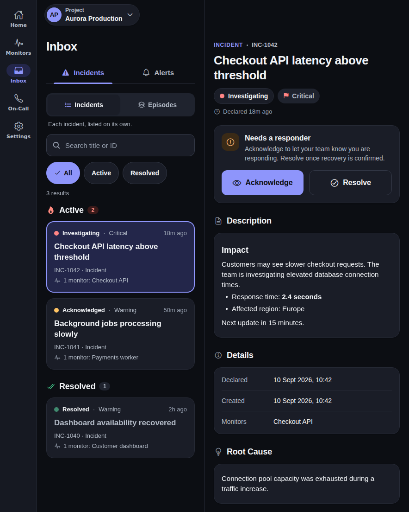 | 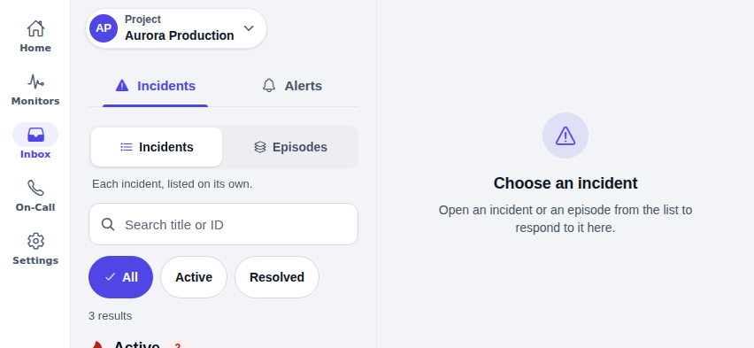 |

Regenerate them with
`UPDATE_SCREENSHOTS=1 npm run test-ui -- --project=foldables`.

See [the visual testing guide](../UI_REDESIGN.md) for reproducible capture
commands, coverage and native-device validation limitations. CI attaches each
journey's screenshots to its Playwright report.
