# Mobile experience v2 screenshots

These are screenshots of the actual Expo / React Native Web application using
synthetic projects, accounts and incident data. They are not native iOS or
Android device captures. Authentication codes and calendar URLs are deliberately
non-production fixtures.

The browser journeys cover every screen that can run on web, plus search,
recovery, project switching and bottom-scroll states. Biometric lock is covered
by native-platform component tests, not a fabricated browser capability.

This second redesign introduces the paper-and-ink theme, five-tab navigation,
a unified Inbox, compact response layouts and simpler authentication. These
captures replace the earlier navy design and wait for navigation to settle.

| Project-focused overview      | Remembered project switcher                         | Incident inbox                          |
| ----------------------------- | --------------------------------------------------- | --------------------------------------- |
|  |  |  |

| Incident response                                   | On-call hub                                 | Coverage review                                     |
| --------------------------------------------------- | ------------------------------------------- | --------------------------------------------------- |
|  |  |  |

| Sign in                         | Settings                              | Bottom clearance                                                |
| ------------------------------- | ------------------------------------- | --------------------------------------------------------------- |
|  |  |  |

All phone and tablet images use one of four viewport prefixes:

- `small-phone`: 320 × 740
- `iphone-size`: 390 × 844
- `android-size`: 412 × 915
- `tablet`: 768 × 1024

Each also has a dark set of the main screens (`-dark`: home, incidents,
incident detail, on-call and settings).

| Dark: Home                         | Dark: incident                                    | Dark: on-call                            |
| ---------------------------------- | ------------------------------------------------- | ---------------------------------------- |
| 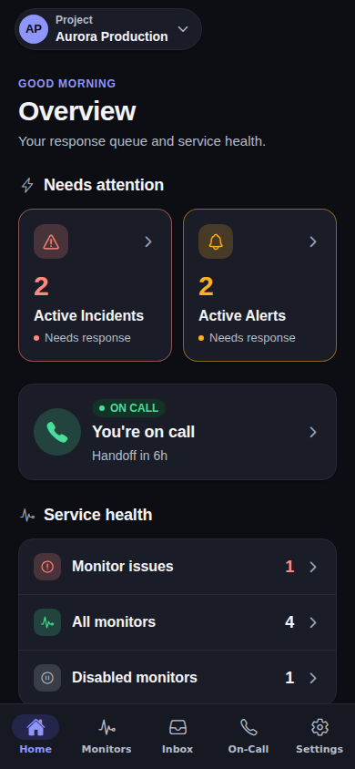 | 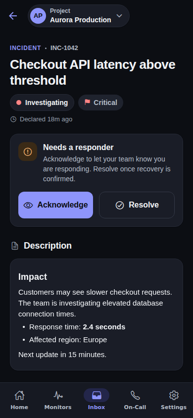 | 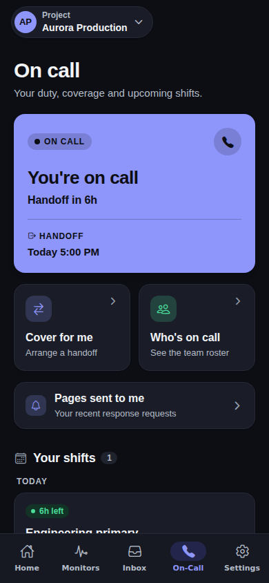 |

## A tablet on its side

The `tablet-landscape-` images come from `tests/ui/tablets.spec.js`, on a
1280 × 800 window: the destinations on a rail, each list beside what is opened
from it, Home in two columns and the sheets at their readable width. A light
set, and a dark one (`-dark`).

| Home in two columns                | The Inbox beside an incident               | On-Call beside the team's roster         |
| ---------------------------------- | ------------------------------------------ | ---------------------------------------- |
| 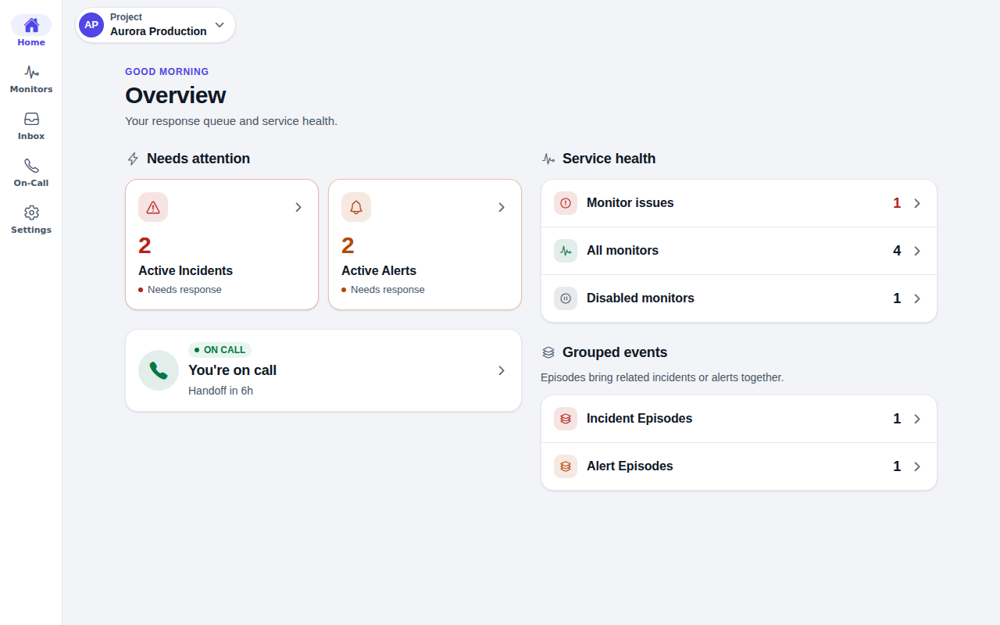 | 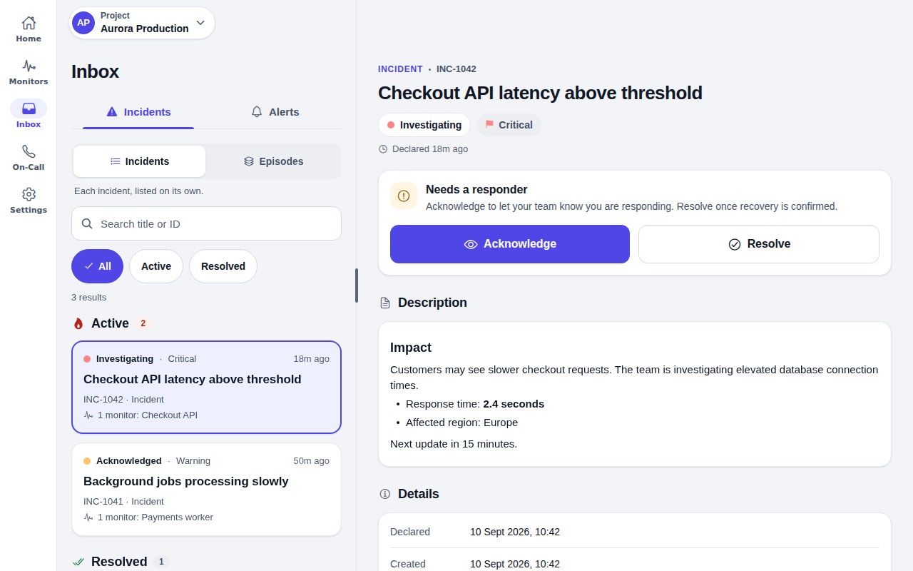 | 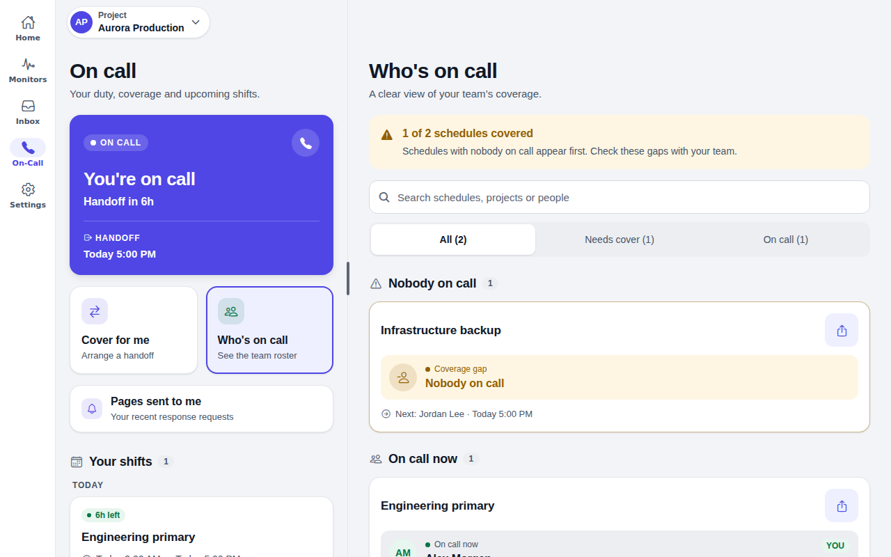 |

| A monitor beside the list                | A security case beside the list                      | Dark: an incident beside the Inbox                   |
| ---------------------------------------- | ---------------------------------------------------- | ---------------------------------------------------- |
| 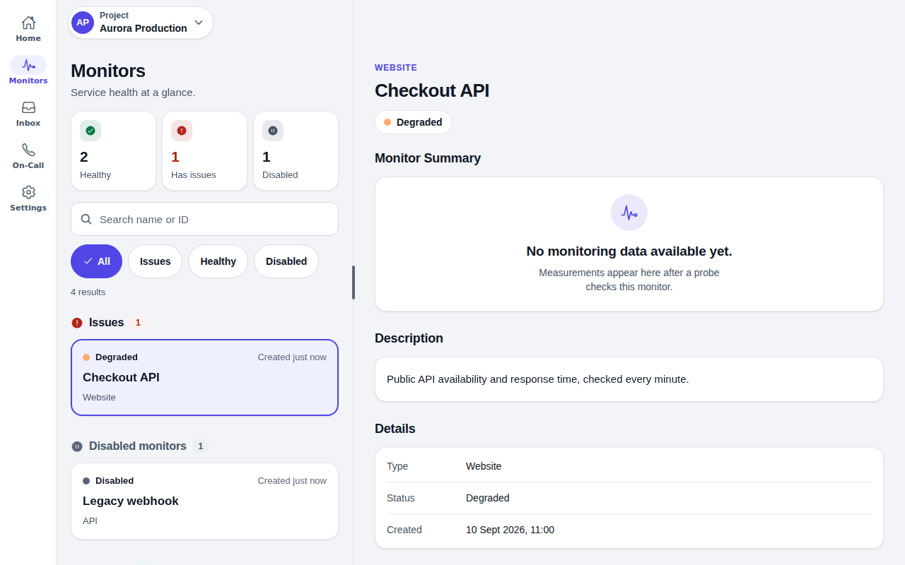 | 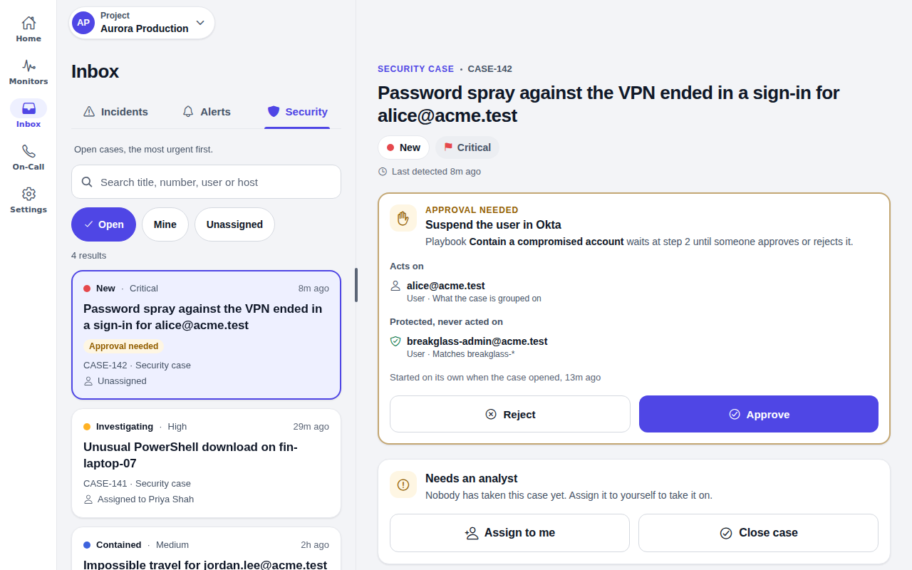 | 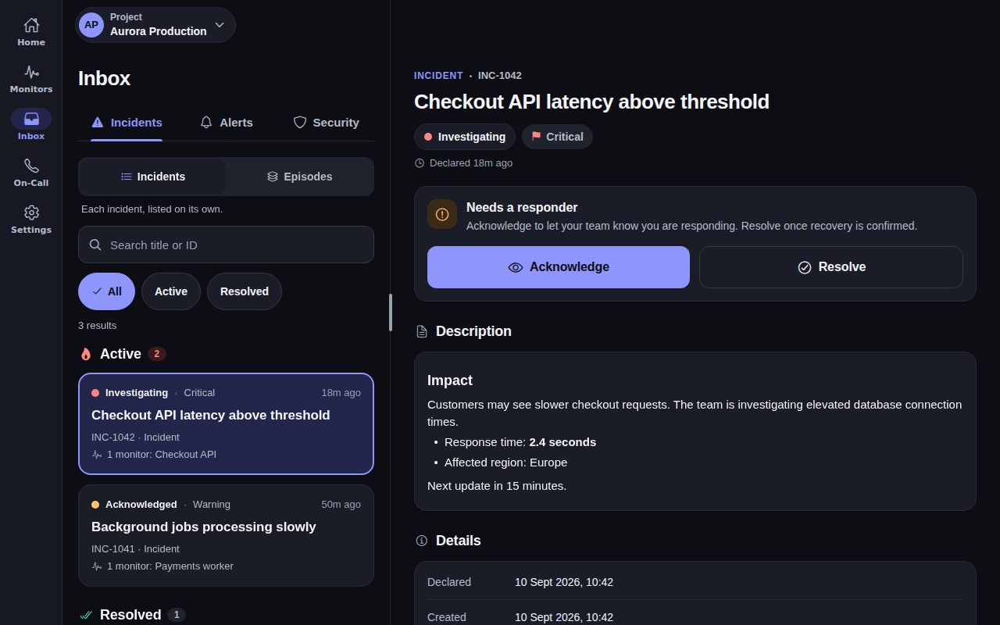 |

## Foldables and wide windows

The `foldables-` images come from `tests/ui/foldables.spec.js`, which sets its
own windows and folds them mid-task: the Galaxy Z Fold's cover screen
(344 × 882) and inner screen (884 × 1104, or 1104 × 884 on its side), the
iPhone Duo held open (951 × 669) and a phone on its side (852 × 393).

| Cover screen                                           | Unfolded: list beside its detail                       | iPhone Duo held open                            |
| ------------------------------------------------------ | ------------------------------------------------------ | ----------------------------------------------- |
|  |  | 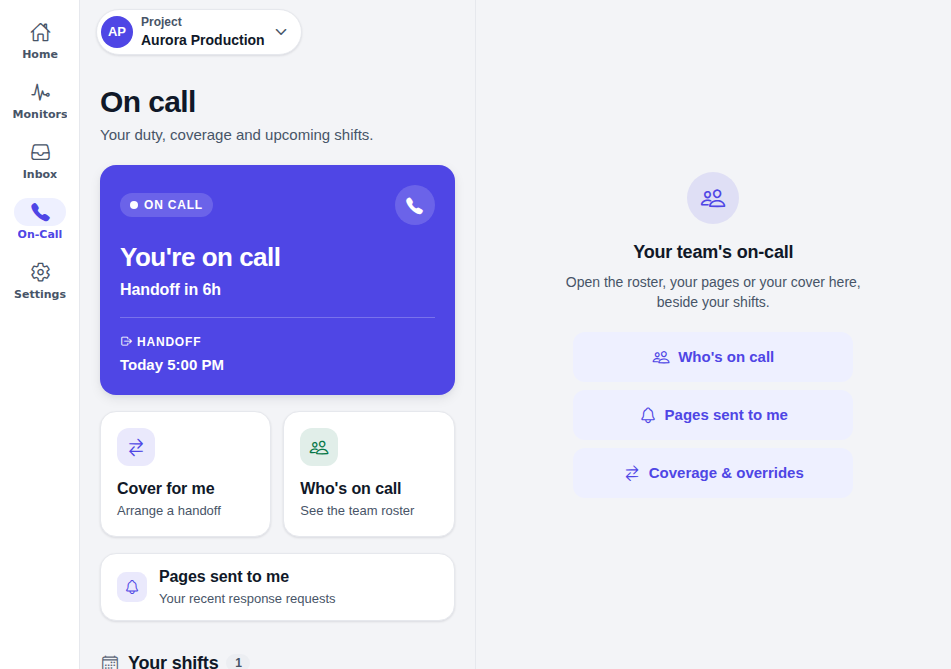 |

| Folded mid-note                                            | Unfolded again, nothing lost                               | On its side: Home in two columns                           |
| ---------------------------------------------------------- | ---------------------------------------------------------- | ---------------------------------------------------------- |
|  |  |  |

| Dark: cover screen                                      | Dark: unfolded                                          | A phone on its side                                       |
| ------------------------------------------------------- | ------------------------------------------------------- | --------------------------------------------------------- |
|  |  |  |

## Hinge and posture

The posture images come from `tests/ui/posture-foldables.spec.js`, where
Chromium's DevTools half close the phone - on a table and like a book - and
open it flat. On Android the app learns this from its posture module; the
iPhone Duo keeps the layout above until iOS has one. Below a tabletop fold a
list opens at its first row, and one that could not load shows why at once
(`foldables-tabletop-list-error.png`).

| Half open on a table                                  | A Galaxy Z Flip on a table                               | Half open like a book                        |
| ----------------------------------------------------- | -------------------------------------------------------- | -------------------------------------------- |
| 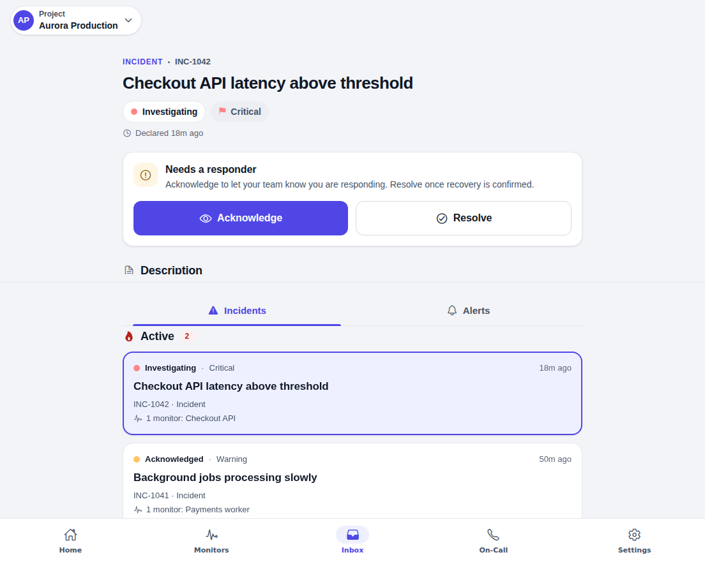 | 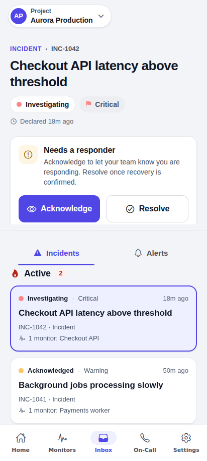 | 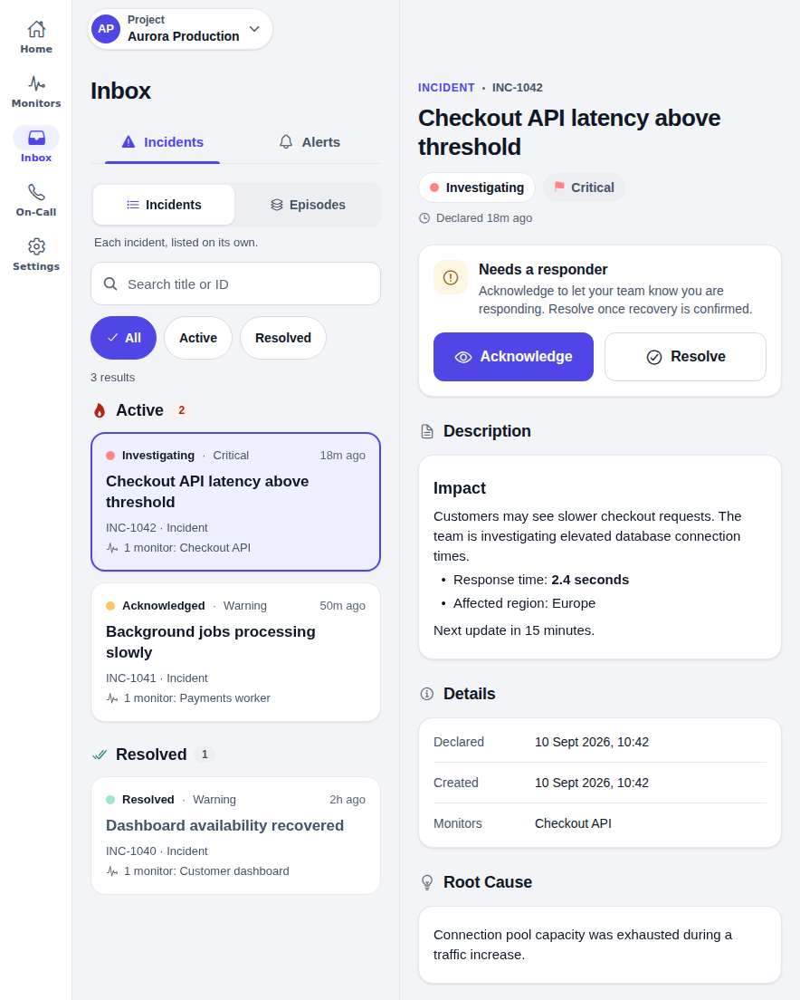 |

| Flat: the divider's handle                    | The divider dragged                                | Dark: on a table                                       |
| --------------------------------------------- | -------------------------------------------------- | ------------------------------------------------------ |
| 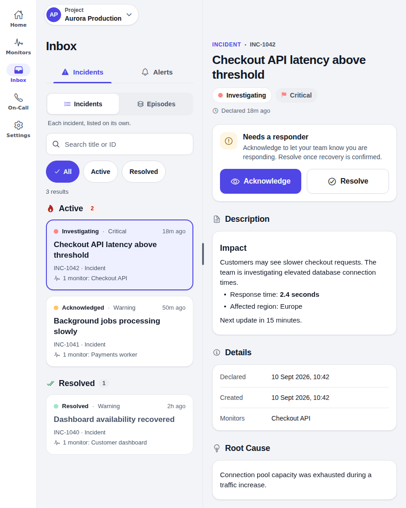 | 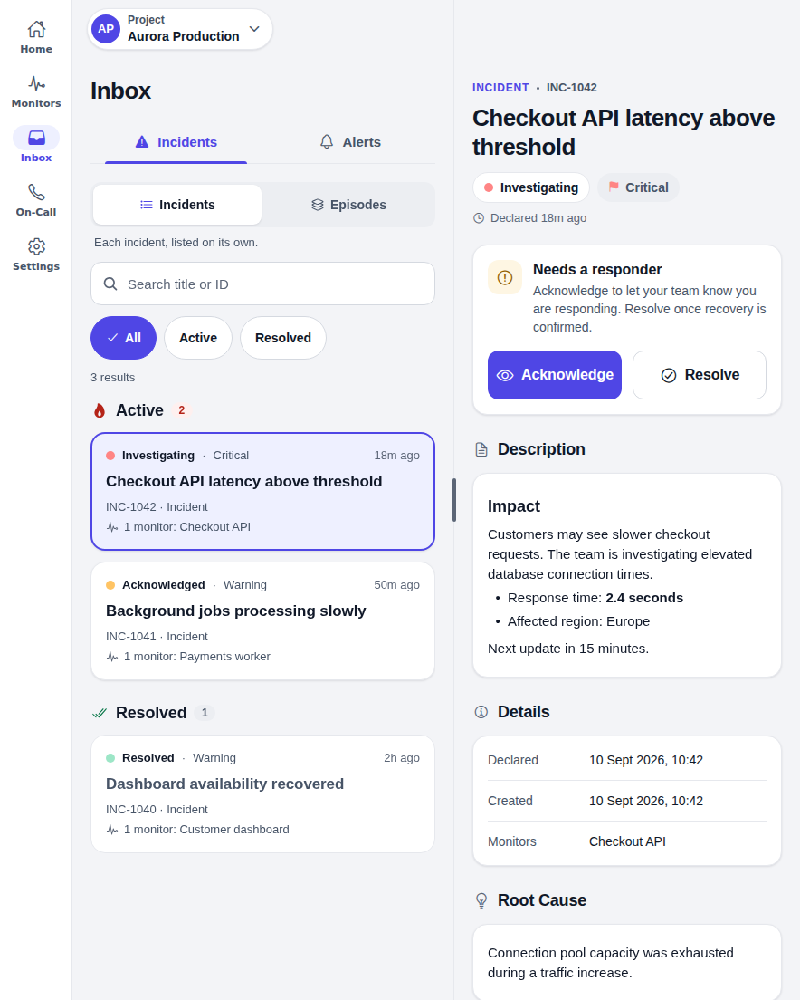 | 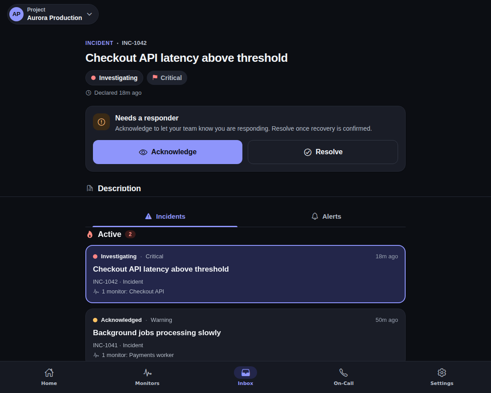 |

Regenerate every set from a fresh export with
`UPDATE_SCREENSHOTS=1 npm run test-ui`, or one of them with
`-- --project=foldables`, `-- --project=tablets` or `-- --project=iphone-size`.
Put back images that changed only by anti-aliasing.

See [the visual testing guide](../UI_REDESIGN.md) for reproducible capture
commands, coverage and native-device validation limitations. CI attaches each
journey's screenshots to its Playwright report.
